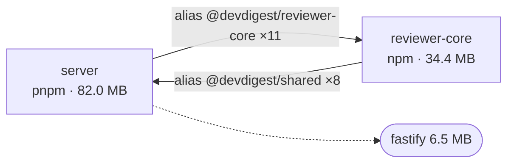

# Report template

Copy this skeleton and replace the placeholders. Keep the five headings and
their order. Numbers below are illustrative.

````markdown
# Dependency report — <repo> — <YYYY-MM-DD>

## 1. Scope

| Package | Path | Manager | node_modules | Source files |
| ------- | ---- | ------- | ------------ | ------------ |
| server | `server/` | pnpm | yes | 201 |
| e2e | `e2e/` | npm | **missing** | 2 |

Excluded: `server/clones/**` (cloned repos), `node_modules/**`.
Method: `scripts/collect.mjs` (read-only; no network).

## 2. Dependency graph



Solid = internal (between our packages). Dashed = heaviest external packages.

## 3. Size breakdown

### server — 82.0 MB declared

| Dependency | Type | Version | Installed size | Used (imports) |
| ---------- | ---- | ------- | -------------- | -------------- |
| `drizzle-orm` | dependency | 0.36.0 | 8.1 MB | 14 |
| `moment` | dependency | 2.30.1 | 4.2 MB | 0 |

### Top 10 across the repo

| # | Package | Dependency | Installed size |
| - | ------- | ---------- | -------------- |
| 1 | client | `next` | 133.0 MB |

Sizes are package files on disk (nested `node_modules` excluded), not bundle size.

## 4. Findings & Priorities

### P0
**P0-1. reviewer-core: relative import into server**
Evidence: `reviewer-core/src/x.ts:3` imports `../../server/src/...`.
Impact: bypasses the `@devdigest/shared` alias; breaks if the layout changes.
Recommendation: import through the alias.

### P1
**P1-1. server: `moment` is declared and never imported**
Evidence: `grep -rn "moment" server/src server/*.json` → only `package.json`.
Impact: 4.2 MB installed for nothing.
Recommendation: remove `moment` from `server/package.json` (confirm first).

### P2
...

### Info
...

## 5. Summary

1. **Fix P0-1 first**: …
2. …
````

## Worked finding shapes

- **Undeclared import (P0).** Evidence = file:line of the import and the absence
  in `package.json`. Recommendation = add it to the right section.
- **Version drift (P1).** Evidence = a small table of package → range → installed
  version. Recommendation = pick one range and say which package changes.
- **Heavy dependency (P1).** Evidence = size and share of the package total.
  Recommendation = a lighter alternative only if one genuinely fits; otherwise
  "keep, but lazy-load / confine to one entry point".
- **Unused (P1/P2).** Evidence = the grep you ran and its empty result.
