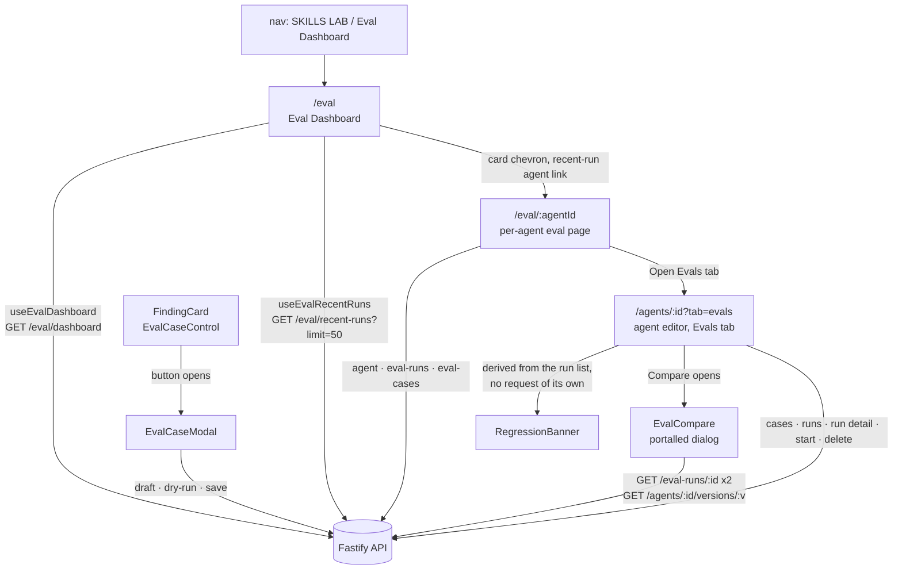
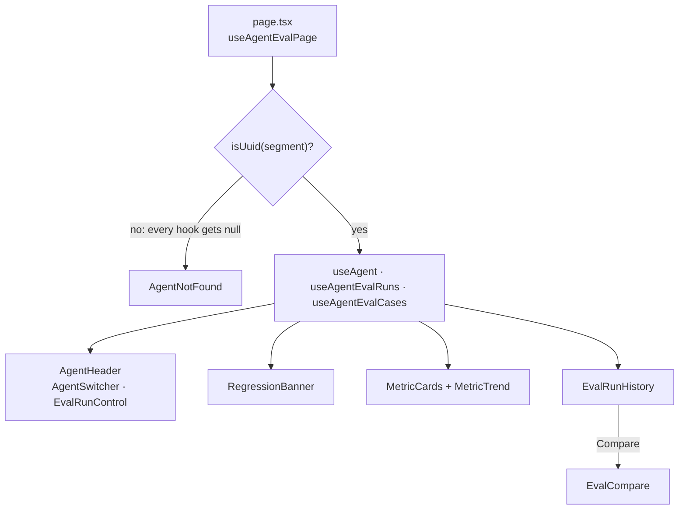
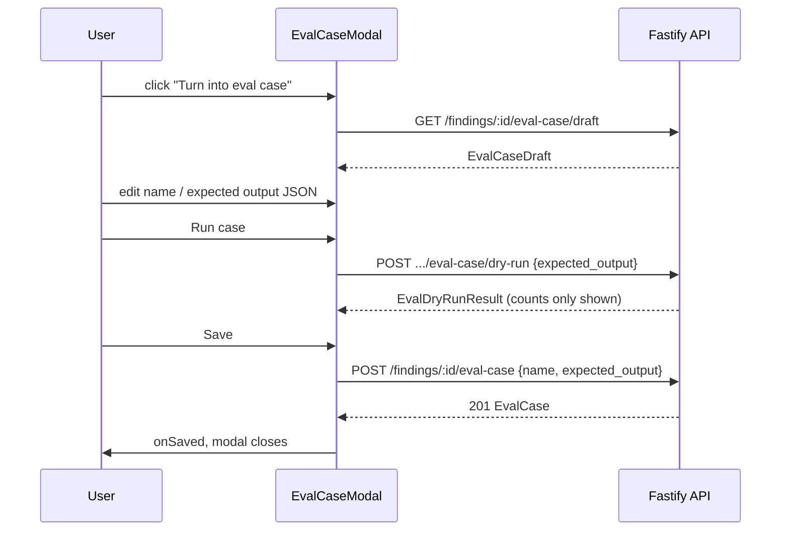

# Eval UI — dashboard, per-agent eval page, Evals tab, compare dialog, "Turn into eval case" (reference)

Which screens talk to the eval API today and through which hooks. The server
side (statuses, scoring, limits, draft and dry-run, recent runs) is in
`../../server/docs/eval.md`; intent is in
`../../specs/2026-10-12-eval-cases-and-scoring.md`,
`../../specs/2026-10-12-eval-run-history-compare.md`,
`../../specs/2026-10-13-eval-case-modal.md` (Spec C, the modal) and
`../../specs/2026-10-13-eval-dashboard-compare-polish.md` (Spec D: compare
dialog, regression banner, recent runs, percent formats) and
`../../specs/2026-10-15-eval-ui-design-alignment.md` (Spec E: row-cards, labels,
local timestamps, uppercase captions; plan
`../../specs/2026-10-15-eval-ui-design-alignment.plan.md`) and
`../../specs/2026-10-16-eval-agent-page-trends.md` (Spec F: per-agent page,
metric trend, sparklines; plan
`../../specs/2026-10-16-eval-agent-page-trends.plan.md`) and
`../../specs/2026-10-17-skill-evals-client.md` (Spec G2: the skill Evals tab and
"Run on evals"; plan `../../specs/2026-10-17-skill-evals-client.plan.md`).

Path shorthand below: `AE/` is `src/components/agent-evals/` (the parts the
Evals tab and the per-agent page share) and `EM/` is
`src/components/eval-metric/`.

All data access is in `src/lib/hooks/eval.ts`; components never call `fetch`.

## Surfaces

Caption: the client surfaces of the eval pipeline and the API each one leans
on; the banner makes no request, the card itself sends nothing, the modal and
the dialogs do. The "In eval set" link from the card goes to the Evals tab; the
dashboard card chevron and the recent-run agent link go to `/eval/:agentId`.

| Surface | Where | Files |
|---------|-------|-------|
| Eval Dashboard | route `/eval`, nav item "Eval Dashboard" in SKILLS LAB (`href: "/eval"`) | `src/app/eval/page.tsx`, `src/app/eval/_components/EvalDashboard/EvalDashboard.tsx`, `src/components/app-shell/nav.ts:46-57` |
| Agent row-card | one `<li>` per agent in the dashboard's Agents section | `src/app/eval/_components/EvalDashboard/AgentCard/AgentCard.tsx` |
| State pill | `drop`, `running`, `partial` text pills (card and recent runs) | `src/app/eval/_components/EvalDashboard/StatePill/` |
| Recent runs section | below the Agents section of the dashboard | `src/app/eval/_components/EvalDashboard/RecentRuns/RecentRuns.tsx` |
| Per-agent eval page | route `/eval/:agentId` | `src/app/eval/[agentId]/page.tsx`, `src/app/eval/[agentId]/_components/AgentEvalPage/` (`AgentEvalPage.tsx`, `helpers.ts`, `hooks/useAgentEvalPage.ts`, `AgentHeader/`, `AgentHeader/AgentSwitcher/`, `AgentNotFound/`, `MetricCards/`, `MetricTrend/`, `MetricTrend/TrendTooltip/`) |
| Evals tab | agent editor tab `evals` (`?tab=evals`) | `src/app/agents/[id]/_components/AgentEditor/AgentEditor.tsx:30`, `constants.ts:15`, `_components/EvalsTab/` (`EvalsTab.tsx`) |
| Skill Evals tab and "Run on evals" | skill detail tab `evals` (`/skills?id=…&tab=evals`) and the header button on every tab | `src/app/skills/_components/SkillDetail/` (`_components/SkillEvalsTab/` with `HostPicker/`, `CopyCaseDialog/`; `_components/RunOnEvalsButton/`; `hooks/useSkillEvalHost.ts`) |
| Case list, run control, run history, regression banner, compare dialog | shared by the agent Evals tab, the skill Evals tab and (not the list) the per-agent page | `AE/EvalCasesList/` (with `CaseEditorDialog/`), `AE/EvalRunControl/`, `AE/EvalRunConfirm/`, `AE/EvalRunHistory/`, `AE/RegressionBanner/`, `AE/EvalCompare/` (`PromptDiff/`, `SkillBodyDiff/`, `LineDiff/`), `AE/helpers.ts` |
| "Turn into eval case" and its modal | inside an expanded `FindingCard` | `src/components/finding-card/EvalCaseControl/`, `EvalCaseControl/EvalCaseModal/` |
| Metric rendering shared by all of the above | `MetricPercent`, `PointDelta`, `RanAt`, `EVAL_CAPTION_STYLE`, `METRIC_COLOR` | `EM/EvalMetric.tsx`, `EM/constants.ts` |
| Sparkline | recall on the dashboard card, one per metric card on the page | `EM/MetricSparkline/MetricSparkline.tsx` |

## Hooks and endpoints (`src/lib/hooks/eval.ts`)

| Hook | Request | Notes |
|------|---------|-------|
| `useAgentEvalCases(agentId)` | `GET /agents/:id/eval-cases` | idle without an agent id |
| `useEvalCaseDraft(findingId)` | `GET /findings/:id/eval-case/draft` | key `["eval-case-draft", id]`; `staleTime: 0`, `gcTime: 0`, `retry: false`, so every open refetches (`eval.ts:37-46`); idle without an id |
| `useEvalDryRun(findingId)` | `POST /findings/:id/eval-case/dry-run` | `mutate(expected_output?)` posts `{ expected_output }`, or no body when called with nothing; invalidates nothing, because nothing is stored (`eval.ts:53-61`) |
| `useCreateEvalCase(agentId)` | `POST /findings/:id/eval-case` | `mutate({ findingId, overrides? })`; `overrides` is the `{ name, expected_output }` body, omitted = Spec A behaviour; invalidates `["eval-cases", agentId]` (`eval.ts:68-77`) |
| `useDeleteEvalCase(agentId)` | `DELETE /eval-cases/:id` | invalidates `["eval-cases", agentId]` |
| `useStartEvalRun(agentId)` | `POST /agents/:id/eval-runs` | invalidates `["eval-runs", agentId]` and `["eval-dashboard"]` |
| `useEvalRun(id)` | `GET /eval-runs/:id` | refetches every 2 s (`EVAL_RUN_POLL_MS`) while `status` is `running`; when a poll sees it leave `running`, the history and the dashboard are invalidated once |
| `useAgentEvalRuns(agentId)` | `GET /agents/:id/eval-runs` | newest first, at most 50 (server side); read by both the history and the banner under the same key `["eval-runs", agentId]` |
| `useEvalDashboard()` | `GET /eval/dashboard` | key `["eval-dashboard"]`; no polling |
| `useEvalRecentRuns(limit = 10)` | `GET /eval/recent-runs?limit=` | key `["eval-dashboard", "recent-runs", limit]`, so the invalidations of `["eval-dashboard"]` above also refetch it; no polling (`eval.ts:151-156`). The dashboard passes `RECENT_FETCH_LIMIT = 50` from both `EvalDashboard` and `RecentRuns`: same key, one request, serving the card sparklines and the recent section, which shows the first `RECENT_SHOWN = 10` (`EvalDashboard/constants.ts:2,4`). The `10` default is only the hook's own |

The per-agent page adds no hook: it reuses `useAgent`
(`src/lib/hooks/agents.ts`), `useAgentEvalRuns`, `useAgentEvalCases`,
`useEvalDashboard` (switcher) and, through the shared parts, `useStartEvalRun`,
`useEvalRun` (`useAgentEvalPage.ts:11-15`, `AgentSwitcher.tsx:19`).

`PromptDiff`, inside the compare dialog, additionally uses `useAgentVersion`
(`src/lib/hooks/agents.ts:94`, `GET /agents/:id/versions/:version`).

## Skill Evals (Spec G2)

The shared parts take an **owner**: `{ agentId }` (every agent call site, unchanged)
or `{ owner: { kind: "agent" | "skill", id } }`, resolved by `resolveOwner`
(`AE/helpers.ts`). A skill's cases run through a **host agent** (`EvalHost`
`{ id, name, model }`): run-capable parts (`EvalRunControl`, `EvalCasesList`,
`CaseEditorDialog`) take `host?: EvalHost | null` (`null` disables running) and
`runHintId`; history and compare take `hosts?: ReadonlyMap<string, EvalHost>`
built by the skill tab from `useAgents`, so the shared parts never request
`/agents` themselves.

- **Tab**: `SKILL_TABS` ends with `evals` (icon `FlaskConical`); the vendored
  `Tabs` has no `role="tab"`, tests query a `button` named "Evals".
- **Host state** (`useSkillEvalHost`, one instance in `SkillDetail`, shared by the
  header button and the tab): preset by `presetHostId` — newest skill suite's
  `agent_id` if that agent exists, else the first `SkillStats.agents` entry that
  exists, else none. The explicit choice is stored with its skill id because
  `SkillDetail` is not keyed by skill. `HostPicker` is a native `<select>`.
  With no host the hint "Pick an agent…" is the `aria-describedby` of the run
  control and every per-row Run.
- **Run on evals** (header, every tab): disabled with a text reason (running, no
  cases, no host), opens `EvalRunConfirm` (case count, host name and model, last
  skill suite cost), starts `POST /skills/:id/eval-runs` `{ agent_id }` and then
  switches to the Evals tab, which adopts the running suite.
- **Hooks** (`src/lib/hooks/eval.ts`): `useSkillEvalCases` (`["skill-eval-cases", id]`),
  `useSkillEvalRuns` (`["skill-eval-runs", id]`), `useStartSkillEvalRun`
  (prepends the created suite into the history cache), `useCreateSkillManualEvalCase`,
  `useCopyEvalCaseToSkill`, `useAgentCasesForCopy`, and the dispatchers
  `useOwnerEvalCases` / `useOwnerEvalRuns`. `useRunEvalCase` sends `agent_id` only
  when given. `useEvalRun` is owner-aware: a skill suite leaving `running`
  invalidates `["skill-eval-runs", skill_id]` only (never the dashboard).
  A `host_not_found` refusal invalidates `["agents"]`.
- **Refusals**: skill requests map `ApiError.code` through `skillRefusalKey` to
  `skillEvals.refusals.*`; the agent paths keep `evalsTab.refusals.*`.
- **History / banner / compare**: the version cell is `skill_version`, a "Host"
  column reads "<name> v<agent_version>" or "Deleted agent"; the banner names the
  skill version; compare titles with skill versions, shows `SkillBodyDiff` (the
  skill body from `GET /skills/:id/versions`, "Same skill body" for the same
  version) and a `role="note"` "Host changed: …" when the host or its version
  differs. `LineDiff` is the presentational part shared with `PromptDiff`.
- **Copy from agent case** (`CopyCaseDialog`): mounted only while open; one
  section per agent with cases; a click sends `POST /skills/:id/eval-cases/copy`.

## Eval Dashboard (`/eval`)

`EvalDashboard.tsx`: an `h1` (`dashboard.defaultTitle`) with a subtitle
(`dashboard.subtitle`), then an Agents `<section>` whose `h2` carries
`EVAL_CAPTION_STYLE` and a decorative `Icon.Gauge`
(`EvalDashboard.tsx:53-62`). The body is a `<ul role="list">` named by that
heading with one `AgentCard` per agent the server returned, in the server's
order (regressions first, then by name). The role is explicit because
`list-style: none` drops list semantics in Safari (`EvalDashboard.tsx:40-42`).
States: loading text, `ErrorState` with retry, and an empty text with a link to
`/agents`.

The Agents section and the recent-runs section below it load and fail
independently: each has its own query, loading text and `ErrorState`, and each
Retry refetches only its own query.

### Agent row-card (`AgentCard/`)

One `<li>` per agent (`AgentCard.tsx:58-107`), in four parts:

- **Left column, line 1**: a decorative `Icon.FlaskConical` tile, the agent name
  (``, ellipsized, rendered as text), then pills. No
  model chip.
- **Left column, line 2**: the last-run or never-run line, below.
- **Recall sparkline** (optional): a `MetricSparkline` in `METRIC_COLOR.recall`,
  rendered only when `recallPoints` has at least 2 points, so a card without it
  reserves no slot (`AgentCard.tsx:86-94`). `recallPoints` comes from
  `recallPointsByAgent(recent.data)` in `EvalDashboard`: the agent's items of
  the recent-runs response, oldest first, null recall dropped
  (`EvalDashboard/helpers.ts:9-19`); it is `undefined` while that query loads or
  fails, so cards then show no sparkline and the Agents section is unaffected
  (`EvalDashboard.tsx:24-27,52`).
- **Metric blocks**: three `MetricBlock`s (recall, precision, citation).
- **Chevron link**: the only link and only tab stop of the card (the sparkline
  is not focusable), to `/eval/:agentId`, with the accessible name
  `dashboard.openEvalPageFor` ("Open eval page of {name}") and a decorative
  `Icon.ChevronRight` (`AgentCard.tsx:100-106`).

**Pills** (`StatePill`, `AgentCard.tsx:59-65`), in this order, each with a
`title` tooltip (`dashboard.card.pillTitle.*`):

| Pill | When | Tone |
|------|------|------|
| `drop` | `row.drop` | `crit` |
| `running` | `row.running` | `accent` |
| `partial` | `row.latest?.status === "partial"` | `warn` |

A pill is text with `--text-primary`; the tone is a 1 px border in the tone
colour plus its `-bg` tint, so colour only reinforces the word
(`StatePill/styles.ts:5-24`). The same `StatePill` renders the `partial` mark in
the recent-runs table.

**Last-run / never-run line** (`AgentCard.tsx:67-76`): with a latest run, the
rich message `dashboard.card.lastRun` = "Last run v{version} · `<time>` ·
{passed}/{total} pass", where the time is `<RanAt iso={latest.ran_at} />`
(local time, UTC tooltip; see "Metric formats"). Without one,
`dashboard.card.neverRun` = "Never run · {count, plural, one {# case} other {#
cases}}" with `count = row.cases_total`.

**Metric blocks** (`MetricBlock`, `AgentCard.tsx:24-44`): an abbreviated
uppercase caption ("Recall", "Prec", "Cite" via `dashboard.card.metric.*`),
the value as `MetricPercent` in the metric's `METRIC_COLOR`, and, only when the
value is not `null`, the `PointDelta` below it from `row.delta`. The caption is
`` holding an `aria-hidden` abbreviation and a
`VISUALLY_HIDDEN` full name (`dashboard.card.metricName.*`), so the abbreviation
is never the accessible name. A `null` value (or no latest run) renders `—` and
no delta; a `null` delta renders `—` through `PointDelta`. The delta is
`pointDelta(row.delta[field])`, not parentheses after the percent.

## Recent runs (`RecentRuns`)

`RecentRuns.tsx`, rendered after the Agents section (`EvalDashboard.tsx:63`), a
`<section>` labelled by its `h2` "Recent eval runs · all agents", styled with
`EVAL_CAPTION_STYLE` and a decorative `Icon.Clock` (`RecentRuns.tsx:115-122`).
It calls `useEvalRecentRuns(RECENT_FETCH_LIMIT)` (50, `RecentRuns.tsx:48`), the
same query as `EvalDashboard`, and renders `data.slice(0, RECENT_SHOWN)` (10,
`RecentRuns.tsx:83`) in the server's order unchanged.

It is a **headerless card-table**: a `<table>` with a `<colgroup>` (agent takes
the rest; ran-at 140, version 56, three metrics 110, pass 96;
`RecentRuns.tsx:27-29,68-72`), whose rows are painted as cards. The header row
is kept for assistive tech by applying `VISUALLY_HIDDEN` to the `<thead><tr>`
(`RecentRuns.tsx:73-82`); columns are Agent, Ran at, Version, Recall, Precision,
Citation, Pass (`dashboard.recent.columns.*`).

- **Row** (`RecentRuns.tsx:84-108`): agent name as a bold link to
  `/eval/:agentId` with a `title` carrying the full name; `RanAt`;
  `v{version}` as plain accent-coloured text (not a link); recall, precision and
  citation as a percent plus a bar; `{passed}/{total}` in `<strong>`
  (`history.passedOfTotal`), followed by a `StatePill` "partial" (tone `warn`,
  tooltip `dashboard.card.pillTitle.partial`) when `status` is `partial`.
- **Bar** (`MetricCell`, `RecentRuns.tsx:31-45`): a decorative
  `` track holding a `data-metric-bar` span whose width
  is the percent and whose background is the metric's `METRIC_COLOR`; a `null`
  metric has no bar and shows `—`. The value is in the percent text, which stays
  `--text-primary`; only the bar takes the colour.
- **States**: loading text; `ErrorState` with Retry calling `refetch()`; an empty
  list shows "No finished eval runs yet." (`RecentRuns.tsx:53-64`).

## Per-agent eval page (`/eval/:agentId`)

`page.tsx` is a client route: `useParams` feeds `useAgentEvalPage`, and the
crumbs are "Skills Lab", "Eval Dashboard" (`/eval`) and the agent's name once
`state === "ready"`, otherwise `agentPage.crumbAgent` ("Agent")
(`page.tsx:12-23`). `AgentEvalPage` only composes.

Caption: one page, three queries (the banner, history and run control reuse the
same keys); cards, trend and subtitle derive from the one eval-runs response.

**UUID gate.** `isUuid` is a case-insensitive 8-4-4-4-12 hex test, nil
accepted (`AgentEvalPage/helpers.ts:8-12`). A segment that fails it makes
`validId` `null`, so `useAgent`, `useAgentEvalRuns` and `useAgentEvalCases` get
`null` and no request is sent (`hooks/useAgentEvalPage.ts:12-15`).

**States** (`pageState`, `helpers.ts:31-45`; rendering `AgentEvalPage.tsx:28-42`):

| State | When | Shows |
|-------|------|-------|
| `invalid` | segment is not a UUID | `AgentNotFound` |
| `notFound` | the agent query or the runs query failed with `ApiError.status === 404`, even when data is cached | `AgentNotFound` |
| `ready` | the agent query has data (a later non-404 failure keeps it ready) | the body below |
| `error` | the agent query failed (not 404) and has no data | `ErrorState`, Retry refetches the agent only (`retryAgent`) |
| `loading` | otherwise | text `agentPage.loading` |

`AgentNotFound` is a `role="status"` block with an `h1` (`agentPage.notFound.title`),
a body text and the link "All agents" (`agentPage.backLink`) to `/eval`
(`AgentNotFound/AgentNotFound.tsx:13-17`).

**Body, in order** (`AgentEvalPage.tsx:65-73`): `AgentHeader`,
`RegressionBanner`, the overview, `EvalRunHistory`, and `EvalCompare` only while
`compareIds` is set (same state shape as the Evals tab).

- **Overview** (`:44-63`): when `cases.data` is loaded and empty, the no-cases
  block replaces cards and trend: `agentPage.noCases.text` and a link to
  `/agents/:id?tab=evals`. Otherwise, while `runs.isLoading`, one loading text
  `agentPage.loadingRuns` (no "no finished runs" flash). Otherwise `MetricCards`
  and `MetricTrend` over `runs.data ?? []`; on a non-404 runs error they render
  from an empty list.
- **Header** (`AgentHeader.tsx:36-68`): a back link "All agents" to `/eval`; the
  `h1` with the agent name (`title`, ellipsized) and a mono `Badge`
  `provider/model`; a subtitle; and, on the right, `AgentSwitcher`,
  `EvalRunControl` and an "Open Evals tab" link (`aria-label` includes the name)
  to `/agents/:id?tab=evals`. The subtitle is hidden while `runs` is
  loading or failed (`runs` undefined, `:28-34`); otherwise `subtitleFor` over
  finished runs gives `none`, `same` (count and case count) or `different`
  (`AgentHeader/helpers.ts:13-21`).
- **Switcher** (`AgentSwitcher.tsx`): a native `<select>` with a
  `VISUALLY_HIDDEN` `<label>` and a hidden description via `aria-describedby`.
  Options come from `useEvalDashboard` through `switcherOptions` (case-insensitive
  name order, `agent_id` tiebreak, the current agent appended when absent,
  `AgentSwitcher/helpers.ts:11-23`). It renders nothing while the dashboard has
  no data (`:24`), and `onChange` pushes `/eval/:id` only when the id differs
  (`:37-40`).
- **Metric cards** (`MetricCards.tsx`): Recall, Precision, Citation accuracy.
  `metricCardView` takes the newest finished run's value, the delta against the
  previous finished run (`pointDelta(metricDelta(previous, value))`, `null`
  without a previous run or with a null side) and the non-null finished values
  oldest first (`MetricCards/helpers.ts:21-31`). The value is `MetricPercent` in
  `METRIC_COLOR`; the `PointDelta` shows only when the value is not `null`
  (`MetricCards.tsx:42-46`); a `MetricSparkline` shows only with at least 2
  points (`:49-53`). A `null` value renders `—` and no sparkline.

### Metric trend (`MetricTrend/`)

Three series (recall, precision, citation) over the finished runs, oldest to
newest (`trendRows`, `MetricTrend/helpers.ts:23-34`).

- **Recharts setup.** `recharts` is imported directly in `MetricTrend.tsx:13`,
  not through `@devdigest/ui`. `ResponsiveContainer` (`CHART_HEIGHT`) wraps a
  `LineChart` with `accessibilityLayer={false}`; the x axis uses `idx` (two runs
  can share a version) with `tickFormatter` to the `v<version>` label; the y axis
  is `domain [0, 100]` with ticks 0, 25, 50, 75, 100 and a `%` formatter. Lines
  are `type="linear"`, `strokeWidth={LINE_WIDTH}`, dot `r: 2`, in `METRIC_COLOR`,
  `isAnimationActive={false}` (`MetricTrend.tsx:59-91`).
- **Null gaps.** Percents come from `toPercent` and `null` stays `null`, never
  `0`. Lines use `connectNulls={false}`, so a null run leaves a gap
  (`helpers.ts:30-32`, `MetricTrend.tsx:88`).
- **No data.** A series that is `null` in every run draws no `<Line>`
  (`seriesHasData`, `MetricTrend.tsx:79`) and its legend entry reads
  `agentPage.trend.noData` ("{metric} (no data)", `:42`).
- **Legend.** A text `<ul role="list">` with `aria-hidden` swatches in the card
  header, not the Recharts `Legend`; it renders only with at least 2 finished
  runs (`rows.length >= 2`, `:133`).
- **Text alternative.** The chart sits in `aria-hidden` inside a `
` (`agentPage.trend.summary`, "over {count} finished
  runs, oldest to newest", `:57-58`). A `VISUALLY_HIDDEN` `<table>` with a
  `<caption>`, one row per run and `—` for null is a sibling of that wrapper, not
  inside it (`:96-122`).
- **Tooltip.** `Tooltip content={<TrendTooltip />}` with no animation
  (`:78`). `TrendTooltip` renders nothing unless `active` and a row is present;
  otherwise the header "v{version} · `<RanAt>`" and one line per metric
  (`TrendTooltip.tsx:18-40`). Recharts' tooltip wrapper carries `tabindex=-1`,
  so it is not a tab stop. Source: implementer note (not verified in code).
- **Short history.** 0 finished runs: `agentPage.trend.empty`; 1:
  `agentPage.trend.oneRun`; no chart and no table in either case (`:50-53`).

## Evals tab (`EvalsTab`)

`EvalsTab.tsx:26-30` stacks, in order, `EvalRunControl`, `EvalCasesList`,
`RegressionBanner`, `EvalRunHistory`, and `EvalCompare` only while `compareIds`
is set. The history is **always** rendered: opening a comparison does not swap
it out. `EvalRunControl`, `RegressionBanner`, `EvalRunHistory` and `EvalCompare`
live in `AE/` (imports at `EvalsTab.tsx:9-12`) and are the same components the
per-agent page uses; `EvalCasesList` (now also in `AE/`) is shared by the agent and skill Evals tabs only. Paths such as
`EvalCompare/helpers.ts` and `RegressionBanner/helpers.ts` below are relative to
`AE/`.

- **`EvalRunControl`**: "Run eval (n)" button, disabled with no cases. A click
  opens a confirmation modal that shows the last finished run's cost; only the
  confirmed click sends `POST /agents/:id/eval-runs`. While a suite runs it
  shows "k / n" with `k = cases_completed + cases_errored`
  (`EvalRunControl/helpers.ts:41-43`). A suite found `running` on load is
  adopted. After a run it shows a finished, partial (errored count) or failed
  (reason) notice. Refusals map by `ApiError.code` (`eval_run_in_progress`,
  `no_cases`, `too_many_cases`, `not_found`) or by status (`429`, network)
  (`helpers.ts:20-25`).
- **`EvalCasesList`**: the agent's cases and delete (`useDeleteEvalCase`). Each
  row has two lines (`EvalCasesList.tsx:57-84`): line 1 is a kind badge, the
  case name (ellipsized, full text in `title`) and Delete; line 2 is the
  `file:line` location in mono (`evalsTab.fileLine`, with a `title`). The badge
  reads **Positive** (`must_find`, tone `ok`) or **Negative** (`must_not_flag`,
  tone `warn`) in uppercase by styling; the full meaning is in the wrapper
  `` ("Positive case · must find" /
  "Negative case · must not flag", keys `evalsTab.kind.*Name`), because the
  vendored `Badge` takes no title or aria props (`EvalCasesList.tsx:59-64`).
  The badge text is `--text-primary` with a tone border and tint.
- **`EvalRunHistory`**: the agent's suite runs, newest first, a table with
  columns select, ran at, version, status, recall, precision, citation, **Pass**,
  cost (`COLUMNS`, `EvalRunHistory.tsx:15`). Every `th` carries
  `EVAL_CAPTION_STYLE`; the select column header is a `VISUALLY_HIDDEN` span
  ("Select", `:53-55`). Ran-at is a `RanAt`; the checkbox label is "Select run
  from {local time}" via `formatRanAtLocal` (`:64,74`). Recall, precision and
  citation cells are whole percents through `MetricPercent`, `—` for `null`
  (`:83-85`); Pass is `{passed}/{total}` and `—` while the run is `running`
  (`:86-88`); cost uses `formatCostUsd`. Only finished runs (`done`, `partial`)
  have an enabled checkbox (`isSelectable`, which delegates to `isFinished`,
  `EvalRunHistory/helpers.ts:5-7`).
  - **Heading row** (`:101-124`): a header with the heading on the left and the
    **Compare** button on the right (rendered only when there are runs). The
    heading reads "Recent runs" with nothing selected and "Recent runs · {n}
    selected" otherwise, `n` being the effective selection
    (`history.selected`, `:28,104`); the section's `aria-label` stays the
    constant `history.title`. Under it a subtitle with the run count and, while
    fewer than two runs are chosen, the compare hint in the left column; Compare
    is enabled only with exactly two selected runs and references the hint
    through `aria-describedby`.
- **`RegressionBanner`** and **`EvalCompare`**: below.

### Selection survives the dialog

The selected ids are state of `EvalRunHistory` (`EvalRunHistory.tsx:26`), which
stays mounted while the dialog is open, and `EvalsTab` only keeps the pair it
passed to the dialog. Closing the dialog sets `compareIds` to `null`
(`EvalsTab.tsx:30`); the two checkboxes stay checked and Compare stays enabled.
`effectiveSelection` filters the selection to ids that are still in the history
and still finished, so a refetch that drops or changes a row cannot leave a
stale pair (`EvalRunHistory/helpers.ts:13-20`).

### Regression banner (`RegressionBanner/`)

An amber callout above the history when the newest finished run is worse than
the previous finished run: border and tint from `--warn`, a decorative
`Icon.AlertTriangle` and the sentences in a `` (`RegressionBanner.tsx:44-49`).
It makes no request of its own: it calls `useAgentEvalRuns(agentId)`, the same
key as the history, so one request serves both (`RegressionBanner.tsx:19`). It
renders nothing while that query is loading, on error, or without data
(`RegressionBanner.tsx:20`).

Rules (`regressionBanner`, `RegressionBanner/helpers.ts:41-63`):

- Only finished runs count (`isFinished`: `done` and `partial`); `running` and
  `failed` runs between them are skipped. The first two of the list, in the
  server's newest-first order, are "newest" and "previous". Fewer than two
  finished runs: no banner.
- For recall, precision and citation the delta is
  `pointDelta(metricDelta(previous, newest))`: negative is a dip, positive is
  "up". A flat or `null` delta names nothing.
- The banner exists only when **recall or precision** dipped. A citation-only dip
  shows no banner; citation is named when it dipped or went up while the banner
  is shown.
- `differentCaseSets` is `!sameCaseSet(newest.case_ids, previous.case_ids)`
  (`EvalsTab/helpers.ts:9-13`).

Text (`RegressionBanner.tsx:24-43`, keys `history.regression.*`):

| Sentence | When | Example |
|----------|------|---------|
| dip sentence | always | "Precision dipped 2 pts on v7." The version is the newest finished run's `agent_version`. Several dips join as "A and B" or "A, B and C". A dip that rounds to 0 reads "dipped <1 pt"; one point reads "1 pt" (ICU plural) |
| up sentence | at least one metric went up | "Recall up." or "Recall and citation both up." |
| case-set sentence | the two runs have different `case_ids` | "Metrics are over different case sets." |

The sentences are joined with a space inside
`
` (`RegressionBanner.tsx:45-48`). The
amber colour only reinforces; the sentences carry the meaning.

### Compare dialog (`EvalCompare/`)

`EvalCompare` takes `{ agentId, runIds, onClose }`, reads both runs through
`useEvalRun` and orders them by `ran_at`, so run A is the older one
(`orderRuns`, `EvalCompare/helpers.ts:5-7`). It is a modal dialog **portalled to
`document.body`** (`createPortal`, `EvalCompare.tsx:85-110`), not part of the
Evals tab's DOM, the same way `EvalCaseModal` is.

- **Title**: "Compare runs" while loading, then "Compare runs · v{A} → v{B}"
  with both agent versions (`EvalCompare.tsx:86-88`). The subtitle appears once
  both runs have loaded and depends on the case sets
  (`caseSetSubtitle`, `EvalCompare/helpers.ts:124-132`, via `sameCaseSet`):
  the same set reads "Old prompt vs new — metric deltas and prompt diff on the
  {n}-case set" (`compare.subtitleCaseSet`, `n = a.case_ids.length`), different
  sets read "… on different case sets" (`compare.subtitleDifferentSets`)
  (`EvalCompare.tsx:79-84`). The title element exists from the first render and
  only its text changes, because the dialog's `aria-labelledby` is set once on
  mount.
- **Body, loaded** (`EvalCompare.tsx:59-76`): the different-case-sets notice
  (`role="status"`) when the sets differ; `CompareTiles`; `CompareRunInfo`;
  `PromptDiff`; the per-case table with changed rows first.
- **Tiles** (`CompareTiles.tsx`): a `role="group"` named "Metric comparison"
  with four tiles whose labels use `EVAL_CAPTION_STYLE` (the `label` style is
  cast `as CSSProperties` in `CompareTiles/styles.ts:16`, otherwise the
  exported type triggers TS2742). Recall, precision and citation show `A → B` as percents
  (`MetricPercent`) and the delta B − A through
  `PointDelta(pointDelta(metricDelta(a, b)))`, from the stored values, never
  from the rounded percents. The cost tile shows `formatCostUsd(a) →
  formatCostUsd(b)` and `costDelta` (`EvalCompare/helpers.ts:16-21`): `▲ +$0.02`,
  `▼ −$0.01`, `$0.00` with no glyph when equal, `—` when either cost is `null`.
  The cost delta is plain text with the glyph; it has no separate accessible
  name (`CompareTiles.tsx:21-30`).
- **`CompareRunInfo`**: per run `ran_at` (as `RanAt`: local time, UTC tooltip),
  agent version and skills; the metric rows moved to the tiles.
- **`PromptDiff`**: its `h4` ("System prompt diff") uses `EVAL_CAPTION_STYLE`;
  collapsed by default; the two versions are fetched only when they differ. Once expanded it shows a text legend, "v{A} (old)" next to the
  `−` marker and "v{B} (new)" next to `+` (`PromptDiff.tsx:58-73`).
- **Error**: if either run fails, an `ErrorState` replaces the body; Retry
  refetches only the failed run(s) (`EvalCompare.tsx:46-56`). The footer Close
  stays available and the dialog is not "ready" for initial focus.
- **Closing**: footer Close, the vendored X button, Escape and a backdrop click
  all end in `onClose`; nothing is sent. Two buttons are therefore named
  "Close" (the X and the footer one).
- **Footer ref**: `@devdigest/ui` `Button` does not forward `ref`, so the footer
  button is wrapped in a `` whose callback ref stores the inner `button`
  as the initial-focus target (`EvalCompare.tsx:96-103`).
- **i18n**: the tile value uses the rich message `compare.tiles.values` =
  ` → <b></b>` (`messages/en/eval.json:314`).

## Metric formats

One rendering for every eval screen (banner, tiles, history, dashboard, recent
runs). Pure helpers are in `src/lib/format.ts`; the shared components in
`src/components/eval-metric/EvalMetric.tsx` render them with the strings of
`eval.metricFormat.*` (`messages/en/eval.json:322-333`).

| Value | Helper | Shown | Accessible name |
|-------|--------|-------|-----------------|
| metric `0.78` | `toPercent` → `round(v × 100)` | `78%` | none |
| metric `null` | — | `—` (`EMPTY`) | none |
| delta `+0.04` | `pointDelta` | `▲ 4 pt` | "up 4 pt" |
| delta `−0.10` | `pointDelta` | `▼ 10 pt` | "down 10 pt" |
| delta `+0.003` (rounds to 0) | `pointDelta`, `belowOne` | `▲ <1 pt` | "up <1 pt" |
| delta `0` | `pointDelta` | `0 pt`, no glyph | "unchanged" |
| delta with a `null` side | `metricDelta` → `null` | `—` | none |

- `metricDelta(a, b)` is `b − a` rounded to 6 decimals, so float noise such as
  `0.8 − 0.6` cannot decide a direction; it is `null` when either side is
  `null` (`format.ts:55-63`). `pointDelta(d)` returns `{ direction, points,
  belowOne }` with `points = round(|d| × 100)` (`format.ts:65-79`).
- The delta is computed from the stored values, not from the displayed
  percents, so a delta can differ by one from the difference of two shown
  percents.
- `PointDelta` renders `role="img"` with an `aria-label`, so the direction is
  carried by words as well as by the glyph (`EvalMetric.tsx:23-44`).
  `MetricPercent` is a plain `` (`EvalMetric.tsx:12-16`).
- Cost keeps its own helper, `formatCostUsd` (`format.ts:20-28`), and
  `costDelta` for the tile; they are not part of `eval.metricFormat.percent`.
- Pass counts are `{passed}/{total}` (`history.passedOfTotal`, no spaces), in
  the run history, the recent runs and the agent card's last-run line.

### Timestamps

`ran_at` is shown in the browser's local zone with the exact UTC instant as
tooltip, through `RanAt` (`EvalMetric.tsx:46-57`):

| Piece | Helper | Output |
|-------|--------|--------|
| visible text | `formatRanAtLocal(iso, timeZone?)` (`format.ts:88-107`) | `2026-10-12 09:30`: 24-hour, zero-padded, no zone suffix |
| `title` | `formatRanAt(iso)` (`format.ts:81-86`) | `2026-10-12 09:30 UTC` |
| `dateTime` | the raw ISO string | omitted when unparsable |

- `formatRanAtLocal` uses `Intl.DateTimeFormat("en-US")` with `hourCycle: "h23"`
  (`hour12: false` can print "24:05") and assembles the string from
  `formatToParts`. Unparsable input is returned as is, for both helpers.
- `RanAt` must render client-side only: the zone is the browser's, so a server
  render would mismatch on hydration. The eval screens are client components
  over client-fetched data.
- Tests run with `TZ=UTC` pinned by `process.env.TZ = "UTC"` at the top of
  `client/vitest.config.ts:7`; a non-UTC case passes `timeZone` explicitly.

### Shared styles

| Export | Where | Value and use |
|--------|-------|---------------|
| `EVAL_CAPTION_STYLE` | `src/components/eval-metric/constants.ts:8-14` | 11 px, weight 700, `letterSpacing: "0.07em"`, `textTransform: "uppercase"`, `color: var(--text-secondary)`. Uppercase is styling only; the DOM text stays sentence case |
| `VISUALLY_HIDDEN` | `src/lib/visually-hidden.ts:4-13` | absolute 1x1, margin -1, `clip: rect(0, 0, 0, 0)`, nowrap, no border: out of sight, still in the accessibility tree |
| `METRIC_COLOR` | `src/components/eval-metric/constants.ts:16-22` (with type `MetricField`) | `recall` `var(--accent)`, `precision` `var(--ok)`, `citation_accuracy` `var(--warn)` ("orange" is `--warn`; there is no orange token). Identity colour only; a caption always names the metric |

Why `--text-secondary`, not `--text-muted`: the caption comment records that
muted text fails 4.5:1 for small text in both themes
(`constants.ts:3-7` of `eval-metric`); the plan decision E4 repeats it and also
uses `--text-secondary` for the case `file:line` line. Pill and badge text is
`--text-primary` for the same reason (`StatePill/styles.ts:5-6`). This is a
deliberate deviation from the spec wording "muted text colour"; the spec term
is to be amended.

### Consumers

| Item | Used by |
|------|---------|
| `MetricPercent` | `EvalRunHistory`, `CompareTiles`, `AgentCard`, `RecentRuns`, `MetricCards` |
| `PointDelta` | `CompareTiles`, `AgentCard`, `MetricCards` |
| `RanAt` | `AgentCard`, `RecentRuns`, `EvalRunHistory`, `CompareRunInfo`, `TrendTooltip`, `MetricTrend` (hidden table) |
| `EVAL_CAPTION_STYLE` | `EvalDashboard`, `AgentCard`, `RecentRuns`, `EvalRunHistory`, `EvalCasesList`, `CompareTiles`, `PromptDiff`, `MetricCards`, `MetricTrend` |
| `VISUALLY_HIDDEN` | `AgentCard`, `RecentRuns`, `EvalRunHistory`, `AgentSwitcher`, `MetricTrend` |
| `METRIC_COLOR` | `AgentCard`, `RecentRuns`, `MetricCards`, `MetricTrend` |
| `MetricSparkline` | `AgentCard` (recall), `MetricCards` |
| `formatRanAtLocal` | `RanAt`, `EvalRunHistory` (checkbox label) |

### Sparkline (`EM/MetricSparkline/`)

`MetricSparkline({ points, color, metricLabel, width = 72, height = 24 })` is
plain SVG, not Recharts (`MetricSparkline.tsx:25`). `points` are stored 0..1
values, oldest first. Fewer than 2 points renders `null` (`:27`); a flat series
is drawn at mid-height (`:36-37`). The `` carries the name
`metricFormat.sparklineName` ("{metric} trend over {count} runs: from {from}% to
{to}%", from the first and last point); the inner `<svg>` is `aria-hidden` and
`focusable="false"` (`:41-50`).

## FindingCard "Turn into eval case"

`FindingCard` renders `EvalCaseControl` inside the expanded body when all three
hold: an `onAction` handler, an `agentId`, and the finding is accepted or
dismissed (`FindingCard.tsx:58,118`).

`evalControlState` (`EvalCaseControl/helpers.ts:21-33`):

| State | Condition | Shows |
|-------|-----------|-------|
| none | no agent id, or the finding is undecided | nothing |
| link | some case in `GET /agents/:id/eval-cases` has `expected_output.source.finding_id === f.id` | "In eval set", linking to `/agents/:id?tab=evals` |
| button | otherwise | a button labelled for the expectation: accepted is "must find", dismissed is "must not flag" |

The control waits for the case list before rendering, so an existing case shows
the link rather than a button that would come back as `duplicate`
(`EvalCaseControl.tsx:22-25`).

The button **sends nothing**: it sets local `open` state and renders
`EvalCaseModal` while open (`EvalCaseControl.tsx:44-54`). Both `onClose` and
`onSaved` just close it. After a save, the `["eval-cases", agentId]`
invalidation refetches the list and the control turns into the "In eval set"
link. The card has no inline create error any more; refusals show inside the
modal.

## EvalCaseModal (`EvalCaseControl/EvalCaseModal/`)

Props `{ findingId, agentId, onClose, onSaved }` (`EvalCaseModal.tsx:17-23`).
The modal is mounted only while open, so closing it drops every edit and the
last result; reopening starts from a fresh draft. Strings come from the
`eval.caseEditor.*` namespace.

Caption: one open of the modal; Run case is optional and Save does not need it.

**What it shows**

- Header: the case name as the dialog title and a subtitle by kind.
- Left column: a banner (`POSITIVE CASE` / `NEGATIVE CASE`, the title and
  `file:line`), the editable **Name** (native `<input required>`, 500 max) and
  `InputTabs`: Diff, Files, PR meta, all read-only, rendered as plain text
  (`InputTabs.tsx`; the tabs are native `role="tablist" | "tab" | "tabpanel"`
  buttons because the vendored `Tabs` has no roles).
- Right column: the editable **Expected output** textarea with a valid / invalid
  badge and the reason, a "finding skeleton" button that resets it to the
  derived expectation, and the `RunResult` box.
- Footer: Cancel, a cost hint ("Runs the agent once (one paid model call)"),
  **Run case** and **Save**.

**State (`EvalCaseModal.tsx:32-56`)**

- The draft is server state (`useEvalCaseDraft`). The two edits are local
  overrides on top of it: `nameEdit` and `jsonEdit` are `null` while untouched,
  so the shown value is `edit ?? draft value` and nothing is mirrored from the
  server. The skeleton button sets `jsonEdit` back to `null`.
- The JSON text is validated on every change by `validateExpectationText`
  (`helpers.ts:28-55`): parse, then the shared `EvalExpectationInput` schema
  (reasons `parse`, `shape`, `unknownKey`, `range`), then `file` equals the
  draft's `input_files[0]` (`fileMismatch`) and `kind` equals the draft's kind
  (`kindMismatch`). The server repeats the last two as `422`.
- **Run case** is enabled when the JSON is valid and no dry-run is pending
  (`EvalCaseModal.tsx:55,58-62`); a ref blocks a second click before the
  re-render. It calls `dryRun.mutate(parsed)`. The result box shows pass / fail
  / error, `expected ≥ 1 matching finding, got N` (or `expected 0 …` for a
  negative case), kept and dropped **counts**, duration and cost
  (`resultView`, `helpers.ts:89-106`; `RunResult.tsx`). Kept and dropped
  findings are LLM text and are never listed.
- **Save** is enabled when the name (trimmed) is non-empty and the JSON is
  valid (`saveBlockReason`, `helpers.ts:68-72`). It does not require a prior
  Run. It sends `{ name: name.trim(), expected_output: parsed }` and calls
  `onSaved` on success; on error it shows the message and keeps the edits
  (`EvalCaseModal.tsx:64-70,169-173`).
- Errors map through `modalErrorKey` (`helpers.ts:115-123`): `ApiError.code`
  for `finding_undecided`, `no_agent`, `duplicate`, `patch_unavailable`,
  `not_found`, `validation_error`, `file_not_in_diff`, `kind_mismatch`
  (`constants.ts:6-15`); then by HTTP status `429` is `rate_limited` and `413`
  is `payload_too_large` (the server's `413` body keeps `code: internal_error`,
  so the status decides); status `0` or a non-`ApiError` is `network_error`;
  anything else is `unknown`. A draft failure shows the reason and leaves only
  Cancel usable.

Cancel, X, Escape and the backdrop all end in `onClose` and send nothing. The
modal gets its accessible name, initial focus, Escape and Tab wrap from the
shared hook below; it passes the Name input as the focus target and
`ready: !!draft` (`EvalCaseModal.tsx:47`), because the Name input is not
rendered until the draft arrives.

The agent id reaches the card from `ReviewRecord.agent_id`: through
`FindingsPanel` (`ReviewRunAccordion.tsx:179`) and through the diff viewer's
`agentIdFor` (`DiffTab.tsx:72-81`, `diff-viewer/findings.ts:15-16`,
`FileCard.tsx:151`, `CodeLine.tsx:90`).

## Dialog accessibility (`src/lib/hooks/dialog-a11y.ts`)

The vendored `Modal` supplies `role="dialog"`, `aria-modal`, the X button
(`Modal.tsx:58`) and a backdrop click (`Modal.tsx:22`), and is not edited. The
app-side hook `useDialogA11y`, given a ref to a wrapper element, adds what it
lacks (`dialog-a11y.ts:1-5`):

- sets `aria-labelledby` on the `[role="dialog"]` node to the title's id once on
  mount, and restores focus to the element that was focused at mount if it is
  still connected on unmount (`:34-40`);
- initial focus: the dialog itself while not `ready`, the `initialFocusRef`
  target once `ready` (`:42-51`);
- Escape calls `onClose`; Tab and Shift+Tab wrap inside the dialog (`:53-86`).

It has two consumers; the options are the same, the values differ:

| Consumer | `labelId` | `initialFocusRef` | `ready` |
|----------|-----------|-------------------|---------|
| `EvalCaseModal` (`EvalCaseModal.tsx:47`) | the title's id | the Name input | the draft has arrived |
| `EvalCompare` (`EvalCompare.tsx:43`) | the title span's id | the footer Close button | both runs loaded |

Because focus is restored to whatever held focus at mount, the opener needs to
have focus when it is activated; the Evals tab test focuses the Compare button
before clicking it (`EvalsTab.test.tsx:67`). TODO: unverified in a real
browser; the behaviour above is read from the hook and its jsdom tests.

## Sources

`src/lib/hooks/eval.ts`, `src/lib/hooks/dialog-a11y.ts`, `src/lib/format.ts`,
`src/components/eval-metric/` (incl. `MetricSparkline/`), `src/components/agent-evals/`,
`src/lib/visually-hidden.ts`, `vitest.config.ts`,
`src/app/eval/` (`_components/EvalDashboard/{EvalDashboard.tsx,constants.ts,helpers.ts,AgentCard/,StatePill/,RecentRuns/}`,
`[agentId]/page.tsx`, `[agentId]/_components/AgentEvalPage/{AgentEvalPage.tsx,helpers.ts,hooks/,AgentHeader/,AgentNotFound/,MetricCards/,MetricTrend/}`),
`src/app/agents/[id]/_components/AgentEditor/`
(`_components/EvalsTab/{EvalsTab.tsx,EvalCasesList/}`),
`src/components/finding-card/` (incl. `EvalCaseControl/EvalCaseModal/`),
`src/components/diff-viewer/`, `src/components/app-shell/nav.ts`,
`messages/en/eval.json` (`caseEditor.*`, `compare.*`, `history.regression.*`,
`dashboard.card.*`, `dashboard.openEvalPageFor`, `dashboard.recent.*`,
`evalsTab.kind.*`, `history.*`, `metricFormat.*`, `agentPage.*`),
`../../specs/2026-10-16-eval-agent-page-trends.md` (Spec F) and its plan
`../../specs/2026-10-16-eval-agent-page-trends.plan.md` (decisions F1-F12),
`../../specs/2026-10-15-eval-ui-design-alignment.md` (Spec E) and its plan
`../../specs/2026-10-15-eval-ui-design-alignment.plan.md` (decisions E1-E15),
`../../specs/2026-10-13-eval-case-modal.md` (Spec C) and its plan
`../../specs/2026-10-13-eval-case-modal.plan.md`,
`../../specs/2026-10-13-eval-dashboard-compare-polish.md` (Spec D) and its plan
`../../specs/2026-10-13-eval-dashboard-compare-polish.plan.md`.

## Case-list rows and heading (Spec G3)

`AE/EvalCasesList/` now owns the heading row: `EvalRunControl` in heading mode
(`label="runAll"`, `heading`, `actions`) renders `[Eval cases · P/T passing][Run all
evals][New eval case][Copy from agent case]`; the tabs no longer render a standalone
run control (the per-agent page keeps "Run eval (n)").

- **Reference suite**: `referenceSuite(runs)` in `AE/helpers.ts` (newest `done`/`partial`).
  `useCaseResults(owner)` (`EvalCasesList/hooks/`) reads the owner's history plus one
  `GET /eval-runs/:refId`; `records: null` while loading or failed (AC-9: no icons, second
  line is `file:line`, heading "Eval cases"); an empty map when no suite finished (rows read
  "never run"). A per-case Run never touches these keys.
- **Row**: status icon (`role="img"`, distinct shapes: check, cross, warning, dot), kind
  badge, name, `SEVERITY · category` or `assert empty` (`assertParts`), icon-only
  Run/Edit/Delete (names unchanged). Second line: `expected N finding(s), got M · file:line`,
  `never run · …`, or `errored · …` (tooltip = record error). `got M` is `matchCount`: same
  file string and intersecting closed ranges, tolerance 0. The icon uses the stored
  `outcome`, so after editing an expectation icon and `got` may disagree until the next suite.
- Pure rules: `EvalCasesList/helpers.ts` (`matchCount`, `rowView`, `passingCount`, `assertParts`).
