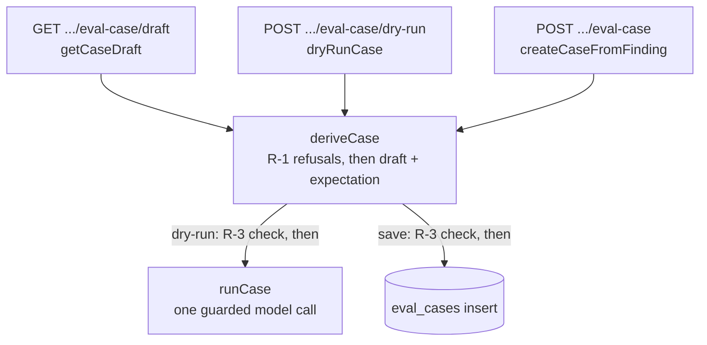
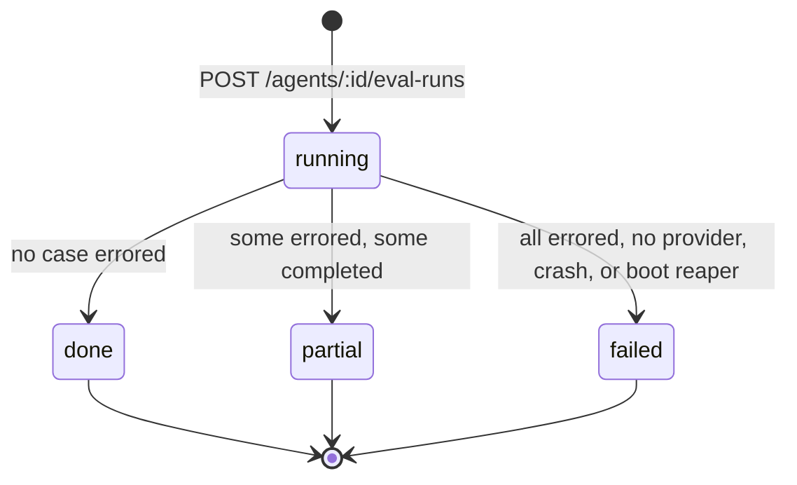

# Eval module — cases, scoring, suite runs (reference)

What `server/src/modules/eval/` does **today**. Intent lives in
`../../specs/2026-10-12-eval-cases-and-scoring.md` (Spec A),
`../../specs/2026-10-12-eval-run-history-compare.md` (Spec B),
`../../specs/2026-10-13-eval-case-modal.md` (Spec C: draft, dry-run and
user-supplied name / expectation) and
`../../specs/2026-10-13-eval-dashboard-compare-polish.md` (Spec D: the
recent-runs read across agents). This module is unrelated to the root
`evals/` package, which evaluates Claude Code skills and agents; the two share
only the word "eval".

An eval case freezes one decided finding (accepted or dismissed) together with
the diff of its file. A suite run replays the agent's **current** config over
every case of that agent and scores the answers in code. The module is
registered as `eval` in `src/modules/index.ts:44`.

## Routes

`src/modules/eval/routes.ts`. Every route declares a `schema.response`. Ids are
resolved inside the request's workspace, so a foreign id is a `404`
(`not_found`). A body, params or querystring that fail their schema are `422
validation_error` before the handler runs (`src/app.ts:135-143`).

| Route | Success | Refusals |
|-------|---------|----------|
| `GET /findings/:id/eval-case/draft` | `200` `EvalCaseDraft`; writes nothing (`routes.ts:49-56`) | `404 not_found`; `409` `finding_undecided`, `no_agent`, `duplicate` (+ `case_id`), `patch_unavailable`, in that order |
| `POST /findings/:id/eval-case/dry-run` | `200` `EvalDryRunResult`; one model call, writes nothing (`routes.ts:58-74`) | the same `404` / `409` list as the draft; `422 validation_error`, `422 file_not_in_diff`, `422 kind_mismatch`; `413`; `429`. A failed model call is **not** a refusal: it is `200` with `outcome: error` |
| `POST /findings/:id/eval-case` | `201` `EvalCase`; optional body `EvalCaseOverrides` (`routes.ts:76-96`) | `404 not_found`; `409` `finding_undecided`, `no_agent`, `duplicate` (+ `case_id` of the existing case), `patch_unavailable`, checked in this order (`service.ts:103-136`); then `422 file_not_in_diff`, `422 kind_mismatch` (`service.ts:41-57`); `422 validation_error`; `413`; `429` |
| `GET /agents/:id/eval-cases` | `200` `EvalCase[]`, ordered by `name` | `404` unknown or foreign agent |
| `POST /agents/:id/eval-cases` | `201` `EvalCase` written by hand: body `{ name, patch, expected_output }` (`patch` = the hunks from the first `@@`, wrapped in the headers of `expected_output.file`); `expected_output.source` is `null`, `input_meta` a stub (`repo: "manual"`) | `404` agent; `422 invalid_diff` (no `@@` hunk), `too_many_cases`; `409 eval_run_in_progress`. Added after Spec F without its own spec (user decision, 2026-10-17); `EvalExpectation.source` became nullable in `@devdigest/shared` |
| `PATCH /eval-cases/:id` | `200` `EvalCase`; body `{ name?, expected_output? }` (no `source`); frozen input and `source` stay | `404`; `422 file_not_in_diff` (the file must stay the frozen diff's file); `409 eval_run_in_progress`. Added after Spec F without its own spec (user decision, 2026-10-17) |
| `POST /eval-cases/:id/run` | `200` `EvalDryRunResult`; one stateless model call, nothing stored, no suite row; optional body `{ expected_output?, agent_id? }`: `expected_output` overrides the expectation for scoring only, `agent_id` is the host of a skill-owned case (G1) | `404` (case, or the case's skill/owner agent); `422 host_required` (skill case, no host), `422 host_not_found`, `422 host_not_allowed` (agent case with `agent_id`), checked before any model call; `422 file_not_in_diff` for an override outside the frozen file; a call failure is `200` `outcome: error`; rate-limited like the dry-run. Same note: no spec |
| `DELETE /eval-cases/:id` | `200` `{ ok: true }` | `404`; `409 eval_run_in_progress` while a suite of the case's **owner** (agent or skill) is `running` |
| `POST /agents/:id/eval-runs` | `202` `EvalSuiteRun` (`status: running`) | `404`; `409 eval_run_in_progress`; `422 no_cases`; `422 too_many_cases` (more than 100) |
| `GET /skills/:id/eval-cases` | `200` `EvalCase[]` of the skill, ordered by `name` (G1) | `404` unknown or foreign skill |
| `POST /skills/:id/eval-cases` | `201` `EvalCase` written by hand for the skill; same body and build as the agent route (G1) | `404` skill; `422 invalid_diff`, `too_many_cases`; `409 eval_run_in_progress`; `413` over 256 KB; `429` (30/min) |
| `POST /skills/:id/eval-cases/copy` | `201` `EvalCase`: body `{ case_id }` of an agent case; name, diff, files, meta, expectation (incl. `source`) and notes are copied, the source row is not touched; copying twice makes two rows (G1) | `404` skill or source; `422 not_agent_case` (source is a skill case); `409`; `422 too_many_cases`; `429` (30/min) |
| `POST /skills/:id/eval-runs` | `202` `EvalSuiteRun` (`owner_kind: skill`): body `{ agent_id }` is the host agent (G1) | `404` skill; `422 validation_error` (no/unknown keys), `422 host_not_found`, `422 no_cases`, `422 too_many_cases`; `409 eval_run_in_progress`; `429` (5/min) |
| `GET /skills/:id/eval-runs` | `200` `EvalSuiteRun[]` of the skill, newest first, at most 50 (G1) | `404` unknown or foreign skill |
| `GET /eval-runs/:id` | `200` `EvalSuiteRunDetail`: the suite plus one record per case that still exists, in `case_ids` order | `404` |
| `GET /agents/:id/eval-runs` | `200` `EvalSuiteRun[]`, newest first, at most 50 | `404` |
| `GET /eval/dashboard` | `200` `EvalDashboardRow[]` | — |
| `GET /eval/recent-runs?limit=` | `200` `EvalRecentRun[]`: finished runs of every agent of the workspace, newest first, at most `limit` (default 10) (`routes.ts:157-164`) | `422 validation_error` when `limit` is not an integer from 1 to 50 |

The two `POST /findings/:id/eval-case*` body schemas are `.nullish()`
(`routes.ts:64,81`): Fastify hands an absent body to the validator as `null`,
and the handler passes `req.body ?? undefined` to the service. No body, `null`
and `{}` are the same request.

`413` is answered by the framework's body limit, not by the module: it goes
through the generic branch of the error handler, so its body carries
`code: internal_error` and the framework message (`src/app.ts:176-185`). A
client has to tell it apart by the HTTP status.

A disabled agent may still be run (`service.ts:282-286`: the agent is looked up
by id only).

**Rate limits and body limit** (`constants.ts:17-24`):

| Route | Per minute | Body limit |
|-------|-----------|------------|
| `POST /agents/:id/eval-runs` | 5 | none set |
| `POST /findings/:id/eval-case` | 30 | 16 KB (`EVAL_BODY_LIMIT_BYTES`, 16 384) |
| `POST /findings/:id/eval-case/dry-run` | 10 (`EVAL_DRY_RUN_RATE_LIMIT`) | 16 KB |

The limited routes answer `429`. Like every per-route limit they are inert
under `NODE_ENV=test`, because the rate-limit plugin is registered only outside
test (`src/app.ts:112-113`). The read routes, including `GET /eval/dashboard`
and `GET /eval/recent-runs`, set no per-route limit and fall under the global
120 per minute only (`src/app.ts:113`, `routes.ts:148-164`).

## Skill evals (G1)

Spec: `../../specs/2026-10-17-skill-evals-server.md`. A skill owns cases
(`eval_cases.owner_kind = skill`, `owner_id` = skill id) and runs them through a
**host agent** chosen per run.

- **Suite row.** `eval_suite_runs` has `owner_kind` (`agent` | `skill`, default
  `agent`), `skill_id`, `skill_version` (both null for an agent suite, both set
  for a skill suite; two CHECKs). For a skill suite `agent_id` / `agent_version`
  are the **host's** and `skills` is exactly `[<skill name at start>]`.
- **Prompt.** The host's system prompt plus ONE `### <skill>` block (the
  third-party line stays for imported/community skills), the case's frozen diff
  and meta. The host's other skills, repo map, callers, project context, intent
  and memory are not in it. `enabledSkillsForPrompt` is never called on this
  path. A disabled skill, a disabled host or an unlinked host still runs.
- **One running suite per owner.** Partial unique indexes
  `eval_suite_runs_agent_owner_running_uq` (`agent_id` where running and
  `owner_kind = 'agent'`) and `eval_suite_runs_skill_running_uq` (`skill_id`
  where running and `owner_kind = 'skill'`), plus an advisory lock
  `eval-<kind>:<id>`. A skill suite therefore never blocks its host's own suite.
  The `ON CONFLICT` arbiter repeats the full index predicate, `owner_kind`
  included. `PATCH` / `DELETE` of a case lock and check the case's own owner.
- **Views.** Agent history, the dashboard (`latest`, `running`, `delta`,
  `drop`) and recent runs filter `owner_kind = 'agent'`; skill suites are listed
  only by `GET /skills/:id/eval-runs` and `GET /eval-runs/:id`.
- **Per-case run.** Same stateless call as for an agent; `skill_version` in the
  result is the skill's current version (`null` for an agent case). Log line
  `eval case <id> (skill <skill_id>): single run <outcome>, cost <usd>`, suite
  line `eval suite <id> (skill <skill_id>): <status>, 
/<t> passed, cost <usd>`.
- **Unchanged.** Scoring, `maxRetries: 0`, 8192 tokens, 120 s, the boot reaper
  (owner-agnostic). No `agent_runs` / `run_traces`. A deleted skill's cases and
  suites become unreachable and stay in the tables (`PATCH` / `DELETE` keep
  working by case id).
- **Finding de-dup stays agent-only**: a skill copy with the same
  `source.finding_id` does not block "Turn into eval case".
- Tests: `test/eval-skill-cases.it.test.ts`, `test/eval-skill-runs.it.test.ts`.

## Frozen input

`createCaseFromFinding` stores this in `eval_cases`
(`src/db/schema/eval.ts:20-33`) and never updates it afterwards:

- `name`: `<file>:<start_line> <title>`, the title cut to 120 characters
  (`buildCaseName`, `helpers.ts:362-365`), unless the caller supplied a name
  (see below).
- `input_diff`: the persisted `pr_files.patch` of the finding's file with a
  `diff --git` / `---` / `+++` header rebuilt on top (`helpers.ts:394-396`);
  `input_files`: that one path.
- `input_meta`: `pr_number`, `pr_title`, `pr_body`, `repo`. No author, no head SHA.
- `expected_output`: one expectation. `kind` is `must_find` for an accepted
  finding and `must_not_flag` for a dismissed one (when both timestamps are set
  the later wins, `helpers.ts:186-193`); then `file`, `start_line`, `end_line`,
  informational `title` / `severity` / `category`, and a `source` block
  (`finding_id`, `review_id`, `pr_id`, `repo`, `head_sha`, `agent_id`,
  `run_id`) (`helpers.ts:196-219`). The derived `title` is cut to 500
  characters with a trailing `…` (`capTitle`, `helpers.ts:226-233`), because the
  caller-editable contract caps it there and `Finding.title` is uncapped.

**What a caller may supply at the first save** (Spec C): only `name` and
`expected_output`, through `EvalCaseOverrides` (`knowledge.ts:164-169`). The
inputs (`input_diff`, `input_files`, `input_meta`), the agent and the `source`
block are always built by the server; the schema is `.strict()`, so any other
key is a `422 validation_error`. A supplied `expected_output` is stored as the
caller's `kind` / `file` / lines / `title` / `severity` / `category` plus the
server's `source` (`withServerSource`, `helpers.ts:292-297`). A supplied
`name` is trimmed and must be 1 to 500 characters. With no body, or `{}`, the
stored row is the Spec A row.

`owner_kind` is always `agent` and `owner_id` is the review's agent
(`repository.ts:164-180`). One case per finding: a duplicate is found through
`expected_output.source.finding_id`, and an advisory lock per finding makes two
concurrent creates serial (`repository.ts:87-89,145-162`). `patch_unavailable`
means `pr_files` holds no patch for that file; the message tells the user to open
the pull request once and retry.

## Draft and dry-run (Spec C)

The modal in the client shows a case before it exists. Three service methods
share one private step, `deriveCase` (`service.ts:103-136`), so a draft equals a
bodiless save by construction:

Caption: the three finding-scoped entry points share `deriveCase`; only save
writes a row, only dry-run calls the model.

- **Shared derivation.** `deriveCase` runs the Spec A refusals in order
  (`not_found`, `finding_undecided`, `no_agent`, `duplicate`,
  `patch_unavailable`; messages unchanged) and builds the draft with
  `buildCaseDraft` (`helpers.ts:255-275`). `getCaseDraft` calls it with no
  transaction and no lock (`service.ts:139-141`); `createCaseFromFinding` calls
  it inside its transaction after `lockFinding` (`service.ts:154-157`).
- **R-3 order.** When a caller supplies `expected_output`, `expectationRefusal`
  (`helpers.ts:281-289`) checks first that `file` equals the frozen diff's
  file, then that `kind` equals the finding's decision **now**. The messages are
  `expected_output.file must be the file of the frozen diff` (`file_not_in_diff`)
  and `expected_output.kind must equal the finding's current decision`
  (`kind_mismatch`), both `422` (`service.ts:41-57`). On save the decision is
  the one read under the finding lock, not anything the client saw earlier.
  Shape errors (unknown key, `end_line < start_line`, lengths) are already
  `validation_error` from the schema (`knowledge.ts:142-156`).
- **One call, reused runner.** `dryRunCase` (`service.ts:188-248`) loads the
  agent's enabled skills like a suite start, resolves the provider with
  `container.llmSingleShot` and calls `runCase` with the draft's `input_diff` and
  `input_meta`. The prompt is therefore the one an eval run builds (see "What
  an eval run's prompt contains" below), with the agent's **current** system
  prompt. The supplied expectation is used for scoring only and never reaches
  the prompt (`service.ts:185-186,216-220`). The result carries the agent's
  `version` at that moment.
- **Writes nothing.** No transaction, no `eval_cases` / `eval_runs` /
  `eval_suite_runs` row, no run bus, no `agent_runs`, no `run_traces`
  (`service.ts:181-187`).
- **Errors are results.** `runCase` does not throw; a timeout, a schema failure
  or a thrown provider error is `outcome: error` (see "One call per case").
  `llmSingleShot` resolves **before** `runCase` and throws `ConfigError` when the
  provider has no key, so `dryRunCase` catches it and returns the same shape
  with `cost_usd: null` (`service.ts:224-235`). The route answers `200` in both
  cases; only the R-1 and R-3 refusals leave the service as `AppError`.
- **Result shape** (`EvalDryRunResult`, `eval-ci.ts:148-168`, built by
  `toDryRunResult`, `helpers.ts:305-346`). On `error` the counts are `null`, the
  lists are empty and `cost_usd` is `null`. Otherwise `matched_count` is the
  number of **kept** findings that intersect the expectation, for both kinds
  (`helpers.ts:338`); this is not `matching_kept`, which is `0` for
  `must_not_flag`. `kept` / `dropped` carry the full findings (LLM text).
- **Timeout may still bill.** The 120 s race is the same as in a suite
  (`case-runner.ts:65-91`): the port has no abort signal, so a call that timed
  out can still be billed and its late answer is ignored.
- **Log line** (`dryRunLogLine`, `helpers.ts:349-357`), written on the request
  logger: `eval dry-run finding <id>: <outcome>, cost <$x.xxxx|n/a>, <ms> ms`,
  with structured `finding_id`, `agent_id`, `outcome`, `cost_usd`,
  `duration_ms` (`service.ts:237-246`).
- **Test seam.** `EvalServiceDeps.caseTimeoutMs` overrides the 120 s timeout of
  a dry-run (`service.ts:76-77,205`).

## What an eval run's prompt contains

Built by `runCase` (`case-runner.ts:121-136`) through the real
`reviewPullRequest` pipeline; a suite case and a dry-run use the same path:

| In the prompt | Source |
|---------------|--------|
| the agent's system prompt, plus the shared `INJECTION_GUARD` that `assemblePrompt` appends | `agents` row at run start; `reviewer-core/src/prompt.ts:238` |
| enabled skills as `### <name>` blocks (third-party ones get a `> Third-party skill…` line) | `enabledSkillsForPrompt` at start; `helpers.ts:399-406` |
| the case's frozen `input_diff` | `eval_cases.input_diff` (a dry-run: the draft's) |
| the PR body, only when non-empty | `input_meta.pr_body` |
| a task line with PR number and title (no author) | `helpers.ts:413-423` |

**Not passed to the engine**: callers, repo map, project context (`specs`),
intent, memory (`case-runner.ts:8-10`). Repo-intel and attached context docs
therefore do not change an eval prompt. The strategy is `single-pass` on a
single-file diff, so one case is one model call. The model itself is not frozen.

## Scoring (code only, no model call)

All of it is in `src/modules/eval/helpers.ts`. It runs on the findings that
survived the mandatory grounding gate; `reviewPullRequest` returns them as
`kept` and `dropped` (`reviewer-core/src/review/run.ts:216-229`).

- **Match** (`matches`, `:50-56`): the same `file` (exact string) and the closed
  line ranges intersect. No tolerance.
- **Pass** (`scoreCase`, `:62-94`): `must_find` passes when at least one kept
  finding matches; `must_not_flag` passes when none does. A case whose call
  failed has `outcome: error` and `pass: null` (`errorCase`, `:97-120`).
- **Per case**: `recall` is `1` or `0` for `must_find` and `null` for
  `must_not_flag`. `precision` is matching kept / kept (matching is `0` on a
  `must_not_flag` case), `null` when nothing was kept. `citation_accuracy` is
  kept / (kept + dropped), `null` with no candidates. An errored case has every
  metric `null`.
- **Per suite** (`aggregateSuite`, `:133-173`), over cases that did not error;
  errored cases are in no numerator or denominator:

  | Metric | Formula | `null` when |
  |--------|---------|-------------|
  | `recall` | passed `must_find` / completed `must_find` | no completed `must_find` case |
  | `precision` (strict) | kept findings matching their case's `must_find` / all kept findings | no kept finding |
  | `citation_accuracy` | kept / (kept + dropped) | kept + dropped is 0 |
  | `cost_usd` | sum of non-null per-case costs | every cost is `null` |

- **Re-scoring** reads the stored `actual_output` (kept findings and dropped
  findings, each dropped one with its reason) plus the case's current
  `expected_output`. It never calls a model (`rescoreCase`, `:123-126`;
  `finalizeSuiteFromStored`, `suite-executor.ts:38-59`).

## One call per case

`guardProvider` (`case-runner.ts:65-104`) wraps the provider so that every
`completeStructured` request goes out with `maxRetries: 0`,
`maxTokens: 8192` (`EVAL_MAX_OUTPUT_TOKENS`) and `timeoutMs: 120000`
(`EVAL_CASE_TIMEOUT_MS`), and is also raced against a 120 s timer
(`constants.ts:1-9`). The port has no abort signal, so after a timeout the call
stays in flight and may still be billed; its late result is ignored. A timeout,
a schema failure or a thrown error turns that case into `outcome: error`; the
stored text has key-like tokens redacted and is cut to 300 characters
(`describeCaseError`, `case-runner.ts:109`; `truncateError`,
`helpers.ts:381-386`), and the suite continues with the next case.

The provider comes from `container.llmSingleShot`
(`src/platform/container.ts:211`):

| Provider | Behaviour |
|----------|-----------|
| pre-built override (tests) | wins, as in `llm()` |
| `openrouter` | a dedicated `OpenRouterProvider` with `maxRetries: 0` and the 120 s timeout, cached per timeout; no key throws `ConfigError` |
| `openai`, `anthropic` | **not** strict: falls back to `llm(id)`, so the adapters' own transport retries still apply and only the request-level `maxRetries: 0` holds. Noted in the code as a known gap (`container.ts:206-209`) |

## Suite lifecycle

Suite status as stored in `eval_suite_runs.status`, with a `CHECK` constraint
(`src/db/schema/eval.ts:51,74`). The decision between the three final states is
`aggregateSuite` (`helpers.ts:147-159`).

- **Start** (`service.ts:282-331`): under a per-agent advisory lock the service
  refuses with `409` / `422`, inserts the `running` row (with `agent_version`,
  the frozen `case_ids` in name order and the enabled skill names) and returns
  it as `202`. The cases then run detached and sequentially in
  `EvalSuiteExecutor`.
- **One running suite per agent**: the partial unique index
  `eval_suite_runs_agent_owner_running_uq` (`src/db/schema/eval.ts`, since
  migration 0016; skill suites have their own, see "Skill evals") plus the
  advisory lock. A lost race is `409 eval_run_in_progress`, never a second
  suite. Cases cannot be deleted meanwhile (same `409`).
- **Progress**: after each case, the `eval_runs` row and the suite counters are
  written in one transaction. `cases_completed` counts answered (non-errored)
  cases and `cases_errored` the errored ones, so finished cases are their sum
  (`repository.ts:260-281`, `suite-executor.ts:86-103`).
- **Failure before any case**: when the provider cannot be resolved (for
  example no `OPENROUTER_API_KEY`) the suite is `failed` with that reason and
  has no case rows (`suite-executor.ts:68-75`). An unexpected exception also
  ends `failed` (`:106-112`); its metrics are still aggregated from the case
  rows already stored.
- **Boot reaper** (`src/app.ts:95-102`, `service.ts:362-404`): before the server
  listens, every `running` suite becomes `failed` with `error: "interrupted"`
  and keeps its stored case rows. A reaper failure is logged as a warning and
  does not stop boot.
- **Log line** per finished suite:
  `eval suite <id>: <status>, <passed>/<total> passed, cost <usd or n/a>`
  (`helpers.ts:518-525`).

Eval runs write **only** `eval_runs` and `eval_suite_runs`: no `agent_runs`, no
`run_traces`, no run bus (`suite-executor.ts:5-6`). They never appear in PR run
history, PR cost columns or skill stats. Deleting a case cascades to its
`eval_runs` rows (`src/db/schema/eval.ts:89`) and leaves a finished suite's
stored aggregates unchanged (`repository.ts:205-212`).

## Dashboard

`GET /eval/dashboard` returns one row per agent that has at least one case and
still exists (`repository.ts:398-465`):

- `latest`: the newest `done` / `partial` suite; `running`: a suite is in
  progress.
- `delta`: recall / precision / citation difference between the two newest
  finished suites, `null` when there is no previous suite or either side is
  `null`, rounded to 6 decimals.
- `drop`: true when the recall delta or the precision delta is negative.
- Order: `drop` rows first, then by agent name (`helpers.ts:535-568`).

## Recent runs (Spec D)

`GET /eval/recent-runs?limit=` answers "what ran lately across all agents".
It is a read: no write, no transaction, no model call, no migration and no new
index (`service.ts:351-355`; `test/eval-recent-runs.it.test.ts`, NFR-4 case).

- **Query.** `EvalRecentRunsQuery`: `limit` is coerced to a number, an integer
  from 1 to 50, default 10 (`eval-ci.ts:191-195`). `0`, `51`, `abc`, `2.5` and
  an empty value are `422 validation_error` before the handler runs
  (`test/eval-recent-runs.it.test.ts`, AC-3 case; `test/eval-contracts.test.ts:360-380`).
- **Response.** `EvalRecentRun[]`: every field of `EvalSuiteRun` plus
  `agent_name` (`eval-ci.ts:197-203`), mapped by `toEvalRecentRun`
  (`helpers.ts:501-504`). Metrics and `cost_usd` stay nullable.
- **Selection.** `listRecentFinishedSuites` (`repository.ts:363-389`) takes the
  suites of the request's workspace whose status is `done` or `partial`
  (`running` and `failed` are never listed), ordered by `ran_at` descending then
  `id` descending, cut at `limit`.
- **Deleted and renamed agents.** The query inner-joins `agents` on the agent id
  **and** the workspace (`repository.ts:377-380`), so a run whose agent was
  deleted is absent while its row stays in `eval_suite_runs`, and `agent_name`
  is the agent's current name. Both are asserted in
  `test/eval-recent-runs.it.test.ts` (deleted/renamed case).
- **Workspace scope.** Both the suite and the agent are matched to the
  workspace, so a run stored under another workspace is absent even when it
  points at a local agent id (`test/eval-recent-runs.it.test.ts`, NFR-3 case).
- **Rate limit.** None per route; see "Rate limits and body limit".

## Verification

`pnpm verify:l06` (`server/package.json:12`) runs
`test/contracts.test.ts`, `test/eval-*` and `test/adapters.test.ts` with
`DEVDIGEST_REQUIRE_DOCKER=1`. The `test/eval-` pattern includes
`test/eval-recent-runs.it.test.ts` (Spec D: default limit and ordering, ties by
`id`, deleted and renamed agent, `limit` bounds, `422` cases, workspace scope,
zero model calls) and the client-copy parity test in
`test/eval-contracts.test.ts:512-529` (`knowledge.ts`, `eval-ci.ts`).

The Spec D NFR-2 timing (p95 of `GET /eval/recent-runs?limit=10` with 5 000
suite runs in one workspace, existing indexes only) has **not** been run; it is
a manual, user-gated check (plan task T66,
`../../specs/2026-10-13-eval-dashboard-compare-polish.plan.md`). TODO: unverified.

## Sources

`src/modules/eval/{routes,service,repository,helpers,case-runner,suite-executor,constants}.ts`,
`src/db/schema/eval.ts`, `src/platform/container.ts`, `src/app.ts`,
`src/vendor/shared/contracts/{knowledge,eval-ci}.ts`,
`test/eval-recent-runs.it.test.ts`, `test/eval-contracts.test.ts`,
`reviewer-core/src/review/run.ts`, `reviewer-core/src/prompt.ts`,
`../../specs/2026-10-13-eval-case-modal.md` (Spec C) and its plan
`../../specs/2026-10-13-eval-case-modal.plan.md`,
`../../specs/2026-10-13-eval-dashboard-compare-polish.md` (Spec D) and its plan
`../../specs/2026-10-13-eval-dashboard-compare-polish.plan.md`.
