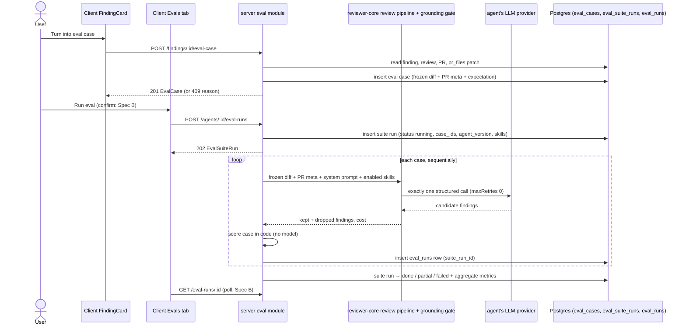

# Spec: Eval cases from findings and code-only scoring | Spec ID: SPEC-2026-10-12-eval-cases-and-scoring | Status: approved
Supersedes: —
Depended on by: [SPEC-2026-10-12-eval-run-history-compare](2026-10-12-eval-run-history-compare.md)
Modules: server, client, @devdigest/shared (contracts)
Approved: free3et (user), 2026-10-12

> Hand-in note: the homework checklist names `specs/eval-pipeline.md`; that file is a thin index pointing at this spec (A) and at Spec B.
>
> Disambiguation: this feature measures a DevDigest **review agent** on product data stored in Postgres. It is unrelated to the root `evals/` package, which evaluates Claude Code skills and agents; the two share only the word "eval".

## Problem and user

A DevDigest user who edits a review agent's system prompt (or model, or skills) has no way to tell whether the agent got better or worse. The accept / dismiss decisions the user already made on real findings (lessons L01–L05) are a ready-made gold set: an accepted finding says "the agent must find this", a dismissed one says "the agent must not say this". This spec turns those decisions into eval cases in one click, runs the agent over an agent's case set on frozen inputs, and scores the result in code with no model involved. History, comparison of two runs and the Eval Dashboard are Spec B.

## Goals / Non-goals

- **G-1** Create an eval case from a decided finding in one click: accepted → `must_find`, dismissed → `must_not_flag`.
- **G-2** See all eval cases of an agent's set.
- **G-3** Run the agent on all cases of its set, on inputs frozen at case creation, so runs of different agent versions are comparable on the parts the eval controls.
- **G-4** Score every run deterministically in code: recall, precision, citation accuracy, and pass per case — zero model calls in scoring.
- **G-5** A `pnpm verify:l06` bundle that proves G-1…G-4 hermetically ($0 spend).

- **NG-1** Skill-owned cases (`owner_kind = skill`); only agents own cases.
- **NG-2** A manual case editor (free JSON expectations), although i18n strings for one are staged (D-2). Amended by Spec C (2026-10-13).
- **NG-3** Cases with more than one expectation.
- **NG-4** Replaying a past agent version; a run always uses the agent's current config.
- **NG-5** Cancelling a running suite.
- **NG-6** Renaming a case.
- **NG-7** More than 100 cases per agent in one run; no pagination of the case list.
- **NG-8** Updating a case when its source finding later flips accepted ↔ dismissed.
- **NG-9** Writing eval runs to `agent_runs` / `run_traces`; eval runs never appear in PR run history, PR cost columns or skill stats.
- **NG-10** Cleaning up eval data of a deleted agent.
- **NG-11** Live progress streaming (SSE); the client polls (Spec B).
- **NG-12** Anything in the root `evals/` package.

## User stories

- **US-1** As a user looking at an accepted or dismissed finding, I turn it into an eval case with one click and see that it is now in the set.
- **US-2** As a user on an agent's Evals tab, I see every case of that agent's set and can delete one.
- **US-3** As a user, I start an eval run of the agent over its whole set and later read recall, precision and citation accuracy (display: Spec B).

## Design references

- **D-1** text from user — homework brief HW6 "Eval Pipeline" (relayed by the main session), seen 2026-10-12.
- **D-2** code — staged i18n namespace `client/messages/en/eval.json` (Evals tab `:60-75`, case editor `:33-59`, dashboard `:2-31`), branch `lesson-06-lab-finish` @ `8aca5f5`, seen 2026-10-12.
- **D-3** code — `server/src/db/schema/eval.ts:7-35`: `eval_cases` (no created-at column; `owner_id` has no FK) and `eval_runs` (one run of one case, `case_id NOT NULL`, cascade on case delete).
- **D-4** code — `server/src/vendor/shared/contracts/knowledge.ts:50-84` (`EvalRun` suite-level, non-nullable metrics) and `contracts/eval-ci.ts:20-89` (`EvalCaseInput`, `EvalRunRecord`, `EvalDashboard`).
- **D-5** code — `reviewer-core/src/grounding.ts:52-84` (finding kept iff its line range intersects a hunk of the same file; full-file kinds need only the file) and `reviewer-core/src/review/run.ts:108-126,216-237` (outcome holds kept findings, dropped findings with reasons, cost).
- **D-6** code — `server/src/modules/reviews/run-executor.ts:118-137,198-259`: a PR review adds live enrichment — intent, repo-intel callers / repo map / rank note, project context read from the clone, PR body, enabled skills.
- **D-7** code — `server/src/modules/reviews/repository/review.repo.ts:163,176`: accept clears `dismissed_at` and vice versa, so a finding is in at most one decided state and can flip.
- **D-8** code — `server/src/db/schema/reviews.ts:10-47`: findings belong to a review; `reviews.agent_id` is nullable; `pr_files.patch` (`server/src/db/schema/pulls.ts:36-44`) is the persisted per-file diff.
- **D-9** code — `server/src/modules/agents/helpers.ts:61-86`: a config change (system prompt, model, …) bumps `agent.version` and snapshots `agent_versions`; skill relinks do not (server `INSIGHTS.md` 2026-08-05).
- **D-10** code — `client/src/components/finding-card/FindingCard.tsx:91-112`: Accept / Dismiss buttons in the expanded card body.
- **D-11** code — `server/src/db/seed.ts:15-16`: seeded agents use `openrouter` / `deepseek/deepseek-v4-flash`, a reasoning model (server `INSIGHTS.md` 2026-10-09).
- **D-12** curated — server `INSIGHTS.md`: 2026-10-07 (real adapters retry up to 3 billed calls unless `maxRetries: 0`), 2026-09-25 (a timed-out call is still billed), 2026-10-01 (`pr_files` is filled only when the PR is opened; review POST is fire-and-forget), 2026-09-19 (skill stats read done `agent_runs`; dev-DB `ADD COLUMN IF NOT EXISTS` trap), 2026-07-29 (it-tests self-skip without Docker); client `INSIGHTS.md` 2026-08-04 (seeded DB has no findings).

## Workflow and communication

## Contracts

| Contract | Change | Shape |
|---|---|---|
| `POST /findings/:id/eval-case` | new | request: no body. response `201` → `EvalCase`. Errors per table R-1 |
| `GET /agents/:id/eval-cases` | new | response → `EvalCase[]`, ordered by `name` ascending; `404` unknown/foreign agent |
| `DELETE /eval-cases/:id` | new | response `{ ok: true }`; `404` unknown/foreign case; `409 eval_run_in_progress` (R-2) |
| `POST /agents/:id/eval-runs` | new | request: no body. response `202` → `EvalSuiteRun` with `status: running`. Errors per table R-2 |
| `GET /eval-runs/:id` | new | response → `EvalSuiteRunDetail`; `404` unknown/foreign suite run |
| `EvalExpectation` (`knowledge.ts`) | new | `kind`: `must_find` \| `must_not_flag`; `file`: string; `start_line`, `end_line`: integers, `end_line ≥ start_line ≥ 1`; informational, ignored by scoring: `title`, `severity`, `category` (strings); `source`: { `finding_id`, `review_id`, `pr_id`, `repo` ("owner/name"), `head_sha`, `agent_id` (all strings), `run_id` (string, nullable — null when the review has no run) } |
| `EvalCase` (`knowledge.ts`) | changed | `owner_kind` always `agent` here; `name`: `<file>:<start_line> <title>` with the title cut to 120 chars; `input_diff`: the single-file unified diff of `expected_output.file`; `input_files`: array of one string (that path); `input_meta`: { `pr_number` int, `pr_title` string, `pr_body` string nullable (null = PR had no body), `repo` string }; `expected_output`: `EvalExpectation`; `notes`: nullable |
| `EvalSuiteRun` (`eval-ci.ts`) | new | `id`, `agent_id`: strings; `agent_version`: int (agent's version when the run started); `status`: `running` \| `done` \| `partial` \| `failed`; `ran_at`: ISO string; `finished_at`: ISO string, nullable (null while running); `case_ids`: string[] (the case set frozen at start); `skills`: string[] (enabled skill names in prompt order at start); `cases_total`, `cases_completed`, `cases_passed`, `cases_errored`: ints; `recall`, `precision`, `citation_accuracy`: number 0..1, nullable (null while running or when the denominator is 0, see Scoring rules); `cost_usd`: number, nullable (sum of non-null per-case costs; null when all are null); `duration_ms`: int, nullable (null while running); `error`: string, nullable (reason for `failed`) |
| `EvalRunRecord` (`eval-ci.ts`) | changed | + `suite_run_id`: string, nullable (null only for a per-case run outside a suite — none are created by this spec); + `outcome`: `passed` \| `failed` \| `error`; + `expectation_kind`: `must_find` \| `must_not_flag`; + `findings_kept`, `findings_dropped`: ints, nullable (null on `error`); + `matched`: boolean, nullable (an expectation intersected by ≥ 1 kept finding; null on `error`); + `error`: string, nullable; `pass` stays nullable (null = `error`); `actual_output`: { kept findings, dropped findings each with its reason } |
| `EvalSuiteRunDetail` (`eval-ci.ts`) | new | `EvalSuiteRun` + `cases`: `EvalRunRecord[]` (one per case that still exists, in `case_ids` order) |
| `EvalRun`, `EvalCaseInput` | unchanged | not used by this spec |
| `FindingRecord`, `ReviewRecord`, `Agent` | unchanged | the client derives a finding's agent from `ReviewRecord.agent_id` |
| DB | new | a parent table `eval_suite_runs` (columns mirror `EvalSuiteRun`) and a nullable `eval_runs.suite_run_id` referencing it. The plan handles the migration (NFR-6) |

Error envelope: the existing structured error envelope, with `code` as below.

**R-1 — case creation refusals** (`POST /findings/:id/eval-case`)

| Condition | Status | `code` |
|---|---|---|
| finding unknown or in another workspace | 404 | `not_found` |
| finding neither accepted nor dismissed | 409 | `finding_undecided` |
| finding's review has no agent, or the agent no longer exists | 409 | `no_agent` |
| a case with `source.finding_id` = this finding already exists | 409 | `duplicate` (+ `case_id` of the existing case) |
| no persisted patch for the finding's file in that PR | 409 | `patch_unavailable` |

**R-2 — run / delete refusals**

| Condition | Status | `code` |
|---|---|---|
| agent unknown or in another workspace | 404 | `not_found` |
| `POST /agents/:id/eval-runs` or `DELETE /eval-cases/:id` while a suite run of that agent is `running` | 409 | `eval_run_in_progress` |
| agent has 0 cases | 422 | `no_cases` |
| agent has more than 100 cases | 422 | `too_many_cases` |

## Acceptance criteria (EARS)

**Scoring rules (normative for AC-12).** Each case is scored only against the findings of its own model call. Only findings kept by the grounding gate (D-5) are matched.
- *Match:* a kept finding matches an expectation when `file` is equal (exact string) and the closed ranges `[start_line, end_line]` intersect. Tolerance is 0.
- *Pass:* a `must_find` case passes when ≥ 1 kept finding matches. A `must_not_flag` case passes when no kept finding intersects its expectation. A case whose call failed has `outcome: error` and `pass: null`.
- *Recall* = `must_find` cases that passed / `must_find` cases completed.
- *Precision* (strict) = kept findings that match the `must_find` expectation of their case / all kept findings of completed cases. Every kept finding that matches no `must_find` is noise; this includes every finding on a `must_not_flag` case.
- *Citation accuracy* = kept / (kept + dropped) over completed cases.
- *Null:* each metric is null when its denominator is 0. Errored cases are excluded from every numerator and denominator.
- *Status:* `done` = no errored case. `partial` = ≥ 1 errored and ≥ 1 completed. `failed` = all cases errored, or the run could not start a single case (e.g. missing provider key). `error` then holds the reason.

- **AC-1** — WHEN the user creates a case from an accepted finding, `POST /findings/:id/eval-case` SHALL return `201` with an `EvalCase` owned by the finding's agent whose `expected_output.kind` is `must_find` and whose `file`, `start_line`, `end_line` equal the finding's.
  - Source: G-1, US-1, D-1, C-3
  - Verify: integration (`*.it.test.ts`) — accept a fixture finding, create, assert body and the `eval_cases` row

- **AC-2** — WHEN the user creates a case from a dismissed finding, `POST /findings/:id/eval-case` SHALL return `201` with an `EvalCase` whose `expected_output.kind` is `must_not_flag` and whose `file`, `start_line`, `end_line` equal the finding's.
  - Source: G-1, US-1, D-1, C-3
  - Verify: integration — dismiss a fixture finding, create, assert body

- **AC-3** — WHEN a case is created, the system SHALL store as its immutable input exactly the persisted diff of the finding's file for that PR (`input_diff`, `input_files`) and that PR's number, title, body and repo (`input_meta`), unaffected by later changes to or deletion of the finding, its review or its PR.
  - Source: G-3, C-7, C-18 (N8), EC-1, EC-4
  - Verify: integration — create, then flip the finding, delete the review, re-read the case: identical `input_*` and `expected_output`

- **AC-4** — IF any condition of table R-1 holds, THEN `POST /findings/:id/eval-case` SHALL answer with that row's status and `code` and store no case.
  - Source: C-10, EC-2, EC-3, G1 (pass-1 gap)
  - Verify: integration — one case per row, including two concurrent creates for one finding (exactly one `201`, one `409 duplicate`)

- **AC-5** — WHILE a finding is accepted or dismissed and its review has an agent, the FindingCard SHALL show exactly one eval control — a "Turn into eval case" button whose label names the expectation ("must find" / "must not flag") when no case exists for the finding, or an "In eval set" link to that agent's Evals tab when one does (outside this state the card has no eval control).
  - Source: US-1, U-1, C-10, C-17 (N7), C-14 (N3), G1 (pass-1 gap)
  - Verify: component (RTL) — undecided → no control; accepted → button "must find"; dismissed → "must not flag"; existing case → link; button reachable by role and name

- **AC-6** — IF case creation fails, THEN the FindingCard SHALL keep the button, re-enable it and show inline text naming the reason (`finding_undecided`, `no_agent`, `duplicate`, `patch_unavailable`, or a network error).
  - Source: G1 (pass-1 gap), C-10
  - Verify: component (RTL) — stubbed `409 patch_unavailable` response shows the reason text; button enabled

- **AC-7** — WHEN the user opens an agent's Evals tab, the tab SHALL list every case from `GET /agents/:id/eval-cases` by name, with the expectation kind as a text badge and `file:start_line`, or show the empty-state text when there are none.
  - Source: G-2, US-2, D-2, G2 (pass-1 gap)
  - Verify: integration — list returns the agent's cases only, sorted by name; component (RTL) — rows and empty state; long paths truncate (no wrap)

- **AC-8** — WHEN the user confirms deletion of a case in the Evals tab, `DELETE /eval-cases/:id` SHALL remove the case without altering the stored `cases_*` counts and metrics of any finished suite run.
  - Source: US-2, C-12 (N1)
  - Verify: integration — finish a suite, delete one of its cases, `GET /eval-runs/:id` returns the same aggregates; component (RTL) — confirmation shown before the request

- **AC-9** — WHEN the user starts a run, `POST /agents/:id/eval-runs` SHALL return `202` with an `EvalSuiteRun` in status `running`, whose `case_ids` are the agent's current cases, whose `agent_version` is the agent's current version, and whose `skills` are the agent's enabled skills in prompt order. This holds also when the agent is disabled.
  - Source: G-3, D-1, C-8, C-9, EC-10, EC-12
  - Verify: integration — response shape and fields; a disabled agent still gets `202`

- **AC-10** — WHILE a suite run is `running`, the system SHALL make exactly one model call per case in `case_ids`, sequentially, each with `maxRetries: 0` and a 60 s timeout, and SHALL make no other model call for that suite run.
  - Source: G-4, D-1 ("scoring makes zero LLM calls"), D-12, C-8
  - Verify: integration — `MockLLMProvider` call count equals `cases_total`; each captured request carries `maxRetries: 0`; re-reading and re-scoring adds 0 calls

- **AC-11** — WHILE a suite run executes a case, the model request for that case SHALL contain the case's `input_diff`, `input_meta` title and body, the agent's current system prompt and the enabled skills recorded on the suite run. It SHALL contain no repo map, callers, rank note, project context, intent or memory section.
  - Source: G-3, D-6, C-7, EC-14
  - Verify: integration — inspect the captured mock request: the diff equals `input_diff`; none of the excluded section headings appear even when the agent has `repo_intel` on and attached context docs

- **AC-12** — WHEN the last case of a suite run has finished, the system SHALL set the suite run's `status`, `recall`, `precision`, `citation_accuracy`, per-case `outcome` / `pass` / `matched`, and `finished_at` exactly as the Scoring rules define. The values are readable through `GET /eval-runs/:id`.
  - Source: G-4, D-1, D-5, C-4, C-5, C-6, EC-5, EC-6, EC-7, EC-18
  - Verify: unit — scoring on fixtures for every rule and every null case; integration — scripted mock over ≥ 8 fixture cases (both kinds, one dropped citation, one failing call → `partial`); two runs with system prompts v1 / v2, where the scripted mock returns different findings per prompt, give recall and precision that differ by ≥ 0.2

- **AC-13** — IF any condition of table R-2 holds, THEN the system SHALL answer with that row's status and `code` and SHALL create no suite run and delete no case.
  - Source: C-9, C-13 (N2), EC-9, EC-16
  - Verify: integration — one case per row, including two concurrent `POST /agents/:id/eval-runs` (exactly one `202`)

## Edge cases

- **EC-1** The source finding flips accepted ↔ dismissed after the case is created (D-7): the case keeps its original expectation → AC-3, NG-8.
- **EC-2** Double click or two concurrent creates for one finding → AC-4 (`duplicate`).
- **EC-3** The PR was only polled, never opened, so `pr_files` is empty; or GitHub truncated the patch (D-12) → AC-4 (`patch_unavailable`).
- **EC-4** The source review or PR is deleted later: the case survives with its frozen input → AC-3.
- **EC-5** A suite with only `must_not_flag` cases: recall is null and shows as "—", not 1 → AC-12.
- **EC-6** Zero kept findings in a suite: precision is null. Zero candidate findings: citation accuracy is null → AC-12.
- **EC-7** Missing provider key, timeout, refusal or malformed model output: that case is `error`, and the suite becomes `partial` or `failed` → AC-12, NFR-2.
- **EC-8** The server crashes while a suite runs → NFR-3.
- **EC-9** Two run requests at once for one agent → AC-13.
- **EC-10** The agent is disabled: an eval run is still allowed, because the eval targets that agent explicitly → AC-9.
- **EC-11** The agent is deleted: its cases and suite runs are no longer reachable (`404`) and are not cleaned up → AC-13 (`not_found`), NG-10.
- **EC-12** Skills are relinked between two runs. Skill links are not versioned (D-9), so they are not frozen. The suite run records the skill names used → AC-9. Spec B shows them on compare.
- **EC-13** Inputs are frozen only for the parts the eval controls (diff, PR meta). The model is not frozen: a reasoning model is not deterministic even at temperature 0 (D-11), and the provider can change the model behind a name. Two runs of the same version can differ → NFR-9.
- **EC-14** Live enrichment (repo-intel, project context read from the clone, intent, memory) would make two runs of different versions see different input → excluded, AC-11.
- **EC-15** The dev DB is shared across branches and may already contain columns another branch added → NFR-6.
- **EC-16** A case is deleted while a suite of its agent is running → AC-13 (`eval_run_in_progress`).
- **EC-17** A finding in a file with several hunks: the stored diff is the whole file's patch, so every hunk is available and grounding works as in the original review → AC-3.
- **EC-18** The model cites a file that is not in the single-file diff: the grounding gate drops the finding and it lowers citation accuracy, not precision → AC-12.
- **EC-19** A full-file finding kind (e.g. `secret_leak`) passes grounding on file presence alone (D-5) but still has to intersect the expectation's lines to match → AC-12.
- **EC-20** The agent's provider or model is changed between runs: this is a config change, so `agent_version` differs between the runs (D-9) → AC-9.

## Non-functional requirements

| ID | Category | Requirement (measurable) | Verify |
|---|---|---|---|
| NFR-1 | cost | One suite run of 8 cases costs ≤ $0.05 on the experiment model (OQ-1). Every case and suite run records `cost_usd`. Before any paid demonstration run, the expected spend (case count × last known per-case cost) is announced to the user; this is a precondition of the demonstration, not an AC. Tests and `verify:l06` spend $0 (MockLLMProvider only). | manual — read `cost_usd` of the demonstration suites; integration — suite `cost_usd` = sum of non-null per-case costs |
| NFR-2 | performance / latency | Each case call times out after 60 s and becomes `error`. A timed-out call may still be billed (D-12), and its cost is then unknown. Cases run sequentially, so an 8-case suite finishes or fails within 8 × 60 s plus scoring time. | unit/integration — a mock that never resolves produces `error` for that case after the timeout (fake timers) |
| NFR-3 | reliability | After a server restart, no suite run remains `running`. Every orphaned one becomes `failed` with `error` "interrupted", and its finished cases keep their rows. | integration — insert a `running` suite, boot the app, read `failed` |
| NFR-4 | security | Every new endpoint resolves the workspace and answers `404` for an id from another workspace (OWASP A01). `POST /agents/:id/eval-runs` is limited to 5 per minute and `POST /findings/:id/eval-case` to 30 per minute (`429`, A06). The API stays loopback-only and unauthenticated, as today. | integration — foreign-id `404`; a rate-limit case built with a non-test `nodeEnv` (the limiter is inert under test, D-12) |
| NFR-5 | observability | One log line per finished suite: `eval suite <id>: <status>, <passed>/<total> passed, cost <usd or n/a>`. Each case's `actual_output` keeps every dropped finding with its grounding reason. | integration — captured log line; `GET /eval-runs/:id` shows the dropped reasons |
| NFR-6 | reliability / data | The schema change (new suite-run table, nullable `eval_runs.suite_run_id`) is generated with `pnpm db:generate`, never hand-written. Afterwards `pnpm db:generate` reports no schema changes. Because dev DBs are shared across branches, the plan must handle the known `ADD COLUMN IF NOT EXISTS` trap (D-12) and must apply the migration (`pnpm db:migrate`). | manual — `pnpm db:generate` shows no changes; integration lane migrates a fresh DB |
| NFR-7 | accessibility | The FindingCard eval control has an accessible name that includes the expectation. Kind badges and the error reason are text, never colour alone. Every control is keyboard-operable with visible focus (WCAG 2.2 AA). | component (RTL role/name queries) |
| NFR-8 | reliability / determinism | Scoring is a pure function of the stored per-case output: re-scoring the same stored outputs gives identical metrics and makes no model call. | unit |
| NFR-9 | measurement | The manual experiment (old prompt vs new, then a deliberately broken prompt) counts as "metrics visibly move" only when \|Δrecall\| or \|Δprecision\| between versions is ≥ 0.2 **and** larger than the spread between two runs of the unchanged baseline version. That means the baseline is run twice. The screenshot and screencast are hand-in items, not AC. | manual — record the four suite runs (v1, v1 again, v2, broken) |
| NFR-10 | verification | `pnpm verify:l06` in `server/` runs the unit, contract-parity and DB-backed tests behind AC-1…AC-4, AC-7…AC-13 (server side), NFR-3, NFR-4, NFR-5, NFR-8, and Spec B's server-side AC. It **fails** (does not skip) when Docker is unavailable. It uses `MockLLMProvider` only. Client AC are covered by `cd client && pnpm test`. | manual — run it with and without Docker |

Not relevant: list-read performance beyond the 100-case cap (local, single user).

**LLM feature checklist (§7a)** — `[new: 1 LLM call per case]`
- Cost: ≤ $0.05 per 8-case suite (NFR-1). Shown as `cost_usd` per case and per suite; shown before a run in Spec B.
- Latency: 60 s per case (NFR-2). While waiting, the user sees "k / n cases" (Spec B).
- Failure: timeout, refusal, malformed output or missing key → the case is `error`, excluded from metrics; the suite is `partial` or `failed` with a reason (AC-12). There is no retry (`maxRetries: 0`, AC-10).
- Grounding: yes. The existing mandatory grounding gate (D-5) runs on every case's findings, and citation accuracy measures it.
- Trace: no `run_traces` row (NG-9). The per-case `actual_output` (kept and dropped findings with reasons) plus the NFR-5 log line replace it.
- Injection: the frozen diff and the PR title and body are untrusted → Untrusted inputs.

## Inputs and provenance

| Input | Tag |
|---|---|
| Finding file, lines, title, severity, category; accepted / dismissed state | `[reused: L01–L05 review findings + the user's accept/dismiss]` (D-7, D-8) |
| `input_diff` | `[reused: persisted PR file patch, pr_files.patch]` (D-8) |
| `input_meta` (PR number, title, body, repo) | `[reused: pull_requests + repos rows]` |
| Agent system prompt, provider, model, version | `[reused: agents / agent_versions, current version at run start]` (D-9) |
| Enabled skills | `[reused: the agent's enabled skill links at run start]` (D-9) |
| Per-case candidate findings | `[new: 1 LLM call per case]` — produces the agent's review of the frozen input; on failure the case is `error` (AC-12) |
| Kept / dropped findings | `[deterministic: reviewer-core grounding gate]` (D-5) |
| Match, pass, recall, precision, citation accuracy, status | `[deterministic: eval scoring]` |

## Untrusted inputs

- **Frozen diff and PR title/body** (written by PR authors): data, never instructions. They reach the model only through the existing review prompt assembly, which wraps untrusted sections and appends the shared injection guard, exactly as a PR review does (D-5, D-6). The eval adds no new prompt text around them.
- **Finding title and rationale, and model output** (LLM-written): stored as data. A case name is built from the title, cut to 120 chars and rendered as plain text, never Markdown or HTML. Spec B renders per-case findings as plain text.
- **Provider error messages**: stored in `error` cut to 300 chars, never containing keys; rendered as plain text.

## Traceability

| Source | Covered by |
|---|---|
| G-1 | AC-1, AC-2, AC-4, AC-5 |
| G-2 | AC-7, AC-8 |
| G-3 | AC-3, AC-9, AC-11 |
| G-4 | AC-10, AC-12, NFR-8 |
| G-5 | NFR-10 |
| US-1 | AC-1, AC-2, AC-5, AC-6 |
| US-2 | AC-7, AC-8 |
| US-3 | AC-9, AC-12; display in Spec B |
| D-1 acceptance "≥ 8 cases" | AC-12 (≥ 8 fixture cases); real cases: C-11, NFR-1 |
| D-1 acceptance "both expectation types work" | AC-1, AC-2, AC-12 |
| D-1 acceptance "prompt change moves recall/precision" | AC-12 (scripted), NFR-9 (manual) |
| D-1 acceptance "scoring makes zero LLM calls" | AC-10, NFR-8 |
| D-1 acceptance "`pnpm verify:l06` green" | NFR-10 |
| G1 gap: card states (undecided, decided, in set, no agent, pending, error) | AC-5, AC-6, AC-4 |
| G2 gap: case list states and volumes | AC-7, NG-7 |
| G3 gap: run states (running, partial, failed, crash, 409, 429) | AC-12, AC-13, NFR-3, NFR-4; display in Spec B |
| G7 gap: i18n keys | AC-5, AC-7 (strings via `prReview` / `eval` namespaces) |
| G8 gap: dropped findings and cost unused by the brief | NFR-5, NFR-1 |
| G9 gap: reuse primitives | AC-5, AC-7 (existing `@devdigest/ui` Button / badges) |
| U-1 (accepted) | AC-5 |
| EC-1, EC-4, EC-17 | AC-3 |
| EC-2, EC-3 | AC-4 |
| EC-5, EC-6, EC-7, EC-18, EC-19 | AC-12 |
| EC-8 | NFR-3 |
| EC-9, EC-16 | AC-13 |
| EC-10, EC-12, EC-20 | AC-9 |
| EC-11 | AC-13, NG-10 |
| EC-13 | NFR-9 |
| EC-14 | AC-11 |
| EC-15 | NFR-6 |
| OQ-1 | NFR-1, NFR-9 (manual demonstration only) |

## Clarifications

- **C-1** 2026-10-12 · One spec or two, and the file name given the dated-name rule → two specs in top-level `specs/` (this one and Spec B), plus a thin index at `specs/eval-pipeline.md` for the hand-in checklist (user, accepted recommendation).
- **C-2** 2026-10-12 · Suite-run storage: migration vs grouping inside jsonb → migration: a new parent suite-run table and a nullable `suite_run_id` on `eval_runs`, generated with `pnpm db:generate` (user, accepted recommendation).
- **C-3** 2026-10-12 · Shape of `expected_output` → one `EvalExpectation` per case (kind, file, lines, informational fields, source) (user, accepted recommendation).
- **C-4** 2026-10-12 · Matching rule → exact path, closed-range intersection, tolerance 0, kept findings only (user, accepted recommendation).
- **C-5** 2026-10-12 · Precision definition → strict: noise = every kept finding that matches no `must_find`. Every metric is null when its denominator is 0, and the contracts become nullable (user, accepted recommendation).
- **C-6** 2026-10-12 · Pass per case and failed cases → as in Scoring rules; errored cases are excluded from metrics; suite status `partial` / `failed` (user, accepted recommendation).
- **C-7** 2026-10-12 · What the frozen input contains → the finding file's persisted patch plus PR title, body, number and repo. Repo-intel, project context, intent and memory are excluded at run time. Enabled skills are included and recorded (user, accepted recommendation).
- **C-8** 2026-10-12 · What "run the agent" means → one real call per case with the agent's current config, single-pass, `maxRetries: 0`; tests and `verify:l06` use `MockLLMProvider` only. Budget ≤ $0.05 per 8-case suite. The UI shows the case count and last cost before a run (Spec B). The experiment model is not yet chosen (OQ-1) (user, accepted recommendation).
- **C-9** 2026-10-12 · Execution model → `202` and background execution; the client polls; one running suite per agent (`409`); 5 per minute rate limit; orphans reaped on boot; nothing written to `agent_runs` (user, accepted recommendation).
- **C-10** 2026-10-12 · Case creation rules → agent-owned only; the button only for decided findings; owner = the review's agent; one case per finding (`409 duplicate`); the case is frozen against later flips; one unnamed set per agent (user, accepted recommendation).
- **C-11** 2026-10-12 · Where the ≥ 8 cases come from → real findings on the user's fork PRs. Those reviews are paid, and the spend is announced to the user before it happens. `verify:l06` builds its own fixtures; nothing is seeded (user, accepted recommendation).
- **C-12** 2026-10-12 · (N1) Deleting a case → allowed after a confirmation; finished suite runs keep their aggregates (user, accepted recommendation).
- **C-13** 2026-10-12 · (N2) Maximum cases per run → 100; above that `422 too_many_cases` (user, accepted recommendation).
- **C-14** 2026-10-12 · (N3) Where the button appears → wherever the FindingCard renders with an action handler, including in the diff viewer (user, accepted recommendation).
- **C-15** 2026-10-12 · (N4) Case name → auto-built `<file>:<start_line> <title>`; renaming is a non-goal (user, accepted recommendation). Amended by Spec C (2026-10-13).
- **C-16** 2026-10-12 · (N5, N6) Cancel and retention → no cancel; suite runs are kept indefinitely (user, accepted recommendation).
- **C-17** 2026-10-12 · (N7) How the client knows a finding already has a case → it matches `source.finding_id` in `GET /agents/:id/eval-cases`; `FindingRecord` is unchanged (user, accepted recommendation).
- **C-18** 2026-10-12 · (N8) A source finding or PR is deleted → the case survives (user, accepted recommendation).
- **C-19** 2026-10-12 · (N9) Per-case cost and duration → stored per case and returned by `GET /eval-runs/:id`; displayed read-only in Spec B (user, accepted recommendation).
- **C-20** 2026-10-12 · Definition of `pnpm verify:l06` → a `server/` script running the unit, contract-parity and DB-backed tests named in NFR-10, failing without Docker; client tests run separately (user, accepted recommendation).
- **C-21** 2026-10-12 · UX proposal U-1 (expectation-labelled button that becomes an "In eval set" link) → accepted (user, accepted recommendation).

## Open questions

None. OQ-1 is resolved by C-22.

- **C-22** 2026-10-12 · (was OQ-1) Experiment model → `deepseek/deepseek-v4-flash` via `openrouter`, the seeded agents' model (user decision). Known risk, accepted: it is a reasoning model and has ended `finish_reason=length` with an empty body in another feature (D-11, D-12), so a case may end as `error` and the suite as `partial` (AC-12). The plan must watch the per-case output token limit; if errors dominate the demonstration runs, the user decides whether to switch model — the spec does not change. Demonstration only; no AC depends on the model.
- **C-23** 2026-10-12 · Approval → user approved Spec A (and B); the planner runs in multi-agent mode (user decision).

- **C-24** 2026-10-16 · Output-token cap → `EVAL_MAX_OUTPUT_TOKENS` raised from 4096 to 8192 (user decision, option 1, after the first experiment: 3, 2, 5 and 10 of 12 cases ended `model output failed schema validation (possibly truncated at max_tokens=4096)` with `deepseek/deepseek-v4-flash`, so recall/precision were computed on too few cases). Every mention of 4096 in this spec and its plan now reads 8192; worst-case cost per suite stays well below the $0.05 stop rule (observed $0.002–0.009 per suite at 4096).

- **C-25** 2026-10-16 · Per-case timeout → `EVAL_CASE_TIMEOUT_MS` raised from 60 s to 120 s (user decision, option A): after raising the token cap (C-24) the remaining `error` cases of `deepseek/deepseek-v4-flash` were all `timed out after 60 s` (4 of 9 in the first suite), because the reasoning model often thinks for more than a minute on a small diff. One call per case, `maxRetries: 0` and the billed-warning text are unchanged; wherever this spec or its plan says 60 s it now means 120 s.
