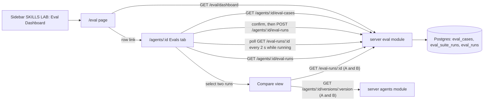

# Spec: Eval run history, run comparison and Eval Dashboard | Spec ID: SPEC-2026-10-12-eval-run-history-compare | Status: approved
Supersedes: —
Depends on: [SPEC-2026-10-12-eval-cases-and-scoring](2026-10-12-eval-cases-and-scoring.md) (Spec A: cases, suite runs, scoring, `EvalSuiteRun` / `EvalSuiteRunDetail` contracts)
Modules: client, server, @devdigest/shared (contracts)
Approved: free3et (user), 2026-10-12

> Hand-in note: the homework checklist names `specs/eval-pipeline.md`; that file is a thin index pointing at Spec A and at this spec (B).
>
> Disambiguation: this is the product feature that evaluates a DevDigest **review agent**. It is unrelated to the root `evals/` package, which evaluates Claude Code skills and agents.

## Problem and user

Spec A produces suite runs with recall, precision and citation accuracy. The user still cannot start a run with its cost in view, follow it, see past runs, or put "old prompt vs new prompt" side by side. Nor is there one place that shows how every agent did on its latest eval. This spec adds the run controls and history to the agent's Evals tab, a two-run compare view, and an Eval Dashboard page in the sidebar.

## Goals / Non-goals

- **G-1** Start a suite run from the Evals tab knowing the case count and the last cost, and follow its progress.
- **G-2** See an agent's run history.
- **G-3** Compare two runs of one agent side by side ("old prompt vs new"), including what changed per case and in the prompt.
- **G-4** An Eval Dashboard page in the left sidebar showing every agent's latest eval run.

- **NG-1** A metric trend chart, although an i18n string for one is staged (D-2).
- **NG-2** Comparing runs of different agents.
- **NG-3** Comparing more than two runs.
- **NG-4** Recomputing metrics over the case overlap of two runs; the compare view shows each run's own stored metrics.
- **NG-5** More than the 50 newest suite runs in the history list (no pagination).
- **NG-6** Cancelling a run (Spec A NG-5); live streaming (the tab polls).
- **NG-7** Editing `@devdigest/ui` vendor `NAV`; the item is registered by the app.

## User stories

- **US-1** As a user, before a paid run I see how many cases will run and what the last run cost, and I confirm.
- **US-2** As a user, while a run is going I see "k / n cases", and afterwards I see whether it was done, partial or failed.
- **US-3** As a user, I open an agent's run history and pick two runs to compare.
- **US-4** As a user, I see the two runs' metrics, per-case outcomes and system-prompt diff side by side.
- **US-5** As a user, I open "Eval Dashboard" from the sidebar and see each agent's latest eval, with regressions on top.

## Design references

- **D-1** text from user — homework brief HW6 "Eval Pipeline", items 4–5 and the "Eval Dashboard" sidebar page, seen 2026-10-12.
- **D-2** code — staged i18n `client/messages/en/eval.json` (dashboard `:2-31`, Evals tab `:60-75`, breadcrumbs `:76-83`), branch `lesson-06-lab-finish` @ `8aca5f5`, seen 2026-10-12.
- **D-3** code — `client/src/components/app-shell/nav.ts:1-61` (app-side NAV registration, SKILLS LAB = Skills, Agents, Conventions) and `client/src/components/app-shell/helpers.ts:35` (`/eval` already maps to active key `eval`); client `INSIGHTS.md` 2026-09-20 (splice in the app, never edit vendor `nav.ts`).
- **D-4** code — `server/src/modules/agents/routes.ts:138-150`: `GET /agents/:id/versions` and `GET /agents/:id/versions/:version` return `AgentVersion` with `config.system_prompt`.
- **D-5** code — `client/src/app/agents/[id]/_components/AgentEditor/constants.ts:11-14` (editor tabs config / skills / context); client `INSIGHTS.md` 2026-10-07 (a new tab must be accepted by the page's tab parser, or it silently falls back to Config).
- **D-6** curated — client `INSIGHTS.md` 2026-10-01 (a new i18n namespace must also be registered in the test renderer), 2026-10-06 (`ErrorState` hardcodes "Retry"), 2026-09-26 (long `file:line` needs nowrap + ellipsis).
- **D-7** spec — Spec A contracts `EvalSuiteRun`, `EvalSuiteRunDetail`, `EvalRunRecord`, endpoints `POST /agents/:id/eval-runs`, `GET /eval-runs/:id`, refusal table R-2.

## Workflow and communication

## Contracts

| Contract | Change | Shape |
|---|---|---|
| `GET /agents/:id/eval-runs` | new | response → `EvalSuiteRun[]`, newest `ran_at` first, at most 50; `404` unknown/foreign agent |
| `GET /eval-runs/:id` → `EvalSuiteRunDetail` | unchanged (defined in Spec A) | each `EvalRunRecord` carries `case_name`, `outcome`, `duration_ms`, `cost_usd` |
| `GET /eval/dashboard` | new | response → `EvalDashboardRow[]`, workspace-scoped, ordered as AC-10 |
| `EvalDashboardRow` (`eval-ci.ts`) | new | `agent_id`, `agent_name`: strings; `cases_total`: int (≥ 1); `latest`: `EvalSuiteRun`, nullable (null = no finished run yet; finished = `done` or `partial`); `running`: boolean (a suite of this agent is `running` now); `delta`: { `recall`, `precision`, `citation_accuracy` }, each a number, nullable (latest minus the previous finished run; null when there is no previous finished run or either value is null); `drop`: boolean (true when `delta.recall` < 0 or `delta.precision` < 0) |
| `GET /agents/:id/versions/:version` → `AgentVersion` | unchanged | used for the prompt diff (D-4) |
| `EvalDashboard`, `EvalTrendPoint` (`eval-ci.ts`) | unchanged | not used (trend is NG-1) |

## Acceptance criteria (EARS)

"Finished run" = a suite run with status `done` or `partial`.

- **AC-1** — WHEN the user clicks "Run eval (n)" in the Evals tab, the tab SHALL ask for confirmation, stating n and the `cost_usd` of the agent's last finished run ("—" when there is none or it is null), sending `POST /agents/:id/eval-runs` only on confirm.
  - Source: US-1, D-1, U-2, C-3
  - Verify: component (RTL) — no request before confirm; texts show n and the cost; cancel sends nothing

- **AC-2** — WHILE a suite run of the agent is `running`, the Evals tab SHALL show "k / n cases" (k = `cases_completed` + `cases_errored`, n = `cases_total`; see C-9) in place of the Run button, refreshed from `GET /eval-runs/:id` at least every 2 s.
  - Source: US-2, C-2, G3 (pass-1 gap)
  - Verify: component (RTL) with fake timers — the text updates after a poll; Run is absent

- **AC-3** — IF the run request is refused (`409`, `422`, `429`) or the run ends `failed` or `partial`, THEN the Evals tab SHALL show inline text naming the refusal code or the status. For `partial` the text includes the errored-case count, and for `failed` the `error` reason.
  - Source: US-2, G3 (pass-1 gap)
  - Verify: component (RTL) — stubbed `409 eval_run_in_progress`, a `partial` run with 2 errored, a `failed` run with a reason

- **AC-4** — WHEN the user opens the Evals tab, the run history SHALL list the agent's suite runs from `GET /agents/:id/eval-runs`, newest first and at most 50. Each row shows `ran_at`, agent version, status, recall, precision, citation accuracy, passed / total, and cost, with "—" for every null; when there are no runs it shows the empty-state text.
  - Source: G-2, US-3, D-1, D-2, G4 (pass-1 gap)
  - Verify: integration — order, cap of 50, workspace scoping; component (RTL) — row cells, "—" for nulls, empty state

- **AC-5** — WHILE the number of selected finished runs in the history is not exactly two, the Compare action SHALL be disabled and show text explaining that two finished runs must be selected. Running and failed runs are not selectable.
  - Source: US-3, C-4, G4, G5 (pass-1 gaps)
  - Verify: component (RTL) — 0, 1 and 3 selected → disabled with the reason; failed row has no enabled checkbox

- **AC-6** — WHEN the user compares two selected runs, the compare view SHALL show run A (older `ran_at`) and run B (newer) side by side. Each column shows `ran_at`, agent version and skills, and for recall, precision and citation accuracy both values plus the signed delta B − A as text (e.g. "+0.25", "−0.10"; "—" when either value is null).
  - Source: G-3, US-4, D-1, U-3, C-4
  - Verify: component (RTL) — values, sign characters, "—"; the delta is not conveyed by colour alone (accessible text)

- **AC-7** — WHEN the compare view is shown, its per-case table SHALL list the union of both runs' `case_ids`. Per run it shows the outcome as text (`passed`, `failed`, `error`, `not in run`, or `case deleted` when the case id is in `case_ids` but the case no longer exists), duration and cost, with rows whose outcome differs between A and B first.
  - Source: G-3, US-4, U-3, C-6 (N9), C-7
  - Verify: component (RTL) — ordering of changed rows; each outcome label; long case names truncate

- **AC-8** — IF the two compared runs have different `case_ids`, THEN the compare view SHALL show the text "Metrics are over different case sets" above the metrics.
  - Source: U-6, C-4
  - Verify: component (RTL) — shown for differing sets, absent for equal sets

- **AC-9** — WHEN the compared runs have different agent versions, the compare view SHALL offer a collapsible line diff of the two versions' `system_prompt` (from `GET /agents/:id/versions/:version`), replaced by the text "Same system prompt" when the versions are equal or the prompts are identical.
  - Source: U-4, US-4, D-4
  - Verify: component (RTL) — collapsed by default and keyboard-expandable; added/removed lines marked with "+"/"−" text; "Same system prompt" case

- **AC-10** — WHEN the user opens `/eval`, the Eval Dashboard SHALL list one row per existing agent that has ≥ 1 case, from `GET /eval/dashboard`. Each row shows agent name, case count, the latest finished run's three metrics with their signed deltas, its `ran_at` (or "never run"), a "running" label when a suite is running, and a link to that agent's Evals tab. Rows with `drop` come first, each marked with the text "drop", then all rows by agent name.
  - Source: G-4, US-5, D-1, U-5, C-5
  - Verify: integration — rows, deltas, `drop`, ordering, a deleted agent's cases excluded, workspace scoping; component (RTL) — row content, "drop" label, link target

- **AC-11** — The sidebar SHALL show an "Eval Dashboard" item in the SKILLS LAB section directly after Agents, linking to `/eval` and marked active on any `/eval` path.
  - Source: G-4, D-1, D-3, C-5
  - Verify: unit — registration order is Skills, Agents, Eval Dashboard, Conventions, and re-registration adds no duplicate; component (RTL) — active state on `/eval`

- **AC-12** — IF no agent has eval cases, THEN the Eval Dashboard SHALL show an empty-state text with a link to `/agents`.
  - Source: G6 (pass-1 gap)
  - Verify: component (RTL)

- **AC-13** — IF `GET /agents/:id/eval-runs`, `GET /eval-runs/:id` or `GET /eval/dashboard` fails, THEN the view that requested it SHALL show the `@devdigest/ui` error state with a Retry button that re-sends the request.
  - Source: G4, G6 (pass-1 gaps)
  - Verify: component (RTL) — fetch stubbed to `500`; query the button by name "Retry" (D-6)

## Edge cases

- **EC-1** Only one finished run exists → AC-5.
- **EC-2** The two runs differ in case set (cases added or deleted in between) → AC-7, AC-8.
- **EC-3** A case in `case_ids` was deleted later → AC-7 ("case deleted"); the run's stored metrics are unchanged (Spec A AC-8).
- **EC-4** The two runs use the same agent version: model non-determinism alone moved the metrics (Spec A EC-13, NFR-9) → AC-9 shows "Same system prompt".
- **EC-5** Skills differ between the runs, since skill links are not versioned → AC-6 shows each run's skills.
- **EC-6** A run is `running` while the dashboard is open → AC-10 ("running" label). The dashboard does not poll; the data refreshes when the user revisits.
- **EC-7** An agent has cases but no finished run → AC-10 ("never run", null metrics and deltas).
- **EC-8** An agent was deleted → AC-10 (its row is excluded).
- **EC-9** A metric is null (nothing to divide by) → AC-4, AC-6, AC-10 show "—"; a delta with a null side is "—" and never counts as a `drop`.
- **EC-10** More than 50 runs → AC-4 (newest 50), NG-5.
- **EC-11** Long agent names, case names, file paths and translations → AC-7, AC-10 truncate with an ellipsis, without wrapping (D-6).
- **EC-12** Loading → each view shows its staged loading text (D-2) until data arrives; this is covered by the component tests of AC-4 and AC-10.

## Non-functional requirements

| ID | Category | Requirement (measurable) | Verify |
|---|---|---|---|
| NFR-1 | accessibility | Every new control (Run, confirm, history checkboxes, Compare, prompt-diff toggle, dashboard links) is keyboard-operable with visible focus and has an accessible name. Deltas, drop and outcome are text, never colour alone (WCAG 2.2 AA). | component (RTL role/name queries) |
| NFR-2 | performance | `GET /agents/:id/eval-runs` (50 rows) and `GET /eval/dashboard` (20 agents with 50 runs each) answer in ≤ 300 ms p95 on the local dev DB. | integration timing, or manual profile |
| NFR-3 | cost | No view in this spec triggers a model call except the confirmed Run (AC-1). The confirmation shows the last known cost before spending. | component (RTL) — the run POST is the only mutating request |
| NFR-4 | security | The new endpoints are workspace-scoped and answer `404` for foreign ids (OWASP A01). Case names, finding titles and prompt text are rendered as plain text, not Markdown or HTML (React escaping). | integration — foreign-id `404`; component — a `<script>` title renders literally |
| NFR-5 | i18n | Every visible string has a key in the `eval` namespace (camelCase, nested by section: `evalsTab.*`, `history.*`, `compare.*`, `dashboard.*`), and the namespace is registered for tests (D-6). | component (RTL) — no missing-message errors |
| NFR-6 | verification | The server-side parts of AC-4 and AC-10 are in `pnpm verify:l06` (Spec A NFR-10). All other AC run in `cd client && pnpm test`. | manual — run both |

Not relevant: reliability (read-only views over stored runs; run reliability is Spec A); observability (no new server-side processing besides reads).

## Inputs and provenance

| Input | Tag |
|---|---|
| Suite runs, per-case records, metrics | `[reused: Spec A eval_suite_runs / eval_runs]` (D-7) |
| Case list and count | `[reused: Spec A eval_cases]` |
| System prompt per version | `[reused: agent_versions]` (D-4) |
| Deltas, `drop`, row ordering, prompt line diff | `[deterministic: eval module / client]` |
| Agent names | `[reused: agents]` |

No `[new: LLM call]` in this spec. The one paid action, Run, is Spec A's call, gated by AC-1.

## Untrusted inputs

- **Case names** (built from LLM-written finding titles), per-case findings and error text: plain text, truncated in the UI (EC-11), never interpreted.
- **System prompt text** in the diff: user-authored, shown as plain text lines in a monospace block, never rendered as Markdown.
- No untrusted text reaches a model in this spec.

## Traceability

| Source | Covered by |
|---|---|
| G-1 | AC-1, AC-2, AC-3 |
| G-2 | AC-4 |
| G-3 | AC-5, AC-6, AC-7, AC-8, AC-9 |
| G-4 | AC-10, AC-11, AC-12 |
| US-1 | AC-1 |
| US-2 | AC-2, AC-3 |
| US-3 | AC-4, AC-5 |
| US-4 | AC-6, AC-7, AC-9 |
| US-5 | AC-10, AC-11 |
| D-1 hand-in "screenshot of two runs compared" | AC-6, AC-7 (manual hand-in, not an AC itself) |
| G3 gap: running / partial / failed / 409 / 429 feedback | AC-2, AC-3 |
| G4 gap: 0 / 1 / many runs, error state | AC-4, AC-5, AC-13, NG-5 |
| G5 gap: compare states, no colour-only delta | AC-5, AC-6, AC-8, NFR-1 |
| G6 gap: dashboard empty, never run, deleted agent, running, error | AC-10, AC-12, AC-13 |
| G7 gap: i18n | NFR-5 |
| G9 gap: reuse primitives | AC-13 (`@devdigest/ui` error state) |
| U-2 (accepted) | AC-1, AC-4 |
| U-3 (accepted) | AC-6, AC-7 |
| U-4 (accepted) | AC-9 |
| U-5 (accepted) | AC-10 |
| U-6 (accepted) | AC-8 |
| EC-1 | AC-5 |
| EC-2, EC-3 | AC-7, AC-8 |
| EC-4 | AC-9 |
| EC-5 | AC-6 |
| EC-6, EC-7, EC-8 | AC-10 |
| EC-9 | AC-4, AC-6, AC-10 |
| EC-10 | AC-4, NG-5 |
| EC-11 | AC-7, AC-10 |
| EC-12 | AC-4, AC-10 |

## Clarifications

- **C-1** 2026-10-12 · One spec or two → two; this is Spec B and depends on Spec A; a thin index at `specs/eval-pipeline.md` serves the hand-in checklist (user, accepted recommendation).
- **C-2** 2026-10-12 · How the client follows a run → polling `GET /eval-runs/:id`, no SSE (user, accepted recommendation).
- **C-3** 2026-10-12 · Spend before a run → the UI shows the case count and the last cost and asks for confirmation (user, accepted recommendation).
- **C-4** 2026-10-12 · Compare scope → two finished runs of the same agent; metrics side by side with signed deltas; version numbers; per-case table; differing case sets are flagged, not recomputed; no cross-agent compare (user, accepted recommendation).
- **C-5** 2026-10-12 · Dashboard content and placement → `/eval`, SKILLS LAB after Agents, registered in the app's nav registration; per-agent rows with latest metrics, deltas, `ran_at`, link; no trend chart (user, accepted recommendation).
- **C-6** 2026-10-12 · (N9) Per-case cost and duration → shown read-only in the compare per-case table (user, accepted recommendation).
- **C-7** 2026-10-12 · (N1) After a case is deleted → past runs keep their stored metrics; compare marks the case "case deleted" (user, accepted recommendation).
- **C-9** 2026-10-13 · AC-2 wording → "k / n" counts FINISHED cases: `cases_completed` (non-errored only, per Spec A Scoring rules) plus `cases_errored`; with `cases_completed` alone the counter would stall on an errored case. Found by plan-verification (code and AC text diverged); the code was right, the AC text was changed (user, accepted recommendation).
- **C-8** 2026-10-12 · UX proposals U-2 (Evals tab layout: metrics, cases, Run with cost confirmation, history with compare selection), U-3 (two-column compare, changed rows first), U-4 (system-prompt diff), U-5 (regressions first on the dashboard), U-6 (different-case-set notice) → all accepted (user, accepted recommendation).

## Open questions

None.
