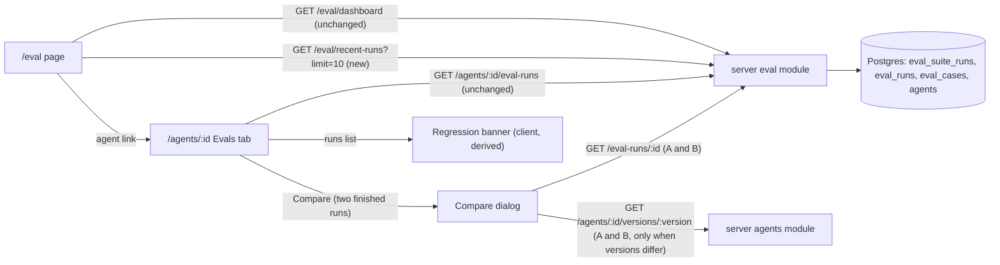

# Spec: Eval compare dialog, regression banner and recent runs across agents | Spec ID: SPEC-2026-10-13-eval-dashboard-compare-polish | Status: approved
Supersedes: parts of [SPEC-2026-10-12-eval-run-history-compare](2026-10-12-eval-run-history-compare.md) (Spec B): where the compare view lives (inline swap → dialog), the compare metric presentation (AC-6, superseded in format, extended by a Cost tile), the prompt-diff legend (AC-9, extended), the location of the compare error state (AC-13, compare part), and the metric number format everywhere on eval screens: two decimals → whole percents with point deltas, in the history (AC-4) and the dashboard agent table (AC-10). See "Amendments to Spec B".
Depends on: Spec B (history, compare, dashboard, `GET /agents/:id/eval-runs`, `GET /eval/dashboard`); [SPEC-2026-10-13-eval-case-modal](2026-10-13-eval-case-modal.md) (Spec C: the app-side dialog accessibility behaviour reused here); [SPEC-2026-10-12-eval-cases-and-scoring](2026-10-12-eval-cases-and-scoring.md) (Spec A: suite statuses and metric definitions).
Modules: client, server, @devdigest/shared (contracts)
Approved: free3et (user), 2026-10-13

> Spec D of the Eval Pipeline (index: `specs/eval-pipeline.md`). This is the DevDigest **review agent** eval. It is unrelated to the root `evals/` package.

## Problem and user

Spec B shipped the run history, the two-run compare and the Eval Dashboard. Three gaps remain against the "Eval Dashboard" mockups (D-1):

- Compare replaces the run history inline, so the user loses the list they picked from. The cost difference and the version pair are not visible at a glance either.
- A regression is visible only on the `/eval` page (`drop`). The agent's own Evals tab, where the user changed the prompt and re-ran, does not say "precision went down on v7".
- The dashboard shows each agent's latest run, but not what ran recently across the workspace.

The user is the person tuning a review agent's prompt. They want "did my last change make it worse?" answered where they work, and "what ran lately?" answered in one place. The user chose a **small scope** (C-1): no trend chart, no promotion of versions, no model calls.

## Goals / Non-goals

- **G-1** Compare two runs in a modal dialog over the Evals tab. The dialog keeps all of Spec B's compare content and adds a Cost tile, `vN → vM` in the title and a Close button.
- **G-2** A regression banner in the agent's Evals tab, above the run history. It is shown when the newest finished run's recall or precision is lower than the previous finished run's.
- **G-3** A "Recent eval runs · all agents" section on the Eval Dashboard: the newest finished suite runs of the workspace, with a link to each agent's Evals tab.
- **G-4** Everything in this spec is read-only and makes zero model calls.
- **G-5** One metric format on every eval screen: whole percents, with deltas in points. This covers the compare tiles, the run history, the dashboard agent table, the recent-runs table and the banner (C-9).

- **NG-1** A metric trend chart or sparklines. Spec B NG-1 stays: the staged `dashboard.metricTrend` key (D-6) stays unused.
- **NG-2** "Run all agents" from the dashboard. Starting runs stays per agent behind Spec B AC-1's cost confirmation. A bulk start would multiply spend with one click.
- **NG-3** A per-agent dashboard sub-page, including the mockup's three per-agent metric cards (D-1). The Evals tab and the `/eval` table already cover that agent-level view.
- **NG-4** Agent or date selectors / filters on the dashboard. The recent section is a fixed "newest N" list.
- **NG-5** Promote or roll back an agent version from the compare dialog (the mockup's "+ Promote"). That changes the production agent config and needs its own decision and spec. This spec only reads.
- **NG-6** Any LLM call, including a generated sentence for the banner. The mockup's "a new false positive slipped in" would need a per-case analysis of both runs, so it is not reproduced. The banner is built from stored metrics only.
- **NG-7** Live refresh of the dashboard. It still does not poll (Spec B EC-6); the recent section refreshes when the page is visited again.
- **NG-8** Paging through older recent runs. At most 50 can be requested, and the dashboard asks for 10.
- **NG-9** A DB migration or a new index (C-1). See NFR-2 for what happens if the existing indexes turn out to be too slow.
- **NG-10** Editing the vendored `@devdigest/ui` `Modal` (D-4).

## Amendments to Spec B

Spec B stays `approved`, and its body is not edited by this spec (C-8). Where Spec B and this spec disagree, this spec wins for the items below. Spec B wins everywhere else.

| Spec B item | Change |
|---|---|
| Workflow: "select two runs → Compare view", which swaps the history for the compare view (D-3) | **Superseded.** Compare opens a modal dialog over the Evals tab, and the history stays rendered underneath (AC-4, AC-11). |
| AC-6 (two columns, metrics with signed deltas, e.g. "+0.25") | **Superseded in format, extended in content.** Recall, precision and citation accuracy are shown as tiles "A → B" in the percent format, with the delta B − A in the point-delta format, e.g. "78% → 82% ▲ 4 pt" (AC-6). Spec B's two-decimal values and "+0.25" deltas are gone. A fourth Cost tile is added (AC-7). Each run's `ran_at`, agent version and skills are still shown (AC-8). |
| AC-4 (history row cells) | **Superseded in format only.** The recall, precision and citation cells show whole percents instead of two decimals (AC-20). Columns, order, the 50-row cap, "—" for null and the selection rules of AC-5 are unchanged. |
| AC-10 (dashboard agent table: metrics with signed deltas) | **Superseded in format only.** Each metric shows the percent plus the point delta, e.g. "82% (▲ 4 pt)" (AC-21). Rows, `drop` and `running` labels, ordering and links are unchanged. |
| AC-7 (per-case table, changed rows first) and AC-8 (different-case-set notice) | **Unchanged.** They now render inside the dialog (AC-8). |
| AC-9 (collapsible prompt diff) | **Extended** by a version legend (AC-9). It is still collapsed by default (C-7). |
| AC-13, compare part (error state with Retry) | **Moved** into the dialog, and Close remains usable (AC-12). |
| The compare view's "Back to history" button | **Replaced** by Close, the X button, Escape and the backdrop (AC-10). |
| AC-11, AC-12 (nav item, dashboard empty state) | **Unchanged.** The dashboard gains a second section below the agent table (AC-17…AC-19). |
| NG-1 (no trend chart), NG-5 (≤ 50 history rows) | **Unchanged.** The banner derives from those ≤ 50 rows (AC-16). |
| NFR-1 (a11y), NFR-2 (performance), NFR-4 (security), NFR-5 (i18n) | **Extended** by NFR-1, NFR-2, NFR-3 and NFR-6 here. |
| C-8 / U-3 (two-column compare) | **Kept** as content. Only the container changes, to a dialog. |
| Contracts | **Extended** by `GET /eval/recent-runs` and `EvalRecentRun`. Every Spec B contract is unchanged. |

## User stories

- **US-1** As a user who just re-ran an agent after a prompt change, I open its Evals tab and read at once whether recall or precision went down, and by how much.
- **US-2** As a user, I tick two runs, press Compare, and see the old and new runs in a dialog: metric and cost deltas, the prompt diff and the per-case table. Then I close it and I am back at the same history with the same two runs ticked.
- **US-3** As a user, I open the Eval Dashboard and see the last ten finished eval runs of all agents, with their scores, and jump to the agent whose run I want to look at.

## Design references

- **D-1** text from user: mockups of an "Eval Dashboard", relayed by the main session, seen 2026-10-13. Content:
  - an agents list;
  - a per-agent page with a regression banner ("Precision dipped 2pts on v7 — a new false positive slipped in. Recall and citation both up."), three metric cards with deltas, and a runs table with two checkboxes plus Compare;
  - a compare **modal** "Compare runs · v6 → v7" with subtitle "Old prompt vs new — metric deltas and prompt diff", four stat tiles Recall / Precision / Citation / Cost (each "old → new ▲/▼ delta"), then SYSTEM PROMPT DIFF with a "v6 (old)" / "v7 (new)" legend and line highlights, and a footer Close [+ Promote];
  - a dashboard table "Recent eval runs · all agents": agent, ran-at, version, recall / precision / citation bars with %, pass n/m.
- **D-2** spec: Spec B (AC-4…AC-13, NG-1, NG-5, NFR-1…NFR-5, C-4, C-8) and Spec C (NFR-5 dialog accessibility, D-3), both approved, read 2026-10-13.
- **D-3** code: Evals tab swaps history and compare (`client/src/app/agents/[id]/_components/AgentEditor/_components/EvalsTab/EvalsTab.tsx:15,26-30`). Compare is a `<section>` with a "Back to history" button (`…/EvalsTab/EvalCompare/EvalCompare.tsx:62-72`). Metrics come from a table of `ran_at` / version / skills rows and three metric rows (`…/EvalCompare/CompareMetrics/CompareMetrics.tsx:12-80`). The prompt diff is collapsed by default (`…/EvalCompare/PromptDiff/PromptDiff.tsx:24,48-58`). Run order is older-first (`…/EvalCompare/helpers.ts:3-6`). History selection keeps finished runs only (`…/EvalsTab/EvalRunHistory/helpers.ts:3-19`). Seen 2026-10-13.
- **D-4** code: the app-side dialog hook `client/src/components/finding-card/EvalCaseControl/EvalCaseModal/hooks/useDialogA11y.ts:1-86` (`aria-labelledby`, initial focus with a `ready` flag, Escape, Tab wrap, focus return). The portal to `document.body` is `…/EvalCaseModal/EvalCaseModal.tsx:76-81`. The vendored `client/src/vendor/ui/kit/Modal.tsx:4-69` (`role="dialog"`, `aria-modal`, X "Close", backdrop click; no Escape, no focus handling) cannot be edited. Seen 2026-10-13.
- **D-5** code (server): `listSuitesByAgent` (`server/src/modules/eval/repository.ts:348-361`, `ran_at desc, id desc`). `dashboardInputs` joins `agents` inside the workspace, so deleted agents drop out (`repository.ts:375-437`). `eval_suite_runs` has no FK to `agents` (`server/src/db/schema/eval.ts:35-48`). The indexes are `eval_suite_runs_agent_ran_at_idx (agent_id, ran_at)` and `eval_suite_runs_workspace_id_idx (workspace_id)` (`eval.ts:73-80`). Eval read routes declare no per-route rate limit (`server/src/modules/eval/routes.ts:127-152`). The global limit is 120/min outside test (`server/src/app.ts:110-113`). Seen 2026-10-13.
- **D-6** code (client): format helpers `client/src/lib/format.ts:5,20-28,47-72` (`EMPTY` "—", `formatCostUsd`, `MINUS` U+2212, `formatMetric` two decimals, `formatSignedDelta`, `formatRanAt`). Outside tests, `formatMetric` / `formatSignedDelta` have exactly three call sites, all of which this spec switches to percents (G-5): `EvalDashboard.tsx:24-25`, `EvalRunHistory.tsx:89-91`, `CompareMetrics.tsx:75-77`. The dashboard table is `client/src/app/eval/_components/EvalDashboard/EvalDashboard.tsx:15-104`. Staged i18n is in `client/messages/en/eval.json`: `dashboard.metricTrend`, `dashboard.recentRuns` (`:9-10`), `dashboard.table.*` (`:22-29`), `history.version` "v{version}" (`:212`), `compare.*` (`:230-270`). Seen 2026-10-13.
- **D-7** contracts: `EvalSuiteRun` (`server/src/vendor/shared/contracts/eval-ci.ts:97-124`), `EvalDashboardRow` (`:172-189`), and the staged, unused `EvalDashboard` / `EvalTrendPoint` (`:199-232`; non-nullable metrics, per-owner shape). The server and client copies of `eval-ci.ts` are both 15 952 bytes on 2026-10-13.
- **D-8** curated:
  - client `INSIGHTS.md`: 2026-10-01 (a new i18n key section must exist in the namespace registered in the test renderer), 2026-10-06 (`ErrorState` hardcodes "Retry"; `mockFetch` answers only 200/404), 2026-09-26 (long text needs nowrap + ellipsis);
  - server `INSIGHTS.md`: 2026-10-07 (rate limiter inert under `NODE_ENV=test`), 2026-09-26 (validation is `422`);
  - root `INSIGHTS.md`: 2026-07-29 (the client `vendor/shared` is a hand-copy with no sync script);
  - `server/docs/eval.md` "Dashboard" and `client/docs/eval-ui.md` "Evals tab".

## Workflow and communication

The banner makes no request of its own. It reads the run list the history already fetched. Every arrow is a read, and none reaches a model.

## Contracts

| Contract | Change | Shape |
|---|---|---|
| `GET /eval/recent-runs` | new | Request query: `limit`, an optional integer 1–50 (absent = 10); anything else is `422 validation_error`. Response `200` → `EvalRecentRun[]`: finished (`done` or `partial`) suite runs of the request's workspace whose agent still exists in that workspace, newest `ran_at` first (ties by `id`, descending), at most `limit`. Reads only. No per-route rate limit; the global limit applies (D-5). |
| `EvalRecentRun` (`@devdigest/shared`, `eval-ci.ts`) | new | Every field of `EvalSuiteRun`, unchanged in meaning and nullability, plus `agent_name`: string, the agent's **current** name. `status` is always `done` or `partial` in this response. Metrics are numbers in 0..1, nullable (null = nothing to divide by, Spec A). `cost_usd` is nullable (null = no known cost). |
| `GET /agents/:id/eval-runs` → `EvalSuiteRun[]` | unchanged | The banner's only input (AC-13…AC-16). |
| `GET /eval-runs/:id` → `EvalSuiteRunDetail` | unchanged | The compare dialog's run data. |
| `GET /agents/:id/versions/:version` → `AgentVersion` | unchanged | The prompt diff. |
| `GET /eval/dashboard` → `EvalDashboardRow` | unchanged | The agent table. |
| `EvalDashboard`, `EvalTrendPoint` | unchanged | Still unused (NG-1, C-5). |
| DB | unchanged | No table, column, index or migration (NG-9). |

Contract order: the server `@devdigest/shared` copy is changed first, and the client copy then becomes byte-identical to it (NFR-5).

## Acceptance criteria (EARS)

"Finished run" = a suite run with status `done` or `partial` (Spec B). "Previous finished run" = the next finished run after the newest one, in the history's newest-first order, skipping `running` and `failed` runs. A metric "dips" when its delta, newest minus previous, is negative after rounding to 6 decimals, and goes "up" when that delta is positive. A delta with a null side neither dips nor goes up. This is the same rounding and null rule as the dashboard's `drop` (D-8, server eval reference, "Dashboard"). "Points" (pts) = |delta| × 100, rounded to the nearest whole number. When that rounds to 0, the text is "<1".

**Formats** (G-5, C-9):
- **Percent format:** a metric v in 0..1 is shown as round(v × 100) followed by "%", e.g. 0.78 → "78%". Null is "—".
- **Point-delta format:** a delta of two metrics is "▲ N pt" when it goes up, "▼ N pt" when it dips, and "0 pt" with no glyph when it is unchanged. N is the points defined above, so a non-zero delta that rounds to 0 is "▲ <1 pt" / "▼ <1 pt". It is "—" when either side is null. The delta is computed from the stored values, not from the rounded percents (EC-19).

**Server**

- **AC-1** — WHEN the client requests `GET /eval/recent-runs` with no `limit`, the server SHALL return `200` with the 10 newest finished suite runs of the request's workspace whose agent still exists, as `EvalRecentRun` items ordered by `ran_at` descending (ties by `id` descending), each carrying the agent's current `agent_name`.
  - Source: G-3, US-3, D-1, D-5, C-5, EC-4, EC-7, EC-8, EC-10
  - Verify: integration (`*.it.test.ts`): seed 12 finished runs plus a `running` and a `failed` run → 10 items, newest first, no `running` / `failed`; a run of a deleted agent is absent; after a rename, `agent_name` is the new name; a `partial` run is included

- **AC-2** — WHEN the request carries `limit` = n with 1 ≤ n ≤ 50, the server SHALL return at most n items, chosen and ordered as in AC-1.
  - Source: C-5, EC-10
  - Verify: integration: `limit=3` → 3 newest; `limit=50` with 12 finished → 12

- **AC-3** — IF `limit` is not an integer from 1 to 50, THEN the server SHALL answer `422` with `code: validation_error`.
  - Source: C-5, D-8 (validation is `422`)
  - Verify: integration (Fastify `inject`): `limit=0`, `limit=51`, `limit=abc`, `limit=2.5` → `422`

**Client: compare dialog**

- **AC-4** — WHEN the user activates the enabled Compare button of the run history, the Evals tab SHALL open a modal dialog (`role="dialog"`, rendered at the document body level) that contains the compare view of the two selected runs.
  - Source: G-1, US-2, D-1, D-4, C-2
  - Verify: component (RTL): click Compare → `getByRole("dialog")` exists and is not inside the Evals tab section; requests are `GET /eval-runs/:id` for both ids

- **AC-5** — WHEN both runs have loaded, the dialog title SHALL read "Compare runs · v<A> → v<B>" and the subtitle "Old prompt vs new — metric deltas and prompt diff". A is the older run's `agent_version` and B the newer one's (Spec B AC-6 order). While loading, the title reads "Compare runs". The title is the dialog's accessible name.
  - Source: G-1, D-1, C-2, EC-11
  - Verify: component (RTL): runs v6 (older) and v7 → dialog named "Compare runs · v6 → v7"; the same version on both → "v7 → v7"; loading title before the stubs resolve

- **AC-6** — WHEN both runs have loaded, the dialog SHALL show one tile each for Recall, Precision and Citation. Each tile shows "<A> → <B>" in the percent format and the delta B − A in the point-delta format, e.g. "78% → 82% ▲ 4 pt".
  - Source: G-1, G-5, US-2, D-1, D-6, C-9, Spec B AC-6 (superseded in format), EC-2, EC-19, EC-20
  - Verify: unit: the percent and point-delta helpers (0.78 → "78%"; +0.04 → "▲ 4 pt"; −0.10 → "▼ 10 pt"; +0.003 → "▲ <1 pt"; 0 → "0 pt"; null → "—"); component (RTL): tile texts "78% → 82%" and "▲ 4 pt"; a null side shows "—" and no glyph; the direction is in text and in the accessible name (NFR-1), not colour

- **AC-7** — WHEN both runs have loaded, the dialog SHALL show a Cost tile with "<A cost> → <B cost>" in the eval UI's cost format and the signed difference B − A in the same format ("▲ +$0.02", "▼ −$0.01", "$0.00" with no glyph when equal). Each cost that is null shows "—", and the difference is "—" when either cost is null.
  - Source: G-1, US-2, D-1, D-6, C-2, EC-14
  - Verify: component (RTL): $0.04 → $0.06 → "▲ +$0.02"; equal costs → "$0.00", no glyph; A cost null → "— → $0.06" and difference "—"; a genuine `0` shows "$0.00", not "—"

- **AC-8** — WHILE the dialog shows two loaded runs, it SHALL contain, unchanged in content and rules:
  - Spec B's per-run `ran_at`, agent version and skills;
  - its different-case-set notice (Spec B AC-8);
  - its prompt diff (Spec B AC-9);
  - its per-case table with changed rows first (Spec B AC-7).

  Spec B's metric rows with two-decimal values are replaced by the tiles of AC-6 and AC-7, and appear nowhere else in the dialog.
  - Source: G-1, G-5, C-2, C-9, Spec B AC-6…AC-9, EC-3
  - Verify: component (RTL): the existing compare tests pass when run against the dialog (notice for differing sets, "Same system prompt", changed rows first, "case deleted"). Their two-decimal metric assertions ("0.75", "+0.25") are replaced by the AC-6 assertions, and no "0.75"-style metric text remains in the dialog

- **AC-9** — WHEN the user expands the prompt diff of two different prompts, the diff SHALL show a legend as text, "v<A> (old)" next to the "−" marker and "v<B> (new)" next to the "+" marker, above the lines.
  - Source: D-1 (legend), C-7, Spec B AC-9 (extended)
  - Verify: component (RTL): expand → legend texts "v6 (old)" and "v7 (new)" present; still collapsed before the toggle

- **AC-10** — WHEN the user activates the footer Close button or the X button, presses Escape, or clicks the backdrop, the client SHALL close the compare dialog without sending any request other than `GET`.
  - Source: G-1, G-4, D-1 (footer Close), D-4, C-2
  - Verify: component (RTL): each of the four ways removes the dialog; the fetch stub saw no non-GET request

- **AC-11** — WHILE the compare dialog is open, and after it closes, the run history SHALL stay rendered with the same two runs selected.
  - Source: US-2, C-2
  - Verify: component (RTL): the history table is in the document while the dialog is open; after Close both checkboxes are still checked and Compare is enabled

- **AC-12** — IF `GET /eval-runs/:id` fails for either run, THEN the dialog SHALL show the `@devdigest/ui` error state with a Retry button that re-sends the failed request, and Close SHALL remain usable.
  - Source: Spec B AC-13 (moved), C-2
  - Verify: component (RTL): fetch stubbed to `500` for one run (D-8: stub by hand); "Retry" re-sends that GET; Close closes

**Client: regression banner (Evals tab)**

- **AC-13** — WHEN the run history has loaded and recall or precision of the newest finished run dips against the previous finished run, the Evals tab SHALL show a banner as text above the run history. Its first sentence names every one of recall, precision and citation accuracy that dipped, with its points and the newest run's version, e.g. "Precision dipped 2 pts on v7." or "Recall dipped 3 pts and precision dipped <1 pt on v7."
  - Source: G-2, US-1, D-1, C-4, EC-5, EC-13, EC-15
  - Verify: unit: the pure banner helper over run lists (precision 0.80 → 0.78 gives "dipped 2 pts"; 0.801 → 0.798 gives "<1 pt"; a `failed` and a `running` run between the two finished runs are skipped); component (RTL): banner text present above the history heading

- **AC-14** — WHILE the banner is shown, it SHALL add a second sentence naming the metrics among recall, precision and citation accuracy that went up: "<X> up." for one, "<X> and <Y> both up." for two. When none went up, the sentence is omitted.
  - Source: G-2, D-1 ("Recall and citation both up."), C-4
  - Verify: unit: precision down with recall and citation up → "Recall and citation both up."; only recall up → "Recall up."; a null or unchanged metric is not named

- **AC-15** — IF the banner is shown and the newest and previous finished runs have different `case_ids` sets, THEN the banner SHALL end with the sentence "Metrics are over different case sets."
  - Source: G-2, C-4, EC-3, Spec B AC-8 (same wording)
  - Verify: unit and component (RTL): sentence present for differing sets, absent for equal sets

- **AC-16** — IF the history holds fewer than two finished runs, neither recall nor precision dips, or the history request is loading or failed, THEN the Evals tab SHALL show no regression banner.
  - Source: G-2, C-4, EC-1, EC-2, EC-6, EC-13
  - Verify: unit: 0 and 1 finished runs, equal metrics, recall up only, a citation-only dip, null recall and precision on either side → no banner; component (RTL): no banner while loading and on the history error state

**Client: Eval Dashboard recent runs**

- **AC-17** — WHEN the user opens `/eval`, the Eval Dashboard SHALL show, below the agent table, a section titled "Recent eval runs · all agents". It lists the items of `GET /eval/recent-runs?limit=10` in the server's order. Each row shows:
  - the agent name as a link to `/agents/<agent_id>?tab=evals`;
  - `ran_at`;
  - the version as "v<agent_version>";
  - recall, precision and citation accuracy, each in the percent format with a bar ("—" and no bar for null);
  - "passed / total" as `cases_passed` / `cases_total`;
  - the text "partial" for a `partial` run.
  - Source: G-3, US-3, D-1, D-6, C-5, C-6, EC-2, EC-4, EC-9
  - Verify: component (RTL): rows in response order; 0.75 → "75%"; null → "—"; link href and accessible name with the agent name; "partial" label; "7 / 8"; a loading text before the stub resolves

- **AC-18** — IF `GET /eval/recent-runs` returns an empty list, THEN the section SHALL show the text "No finished eval runs yet.", and the agent table above SHALL be unaffected.
  - Source: G-3, EC-6, EC-18
  - Verify: component (RTL): empty recent list with a non-empty dashboard → both the agent rows and the empty text; the reverse case shows Spec B AC-12's empty text and recent rows

- **AC-19** — IF `GET /eval/recent-runs` fails, THEN the section SHALL show the `@devdigest/ui` error state with a Retry button that re-sends the request, while the agent table keeps its own state.
  - Source: G-3, Spec B AC-13 (same pattern), EC-18
  - Verify: component (RTL): recent stubbed to `500`, dashboard `200` → agent rows plus "Retry" in the section; Retry re-sends only the recent GET

**Client: percent format in existing tables**

- **AC-20** — WHEN the run history renders a row, its recall, precision and citation accuracy cells SHALL show the percent format ("—" for null). The row order (newest first, at most 50), the other columns and the selection rules of Spec B AC-5 are unchanged.
  - Source: G-5, C-9, Spec B AC-4 (superseded in format), EC-2
  - Verify: component (RTL): 0.75 → "75%", null → "—"; rows still newest first; running and failed rows still have no enabled checkbox; Compare is still enabled only with exactly two selected

- **AC-21** — WHEN the Eval Dashboard renders an agent row with a latest finished run, each metric cell SHALL show the value in the percent format followed by its delta in the point-delta format in parentheses, e.g. "82% (▲ 4 pt)". A null value is "—" (as today), and a null delta reads "82% (—)". Row content, `drop` / `running` labels, ordering and links stay as in Spec B AC-10.
  - Source: G-5, C-9, C-11, Spec B AC-10 (superseded in format), EC-2
  - Verify: component (RTL): latest 0.82 with delta +0.04 → "82% (▲ 4 pt)"; delta −0.02 → "(▼ 2 pt)"; null delta → "(—)"; a `drop` row is still first and labelled "drop"

## Edge cases

- **EC-1** Only one finished run → no banner (AC-16); Compare stays disabled (Spec B AC-5).
- **EC-2** A metric or cost is null → the banner treats that metric as neither dipped nor up (AC-14, AC-16). Tiles show "—" (AC-6, AC-7). Recent rows show "—" and no bar (AC-17). History cells show "—" (AC-20). Dashboard cells show "—", or "(—)" for a null delta (AC-21).
- **EC-3** The two runs have different case sets → banner sentence (AC-15); compare notice (AC-8, Spec B AC-8).
- **EC-4** Errored, partial and failed runs: `partial` is finished and counts for the banner, compare and the recent list, labelled "partial" (AC-1, AC-17). `failed` and `running` are skipped by the banner (AC-13) and excluded from the recent list (AC-1).
- **EC-5** The newest run is still `running`. The banner compares the two newest *finished* runs. When the run finishes, the history refetches (existing invalidation when a polled run leaves `running`, D-8 client eval reference) and the banner follows (AC-13).
- **EC-6** No runs at all → no banner (AC-16); the recent section shows its empty text (AC-18).
- **EC-7** An agent was deleted. Its suite runs stay in the DB (no FK, D-5) but are excluded from the recent list (AC-1), so no row links to a `404` agent.
- **EC-8** An agent was renamed → the recent list shows the current name (AC-1).
- **EC-9** Long agent names and translations truncate with an ellipsis, with the full name in a tooltip, without wrapping the row (AC-17, NFR-1).
- **EC-10** More than 10 finished runs → the 10 newest (AC-1). A larger `limit` is capped at 50 (AC-2, AC-3, NG-8).
- **EC-11** Both compared runs use the same version → title "v7 → v7" (AC-5); the prompt diff says "Same system prompt" (AC-8).
- **EC-12** The two runs differ only by model non-determinism (same version and prompt) → the tiles show the deltas as they are. The banner can still fire, and that is accepted: it reports stored numbers, not a cause (Spec A EC-13).
- **EC-13** The history is capped at 50 rows (Spec B NG-5). If fewer than two finished runs are among them, there is no banner (AC-16).
- **EC-14** A cost of exactly `0` is a real "$0.00", not "—" (AC-7; D-6, `formatCostUsd`).
- **EC-15** A dip that rounds to 0 points (e.g. −0.003) still shows the banner, as "<1 pt" (AC-13).
- **EC-16** A banner metric or recent-row value is a stored number from the server. Nothing is recomputed client-side over case overlaps (Spec B NG-4) → AC-13, AC-17.
- **EC-17** A metric value outside 0..1 cannot occur (Spec A scoring). The percent and bar take the stored value as is → AC-17.
- **EC-18** The two dashboard sections fail or are empty independently (AC-18, AC-19).
- **EC-19** The rounded percents and the point delta can disagree by 1 (e.g. 0.784 → "78%" and 0.825 → "83%", delta 0.041 → "▲ 4 pt"). This is accepted: the delta is computed from the stored values, never from the rounded percents, so the banner, the tiles and the dashboard all report the same delta → AC-6, AC-13, AC-21.
- **EC-20** A non-zero delta below half a point shows "▲ <1 pt" / "▼ <1 pt", never "0 pt", so a dip is never hidden by rounding → AC-6, AC-21.

## Non-functional requirements

| ID | Category | Requirement (measurable) | Verify |
|---|---|---|---|
| NFR-1 | accessibility (WCAG 2.2 AA) | **Compare dialog** (the Spec C dialog behaviour, C-3): the title is the accessible name. On open, focus moves into the dialog (the dialog itself while loading, the footer Close button once both runs have loaded). Tab and Shift+Tab wrap inside it. Escape closes it. On close, focus returns to the Compare button. Every control (Close, X, prompt-diff toggle, Retry) has an accessible name and visible focus. **Text, never colour alone:** every point delta (compare tiles and dashboard agent cells; history cells have no delta) carries its direction as text: the "▲" / "▼" glyph plus an accessible name with the words "up" / "down" (e.g. "up 4 pt"), because a screen reader may not announce the glyph as a direction. The banner is text, and the recent bars are decorative (hidden from assistive tech) next to the percent text. Long agent names truncate with an ellipsis and keep the full name in a tooltip. Long dialog content scrolls inside the dialog. | component (RTL): focus after open, after load and after close; Tab from the last control wraps to the first; bars have `aria-hidden`; a delta is found by the accessible text "up 4 pt"; role/name queries |
| NFR-2 | performance | `GET /eval/recent-runs?limit=10` answers in ≤ 300 ms p95 on the local dev DB with 5 000 suite runs in one workspace, using only the existing indexes (D-5). A new index would need a migration, which is NG-9; if this NFR fails, the fix goes back to the user as a new decision. `GET /eval/dashboard` keeps Spec B NFR-2. | manual: `EXPLAIN ANALYZE` plus timing against a seeded dev DB (a timing assertion in CI would be flaky on shared runners); integration: AC-1 at small volume |
| NFR-3 | security (A01) | `GET /eval/recent-runs` returns only runs and agent names of the request's workspace. `limit` is validated (AC-3). The route has no per-route limit and inherits the global 120 requests per minute, like the other eval reads (D-5). Agent names, case names and prompt text render as plain text (React escaping), never Markdown or HTML. | integration: a second workspace's runs and agents never appear; component: an agent named `<script>…` renders literally |
| NFR-4 | cost | Zero model calls. The banner, the dialog and the recent section send only `GET` requests. No mutating request is added. | integration: `MockLLMProvider` call count 0 after `GET /eval/recent-runs`; component (RTL): no non-GET request in the AC-4…AC-21 tests |
| NFR-5 | contract consistency | `EvalRecentRun` (and its query shape) is added to the server `@devdigest/shared` first. Afterwards the client copy of `eval-ci.ts` is byte-identical to the server copy. | manual: `cmp` of the two files (no automated cross-package check exists, D-8 root 2026-07-29); `cd client && pnpm typecheck` |
| NFR-6 | i18n | Every new visible string has a key in the `eval` namespace, camelCase and nested by section: `compare.*` (title with versions, subtitle, close, `tiles.*`, `legend.*`), `history.regression.*` (dip, up, case-set sentences, with ICU plurals for "pt" / "pts"), `dashboard.recent.*` (title, empty, loading, error, partial), and the shared percent / point-delta strings ("{value}%", "▲ {n} pt", "<1", the "up" / "down" accessible names) in one section used by every eval screen, so that there is a single wording. The banner keeps prose "pts" with ICU plurals, while the compact delta uses the unit "pt" (C-9). The staged `dashboard.recentRuns` key may be reused or left as it is. | component (RTL): no missing-message errors |
| NFR-7 | verification | AC-1…AC-3 and the server parts of NFR-3 and NFR-4 run in `pnpm verify:l06` (their test file matches its `test/eval-*` pattern; fails without Docker). All other AC run in `cd client && pnpm test`. | manual: run both |

Not relevant: reliability (read-only views over stored rows; no new failure mode beyond the error states in AC-12 and AC-19); observability (no new server-side processing and no log line, because a read is not an event worth logging here). No §7a LLM checklist: there is no `[new: LLM call]`.

## Inputs and provenance

| Input | Tag |
|---|---|
| Suite runs (metrics, counts, cost, version, `case_ids`) | `[reused: Spec A eval_suite_runs]` |
| Agent names | `[reused: agents]` (current name, joined at read time) |
| Recent-runs selection and order | `[deterministic: eval module]` |
| Banner sentences (dip / up / case-set) | `[deterministic: client]`, a pure helper over the already fetched `GET /agents/:id/eval-runs` list |
| Tile values and deltas, cost difference | `[deterministic: client]` from the two `EvalSuiteRunDetail` responses |
| Prompt diff and legend | `[reused: agent_versions]` + `[deterministic: client]` line diff (Spec B) |

No `[new: LLM call]` in this spec.

## Untrusted inputs

- **Agent names** (user-authored) in the recent list and link labels: plain text, truncated (EC-9), never interpreted.
- **System prompt text** in the diff and **case names** in the per-case table (case names are built from LLM-written finding titles): unchanged from Spec B. They are plain text, and the prompt is shown as monospace lines, never rendered as Markdown.
- No untrusted text reaches a model in this spec (NFR-4).

## Traceability

| Source | Covered by |
|---|---|
| G-1 | AC-4, AC-5, AC-6, AC-7, AC-8, AC-9, AC-10, AC-12, NFR-1 |
| G-2 | AC-13, AC-14, AC-15, AC-16 |
| G-3 | AC-1, AC-2, AC-3, AC-17, AC-18, AC-19, NFR-2, NFR-3 |
| G-4 | AC-10, NFR-4, NG-6 |
| G-5 | AC-6, AC-13, AC-17, AC-20, AC-21, NFR-6 |
| C-9 (OQ-1 answer) | AC-6, AC-8, AC-20, EC-19, EC-20 |
| C-11 (dashboard table switches) | AC-21 |
| US-1 | AC-13, AC-14 |
| US-2 | AC-4, AC-6, AC-7, AC-8, AC-11 |
| US-3 | AC-1, AC-17 |
| D-1 agents list | Spec B AC-10 (unchanged) |
| D-1 regression banner | AC-13, AC-14, AC-15, AC-16 |
| D-1 banner phrase "a new false positive slipped in" | NG-6 |
| D-1 per-agent page, three metric cards | NG-3 |
| D-1 runs table with two checkboxes + Compare | Spec B AC-4, AC-5 (unchanged), AC-11 |
| D-1 compare modal title / subtitle | AC-4, AC-5 |
| D-1 four stat tiles | AC-6, AC-7 |
| D-1 prompt diff with legend and highlights | AC-8, AC-9 |
| D-1 footer Close | AC-10 |
| D-1 footer + Promote | NG-5 |
| D-1 recent runs table (agent, ran-at, version, bars with %, pass n/m) | AC-17 |
| D-1 implied "Run all agents", selectors, trend | NG-2, NG-4, NG-1 |
| D-1 gap: recent table empty / error / loading | AC-18, AC-19, AC-17 (loading) |
| D-1 gap: dialog keyboard, focus, Escape | AC-10, NFR-1 |
| D-1 gap: delta direction by colour only | AC-6, AC-7, NFR-1 |
| D-1 gap: long agent names | EC-9, NFR-1 |
| D-4 vendored Modal lacks Escape / focus handling | C-3, NFR-1, NG-10 |
| D-5 no FK from suite runs to agents | AC-1, EC-7 |
| Spec B amendments | Amendments to Spec B; AC-4, AC-6, AC-8, AC-9, AC-10, AC-11, AC-12 |
| EC-1 | AC-16 |
| EC-2 | AC-6, AC-7, AC-14, AC-16, AC-17 |
| EC-3 | AC-8, AC-15 |
| EC-4 | AC-1, AC-13, AC-17 |
| EC-5 | AC-13 |
| EC-6 | AC-16, AC-18 |
| EC-7, EC-8 | AC-1 |
| EC-9 | AC-17, NFR-1 |
| EC-10 | AC-1, AC-2, AC-3, NG-8 |
| EC-11 | AC-5, AC-8 |
| EC-12 | AC-6, AC-13 (accepted behaviour) |
| EC-13 | AC-13, AC-16 |
| EC-14 | AC-7 |
| EC-15 | AC-13 |
| EC-16, EC-17 | AC-13, AC-17 |
| EC-18 | AC-18, AC-19 |
| EC-19 | AC-6, AC-13, AC-21 |
| EC-20 | AC-6, AC-21 |

## Clarifications

- **C-1** 2026-10-13 · How big is Spec D → **small scope only** (user decision). In scope: (1) compare of two runs as a modal; (2) the regression banner in the Evals tab; (3) a "Recent eval runs · all agents" dashboard section backed by a new read endpoint. Out of scope: trend chart / sparklines (Spec B NG-1 stays), Run all agents, a per-agent dashboard sub-page, agent / date selectors, Promote / rollback of a version, any LLM call. No DB migration.
- **C-2** 2026-10-13 · What the compare dialog contains → all of Spec B's compare content (metric deltas, the per-case table with changed rows first, the prompt diff, the different-case-set notice), plus a Cost tile (old → new, signed delta, "—" when null), `vN → vM` in the title and a Close button. It is portalled to the document body as in Spec C. Focus and Escape work like Spec C's dialog (user decision).
- **C-3** 2026-10-13 · How the dialog gets its accessibility behaviour → the existing app-side hook of Spec C (D-4) is **promoted** from the EvalCaseModal folder to a shared app-level location and imported by both dialogs. Its behaviour for `EvalCaseModal` does not change (Spec C AC-20 and NFR-5 tests keep passing). The compare dialog passes its title id, the footer Close button as the initial focus target, and "both runs loaded" as `ready`. Rejected: (a) importing it from the finding-card's EvalCaseModal folder, which would tie the Evals tab to another feature's internals; (b) copying it, two copies that drift; (c) editing the vendored `Modal`, which is not ours (NG-10). The user said "decide and justify"; spec-creator decided.
- **C-4** 2026-10-13 · Banner rule → it is derived only from the run list already fetched, so there is no new request. It is triggered by a recall or precision dip of the newest finished run against the previous finished run. Citation accuracy alone never triggers it, but is named when it dips or goes up while the banner is shown. Points = |Δ| × 100 rounded, "<1" when that rounds to 0. Dip / up use the dashboard's 6-decimal rounding and null rule. The version named is the newest run's. A differing case set adds Spec B's notice sentence. The user asked for: a trigger on recall or precision lower than the previous finished run; text like the mockup; text never colour alone; null-safe; hidden otherwise; a pure helper plus i18n. The wording details were chosen by spec-creator.
- **C-5** 2026-10-13 · Which endpoint for recent runs → `GET /eval/recent-runs?limit=` (default 10, 1–50), workspace-scoped, finished runs only, deleted agents excluded (as on the dashboard), with the response type `EvalRecentRun` = `EvalSuiteRun` + `agent_name`. It uses the existing repository query patterns, no new index and no migration. The rate limit is that of the other reads: the global one (D-5). Rejected: (a) widening `EvalDashboardRow`, which is one row per agent, not per run; (b) the staged `EvalDashboard` contract, which is per owner and has non-nullable metrics that cannot express "nothing to divide by"; (c) client fan-out over `GET /agents/:id/eval-runs`, which is one request per agent plus merging on the client. The user said "decide, e.g. `GET /eval/recent-runs?limit=`"; spec-creator decided.
- **C-6** 2026-10-13 · Number formats, first draft → only the recent table used percents ("percent + simple bar", user), and compare kept Spec B's two decimals. **Superseded by C-9 the same day.**
- **C-7** 2026-10-13 · Is the prompt diff open by default in the dialog → no, it stays collapsed as Spec B AC-9 says. The legend appears with the expanded diff. Chosen by spec-creator to keep Spec B unchanged; the user may change this before approval.
- **C-8** 2026-10-13 · "Amended by Spec D" markers in Spec B → not added. spec-creator writes only this spec plus the one line in the Eval Pipeline index. The amendments are described in "Amendments to Spec B"; adding a one-line marker to Spec B is left to the user or the implementer.
- **C-9** 2026-10-13 · (OQ-1) Should compare and history switch to percents → **yes** (user). The compare tiles (Recall / Precision / Citation) and the run-history metric cells use whole percents with point deltas, e.g. "78% → 82% ▲ 4 pt", consistent with the recent table and the banner. Null stays "—". Applied in G-5, AC-6, AC-8, AC-20 and the Formats definitions. spec-creator added two details:
  - the delta is computed from stored values and shows "<1 pt" rather than "0 pt" for a tiny non-zero change (EC-19, EC-20);
  - the compact delta uses the unit "pt" (the user's example), while the banner's prose keeps "pts" (the mockup).
- **C-10** 2026-10-13 · (OQ-2) Split the 21-AC spec → **no, keep one spec** (user, default).
- **C-11** 2026-10-13 · Does the dashboard agent table switch too → **yes**: "82% (▲ 4 pt)" (AC-21), because the user asked for consistent percents. With it, all three existing users of the two-decimal format (D-6) switch, and no eval screen shows "0.75" any more. Default proposed by the coordinator and applied by spec-creator; the user may revert it before approval.

## Open questions

None open.

- **OQ-1** RESOLVED 2026-10-13 by user: yes, switch to percents (C-9). [was: Should the compare tiles and the run history switch from two-decimal values to percents so that they match the recent table and the banner? Default: no.]
- **OQ-2** RESOLVED 2026-10-13 by user: keep one spec (C-10). [was: Size. 19 AC (now 21) over three modules is above the ~12-AC threshold. Split into D1 (compare dialog + banner) and D2 (recent runs)? Default: keep it whole.]
