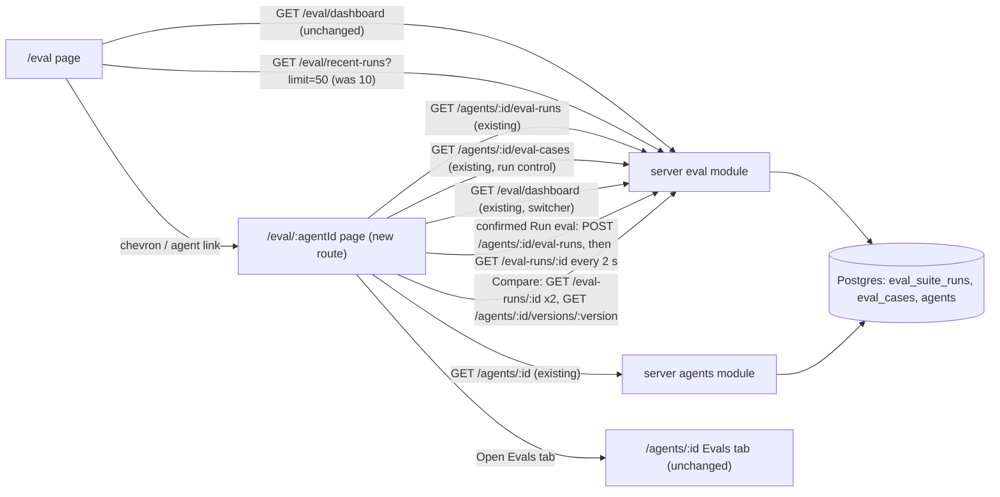

# Spec: Per-agent eval page with metric trend and dashboard sparklines | Spec ID: SPEC-2026-10-16-eval-agent-page-trends | Status: approved
Supersedes: parts of [SPEC-2026-10-15-eval-ui-design-alignment](2026-10-15-eval-ui-design-alignment.md) (Spec E: AC-8 link target, AC-11 agent link target, NFR-2 request list, NG-2 / NG-3 / NG-4, NG-1 on the new page only, NG-7 agent selector only), [SPEC-2026-10-13-eval-dashboard-compare-polish](2026-10-13-eval-dashboard-compare-polish.md) (Spec D: NG-1, NG-3, the `limit=10` request of AC-17) and [SPEC-2026-10-12-eval-run-history-compare](2026-10-12-eval-run-history-compare.md) (Spec B: NG-1, AC-10 link target). See "Amendments to Spec B, D and E". Their bodies are not edited.
Depends on: Spec B, Spec D, Spec E (all approved); [SPEC-2026-10-12-eval-cases-and-scoring](2026-10-12-eval-cases-and-scoring.md) (Spec A: suite statuses, metric definitions).
Modules: client
Approved: free3et (user), 2026-10-16 (OQ-1..3 resolved to their stated defaults)

> Spec F of the Eval Pipeline (index: `specs/eval-pipeline.md`). This is the DevDigest **review agent** eval. It is unrelated to the root `evals/` package. It lives in the top-level `specs/` next to Specs A–E at the user's request, although it touches only `client` (C-1).

## Problem and user

After Spec E the Eval Dashboard looks close to the instructor's mockups (D-1), but the user found two gaps on 2026-10-16 (D-2):

- **No charts.** The dashboard cards have no sparkline, and there is no "Metric trend" anywhere. Specs B, D and E kept charts out of scope (Spec B NG-1, Spec D NG-1, Spec E NG-2 / NG-3).
- **No per-agent page.** An agent card's chevron opens the agent editor's Evals tab (Spec E AC-8). The mockup has a dedicated page under the Eval Dashboard: breadcrumb "Skills Lab › Eval Dashboard › Security Reviewer", an "All agents" back link, three metric cards with sparklines, a 3-line metric trend and the recent-runs table with Compare.

The user is the person tuning a review agent's prompt. They want to open one agent from the dashboard and see at a glance how recall, precision and citation accuracy moved over its runs. From there they want to re-run it and compare two runs, without going through the agent editor. Everything on the new page reads data that already exists. The only paid action is the existing, user-started "Run eval" with its cost confirmation (C-2).

## Goals / Non-goals

- **G-1** A per-agent eval page at `/eval/<agentId>`. It has a breadcrumb under Eval Dashboard, an "All agents" back link, the agent name and model chip, a truthful subtitle, an agent switcher, "Run eval" and a link to the agent's Evals tab.
- **G-2** Three metric cards (Recall / Precision / Citation accuracy). Each has the newest finished value in the percent format, its point delta against the previous finished run, and a sparkline.
- **G-3** A "Metric trend" card: a line chart with three series over the agent's finished runs, oldest to newest. It has a text legend, a hover tooltip and a text alternative for assistive tech.
- **G-4** The agent's recent runs with selection and Compare, the regression banner and "Run eval" on the new page. All three behave exactly as in the Evals tab, because they are the same building blocks, moved to a shared place (C-5).
- **G-5** A recall sparkline on every Eval Dashboard agent card, left of the three big metrics.
- **G-6** The dashboard navigates to the new page: the card chevron and the recent-runs agent link lead to `/eval/<agentId>`. The Evals tab stays reachable and unchanged.
- **G-7** No server, contract, DB or migration change, and no new endpoint. No model call other than the existing user-started "Run eval" (C-2).

- **NG-1** **"Run all agents"** on the dashboard (D-1). One click would start a paid model run for every agent, which multiplies spend. Spec D NG-2 and Spec E NG-5 stay in force. *Possible follow-up* with its own cost confirmation.
- **NG-2** **"Promote vN"** in the compare footer (D-1). It changes the production agent config, which is a write with consequences beyond the eval. Spec D NG-5 and Spec E NG-6 stay in force. *Possible follow-up* as its own spec.
- **NG-3** **The "30 days" range button** (D-1). The history is capped at the 50 newest runs on the server (Spec B NG-5). A date filter over a capped list would silently show fewer days than it claims, and a real range needs a server query parameter, which is a contract change (G-7). The page shows all finished runs of the loaded history instead. See OQ-1.
- **NG-4** A generated banner phrase such as "a new false positive slipped in" (Spec D NG-6, Spec E NG-8). The banner stays as Spec D defines it.
- **NG-5** A model chip on the **dashboard** cards (Spec E NG-1 stays for `/eval`). Only the new page shows the model, because it already reads the agent.
- **NG-6** Case management (list, delete, add) on the new page. It stays in the Evals tab, reached through the link of AC-7.
- **NG-7** Other agent / date selectors or filters on `/eval` itself (Spec D NG-4).
- **NG-8** Charting cost, duration or pass rate. The trend has the three quality metrics only, as in D-1.
- **NG-9** Paging past the 50 newest runs of an agent, or past the 50 newest finished runs of the workspace for the dashboard sparklines (Spec B NG-5, Spec D NG-8).
- **NG-10** Editing the vendored `@devdigest/ui` charts or primitives (D-7). They are used as they are, or not at all.
- **NG-11** Live refresh of `/eval`. It still does not poll (Spec B EC-6, Spec D NG-7).
- **NG-12** Translations other than `en` (Spec E NG-13).

## Amendments to Spec B, D and E

Specs B, D and E stay `approved`, and their bodies are not edited (same rule as Spec D C-8 and Spec E). Where they disagree with this spec, this spec wins for the items below. They win everywhere else.

| Item | Change |
|---|---|
| Spec E AC-8 (card chevron to `/agents/<id>?tab=evals`, name "Open Evals tab of <name>") | **Superseded in target and name.** The chevron leads to `/eval/<agent_id>`, and its accessible name is "Open eval page of <name>" (AC-23). It is still the only link and the only tab stop of the card. |
| Spec E AC-11 / Spec D AC-17 (recent-runs agent link to the Evals tab) | **Superseded in target.** The link leads to `/eval/<agent_id>` (AC-24). The row content and layout are unchanged. |
| Spec D AC-17 / Spec E NFR-2 (`/eval` requests `GET /eval/recent-runs?limit=10`) | **Superseded in request.** `/eval` requests `GET /eval/recent-runs?limit=50` once. The recent section still shows only the first 10 items, in the server's order, and the sparklines read the same response (AC-25, C-9). |
| Spec E AC-7 (card metric blocks) | **Extended.** A recall sparkline sits left of the three blocks (AC-25, AC-26). The blocks themselves are unchanged. |
| Spec B NG-1, Spec D NG-1, Spec E NG-2, NG-3 (no trend chart, no sparklines) | **Lifted** by G-2, G-3 and G-5. |
| Spec D NG-3, Spec E NG-4 (no per-agent dashboard sub-page) | **Lifted** by G-1. |
| Spec E NG-1 (no model chip) | **Lifted on the new page only** (AC-1). It stays for the dashboard cards (NG-5). |
| Spec E NG-7 (no agent / date selectors) | **Lifted for the agent switcher on the new page only** (AC-9). "30 days" stays out (NG-3). |
| Spec B AC-10 (dashboard row links to the Evals tab) | **Superseded in link target** by AC-23. |
| Spec B AC-1…AC-5, Spec D AC-4…AC-16, Spec E AC-16…AC-19 (run control, history, compare, banner) | **Unchanged in behaviour.** They now render on two routes: the Evals tab and the new page (AC-11, AC-12, AC-21, AC-28). |
| Spec B AC-11 (nav item active on any `/eval` path) | **Unchanged.** `/eval/<agentId>` is such a path (AC-5). |
| Spec D NG-2, NG-5 (Run all agents, Promote) | **Kept** (NG-1, NG-2). |

## User stories

- **US-1** As a user on `/eval`, I see a small recall trend on each agent card, and the chevron opens that agent's own eval page.
- **US-2** As a user on an agent's eval page, I read the newest recall, precision and citation accuracy, with how much each moved since the previous run and a sparkline of each.
- **US-3** As a user, I read the metric trend across the agent's finished runs. I hover a point to see its version, time and exact percents. With a screen reader, I get the same data as a table.
- **US-4** As a user, I re-run the agent from this page after the cost confirmation. When the run finishes, the cards, the trend and the runs table show it.
- **US-5** As a user, I tick two runs and compare them in the existing dialog. I switch to another agent with the switcher, or go back to all agents or to the agent's Evals tab.

## Design references

- **D-1** text from user: **"D-mockups-2026-10-15"**, the instructor's design reference, the same source as Spec E D-1, relayed by the main session, seen 2026-10-15 and again 2026-10-16. Mock values (`gpt-4.1`, "20-trace gold set", "5 runs", "82%", "↑ 0.04") are illustrative only (C-3).
  - (1) *Eval Dashboard* agent card: a small **sparkline** (recall trend) left of the three big metrics RECALL / PREC / CITE; a chevron. Top right: "Run all agents".
  - (2) *Per-agent page*:
    - breadcrumb "Skills Lab › Eval Dashboard › Security Reviewer"; a "‹ All agents" back link; the title plus a model chip; the subtitle "Regression harness · 5 runs on the 20-trace gold set";
    - on the right, an agent switcher dropdown ("Security Reviewer ▾"), a "30 days" range button and a primary "Run eval";
    - an amber banner "Precision dipped 2pts on v7 — a new false positive slipped in. Recall and citation both up.";
    - three metric cards RECALL / PRECISION / CITATION ACCURACY, each with a big "82%", a coloured delta "↑ 0.04" and a sparkline in the corner;
    - a "METRIC TREND" card: a 3-line chart (Recall blue / Precision green / Citation orange), y-axis about 0.6–1.0, x = runs, legend top right;
    - "RECENT RUNS · 2 selected" with a Compare button and a table with checkboxes: RAN AT / VERSION / RECALL / PRECISION / CITATION / PASS / COST. Compare opens the compare modal.
  - (3) *Compare modal* footer: Close and "Promote v7".
- **D-2** text from user: feedback of 2026-10-16, relayed by the main session. The dashboard is close to the mockups after Spec E, but (a) there are no charts and (b) the chevron goes to the agent editor's Evals tab instead of a dedicated per-agent page. The user asks to build the page. "Run all agents" and "Promote" stay out, with reasons.
- **D-3** code, current UI, read 2026-10-16:
  - The route `/eval` is `client/src/app/eval/page.tsx:8-15`. Its crumbs are "Skills Lab" and "Eval Dashboard", both without a link. There is no `client/src/app/eval/[agentId]/` folder.
  - Card: `client/src/app/eval/_components/EvalDashboard/AgentCard/AgentCard.tsx:46-92`. The chevron is `:83-89`, to `/agents/${agent_id}?tab=evals`, named by `dashboard.openEvalsFor`.
  - Recent runs: `…/EvalDashboard/RecentRuns/RecentRuns.tsx:21,49` (`RECENT_LIMIT = 10`, `useEvalRecentRuns(10)`).
  - Metric colours: `METRIC_COLOR` is in `…/EvalDashboard/constants.ts:3-7` (recall `--accent`, precision `--ok`, citation `--warn`).
  - Shared metric rendering: `client/src/components/eval-metric/EvalMetric.tsx` (`MetricPercent`, `PointDelta` with `role="img"` and an "up N pt" name, `RanAt`).
  - Evals tab composition: `client/src/app/agents/[id]/_components/AgentEditor/_components/EvalsTab/EvalsTab.tsx:15-33` (`EvalRunControl`, `EvalCasesList`, `RegressionBanner`, `EvalRunHistory`, `EvalCompare`).
    - `EvalRunControl.tsx:14-113`: "Run eval (n)", a cost confirmation `Modal`, progress, adoption of a running suite, notices.
    - `EvalRunHistory.tsx:17-128`: table, selection, "Recent runs · N selected", Compare.
    - `RegressionBanner.tsx:17-50`.
    - `EvalsTab/helpers.ts:4-13`: `isFinished`, `sameCaseSet`, used by the banner, the history and compare.
  - Agent editor crumbs: `client/src/app/agents/[id]/page.tsx:32-36`. Its header shows the model as a mono `Badge` "provider/model" (`:104-106`).
  - Nav: `client/src/components/app-shell/nav.ts:46-60` (key `eval`, `href: "/eval"`). `activeKeyFor` returns `eval` for any path starting with `/eval` (`client/src/components/app-shell/helpers.ts:35`).
  - There is no agent-performance page under `client/src/app` (only the nav key, `helpers.ts:37`). So no app-side chart exists to follow; the only charts are the vendored ones (D-7).
- **D-4** code, hooks and endpoints, read 2026-10-16:
  - `client/src/lib/hooks/eval.ts`:
    - `useAgentEvalRuns`: `GET /agents/:id/eval-runs`, key `["eval-runs", id]`, newest first, at most 50.
    - `useAgentEvalCases`: `GET /agents/:id/eval-cases`.
    - `useEvalRun`: polls every 2 s while `running`. When a poll sees the run leave `running`, it invalidates `["eval-runs", agentId]` and `["eval-dashboard"]`.
    - `useEvalDashboard`: `GET /eval/dashboard`, key `["eval-dashboard"]`.
    - `useEvalRecentRuns(limit)`: key `["eval-dashboard", "recent-runs", limit]`.
  - `client/src/lib/hooks/agents.ts`: `useAgent(id)` is `GET /agents/:id` (`:15-21`) and returns the `Agent` with `name`, `provider`, `model`.
  - Server: every `:id` param is `z.string().uuid()` (`server/src/modules/_shared/schemas.ts:11`), so a non-UUID id answers `422 validation_error`. An unknown or foreign id answers `404` (`server/docs/eval.md:20-34`; `server/src/modules/agents/routes.ts:90`).
- **D-5** contracts (`client/src/vendor/shared/contracts/eval-ci.ts`, read 2026-10-16):
  - `EvalSuiteRun` `:97-124`: `agent_version`, `status`, `ran_at`, `case_ids`, `cases_passed` / `cases_total`, `recall` / `precision` / `citation_accuracy`. The three metrics are nullable, where null = nothing to divide by.
  - `EvalDashboardRow` `:172-189`: `cases_total` ≥ 1, so only agents with cases appear.
  - `EvalRecentRun` `:202`: `EvalSuiteRun` + `agent_name`, finished runs only.
  - The staged, unused `EvalTrendPoint` / `EvalDashboard` `:213-246` have non-nullable metrics and are not used (Spec D C-5).
- **D-6** specs and docs, read 2026-10-16:
  - Spec B (AC-1, AC-4, AC-5, AC-10, AC-11, NG-1, NG-5);
  - Spec D ("Formats", AC-13…AC-17, NG-1…NG-8, C-3, C-5);
  - Spec E (AC-7, AC-8, AC-11, AC-12, AC-16, NFR-1, NFR-2, NG-1…NG-7, C-6);
  - `client/docs/eval-ui.md` (surfaces, hooks table, metric formats, timestamps, shared styles).
- **D-7** code, vendored charts (not editable, NG-10), read 2026-10-16:
  - `recharts` `^2.15.0` is already a dependency (`client/package.json:21`). Outside the vendored folder, the only user is the Showcase page (`client/src/components/showcase/Showcase.tsx:202-203`).
  - The vendored `LineChart` (`client/src/vendor/ui/charts/LineChart.tsx:31-38`) turns a missing value into `0` (`s.data[i] ?? 0`). It defaults to `yMin` 0.6, and has no tooltip, legend, x labels or accessible name. As it is, it cannot meet AC-17 (gaps for null) or AC-18 / AC-19.
  - The vendored `Sparkline` (`…/charts/Sparkline.tsx:4-28`) is inline SVG with no Recharts. It takes `number[]` without nulls and has no accessible name.
  - The vendored `MetricCard` (`…/charts/MetricCard.tsx:21-66`) shows the delta as `toFixed(2)` with an arrow icon, which is the mockup's "↑ 0.04" and not the project's point format (C-7).
- **D-8** curated: `client/INSIGHTS.md`:
  - 2026-10-01: a new i18n section must exist in the namespaces registered in the test renderer; ICU plurals need `t(key, { count })`.
  - 2026-10-06: `mockFetch` answers only 200 / 404, so other statuses are stubbed by hand; `ErrorState` hardcodes "Retry".
  - 2026-09-26: long text in a flex row needs nowrap + ellipsis on both siblings.
  - 2026-09-26: `@testing-library/user-event` is not installed; use `fireEvent`.
- **D-9** decided relocation of shared building blocks (C-5). This is listed here because the user asked the spec to fix it. Current → target:

  | Current (route-private) | Target (shared) |
  |---|---|
  | `client/src/app/agents/[id]/_components/AgentEditor/_components/EvalsTab/EvalRunControl/` | `client/src/components/agent-evals/EvalRunControl/` |
  | `…/EvalsTab/EvalRunHistory/` | `client/src/components/agent-evals/EvalRunHistory/` |
  | `…/EvalsTab/RegressionBanner/` | `client/src/components/agent-evals/RegressionBanner/` |
  | `…/EvalsTab/EvalCompare/` (with `CompareTiles/`, `CompareRunInfo/`, `CompareCasesTable/`, `PromptDiff/`) | `client/src/components/agent-evals/EvalCompare/` |
  | `…/EvalsTab/helpers.ts` (`isFinished`, `sameCaseSet`) + `helpers.test.ts` | `client/src/components/agent-evals/helpers.ts` + test |
  | `client/src/app/eval/_components/EvalDashboard/constants.ts` (`METRIC_COLOR`, `MetricField`) | `client/src/components/eval-metric/constants.ts` (next to `EVAL_CAPTION_STYLE`) |

  Each component keeps its own tests, which move with it. `EvalCasesList` stays in the Evals tab, its only consumer. `EvalsTab` keeps its composition and imports the moved parts. The new page's own parts (header, metric cards, trend) are colocated with the new route.

## Workflow and communication

The metric cards, sparklines, trend, subtitle and banner make no request of their own. They are derived on the client from the one `GET /agents/:id/eval-runs` response. The dashboard sparklines are derived from the one `GET /eval/recent-runs?limit=50` response. The only write is the confirmed `POST`, which already exists (Spec B AC-1).

## Contracts

| Contract | Change | Shape |
|---|---|---|
| `GET /agents/:id` → `Agent` | unchanged | `name`, `provider`, `model` feed the title and the model chip. `404` = not found, `422` = non-UUID id. |
| `GET /agents/:id/eval-runs` → `EvalSuiteRun[]` | unchanged | Newest first, at most 50. It feeds the cards, sparklines, trend, subtitle, banner and runs table. `404` = agent not found. |
| `GET /agents/:id/eval-cases` → `EvalCase[]` | unchanged | It feeds the run control's case count and the "no cases" state. |
| `GET /eval/dashboard` → `EvalDashboardRow[]` | unchanged | The dashboard cards, and the agent switcher's options (agents with ≥ 1 case). |
| `GET /eval/recent-runs?limit=` → `EvalRecentRun[]` | unchanged | Requested with `limit=50` instead of 10. The value is already allowed (1–50, Spec D AC-2). |
| `POST /agents/:id/eval-runs`, `GET /eval-runs/:id`, `GET /agents/:id/versions/:version` | unchanged | Run control and compare, as in Specs B and D. |
| `EvalTrendPoint`, `EvalDashboard` (`@devdigest/shared`) | unchanged | Still unused. Their metrics are non-nullable and cannot express "nothing to divide by" (D-5). |
| DB, server, `@devdigest/shared` | unchanged | No table, column, index, route, schema or migration (G-7). |

## Acceptance criteria (EARS)

Terms:

- "**Finished run**" = a suite run with status `done` or `partial` (Spec B). `running` and `failed` runs are never points, values or deltas on this page.
- "**Loaded history**" = the `GET /agents/:id/eval-runs` response: newest first, at most 50.
- "**Newest**" / "**previous finished run**" = the first and second finished runs of the loaded history (Spec D).
- "**Percent format**", "**point-delta format**", the 6-decimal rounding and the null rules are Spec D's "Formats", unchanged. A delta is computed from stored values. Null is "—" (C-7).
- "**Local time**" is Spec E's (AC-12): `YYYY-MM-DD HH:mm` in the browser's zone, with the UTC instant as tooltip.
- "**Metric colours**" are the existing identity colours: recall = blue (`--accent`), precision = green (`--ok`), citation accuracy = orange (`--warn`). The colour never carries meaning alone (Spec E NFR-1).
- "**Small uppercase caption**" is Spec E's term: uppercase by styling, sentence-case DOM text (Spec E C-6).

**Per-agent page: route and states**

- **AC-1** — WHEN the user opens `/eval/<agentId>` for an existing agent, the page SHALL show a level-1 heading with the agent's `name`, followed by a monospace model chip "<provider>/<model>" from `GET /agents/:id`. The name stays on one line, with an ellipsis when it does not fit and the full name as tooltip.
  - Source: G-1, US-2, D-1 (2), D-3 (editor chip format), C-4, EC-8
  - Verify: component (RTL): `getByRole("heading", { level: 1, name: "Security Reviewer" })`; the chip text "openrouter/gpt-x"; the heading has `title` = name and ellipsis style; an agent named `` renders literally; manual: a 120-character name at 1280 px does not push the right-side controls off the header

- **AC-2** — IF the `agentId` route segment is not a UUID, THEN the page SHALL show the not-found state (title "Agent not found", text "This agent does not exist or was deleted.", and a link "All agents" to `/eval`) without sending any `/agents/…` or `/eval-runs/…` request.
  - Source: G-1, C-3 (decided route rules), D-4 (non-UUID = `422`), EC-1
  - Verify: component (RTL): segment `not-a-uuid` → the not-found texts and the link `href` "/eval"; the fetch stub saw no request whose path contains `not-a-uuid`

- **AC-3** — IF `GET /agents/:id` or `GET /agents/:id/eval-runs` answers `404`, including when the agent is deleted while the page is open, THEN the page SHALL replace its content with the not-found state of AC-2.
  - Source: G-1, C-3, D-4, EC-1, EC-9
  - Verify: component (RTL): `GET /agents/:id` stubbed `404` → not-found state; a page that rendered data, whose `eval-runs` refetch then answers `404` (stubbed by hand, D-8) → not-found state

- **AC-4** — IF `GET /agents/:id` fails with any status other than `404`, or with a network error, THEN the page SHALL show the `@devdigest/ui` error state with a Retry button that re-sends `GET /agents/:id`.
  - Source: G-1, Spec B AC-13 (same pattern), D-8, EC-10
  - Verify: component (RTL): stub `500` by hand → "Retry"; clicking it re-sends `GET /agents/:id`

**Per-agent page: header and navigation**

- **AC-5** — WHILE the page is shown, the breadcrumb SHALL read "Skills Lab › Eval Dashboard › <agent name>", with "Eval Dashboard" linking to `/eval`. The last crumb reads "Agent" until the name has loaded, and also in the not-found state.
  - Source: G-1, D-1 (2), D-3, Spec B AC-11, C-10
  - Verify: component (RTL) with the app shell mocked to print its crumbs (the pattern of the Project Context page test): labels and the `/eval` href; unit (regression guard for Spec B AC-11, already true per D-3): the nav active-key helper maps `/eval/<uuid>` to `eval`

- **AC-6** — WHEN the page renders, it SHALL show, above the title, a link "All agents" with a decorative back chevron, leading to `/eval`.
  - Source: G-1, US-5, D-1 (2)
  - Verify: component (RTL): `getByRole("link", { name: "All agents" })` with `href` "/eval"; the chevron icon has `aria-hidden="true"`

- **AC-7** — WHEN the page renders for an existing agent, its header SHALL show a secondary link "Open Evals tab", with the accessible name "Open Evals tab of <name>", leading to `/agents/<agentId>?tab=evals`.
  - Source: G-6, US-5, C-11, NG-6
  - Verify: component (RTL): link name "Open Evals tab of Security Reviewer" and `href` "/agents/<id>?tab=evals"

- **AC-8** — WHEN the loaded history is available, the subtitle under the title SHALL read:
  - "Regression harness · <N> runs on the <M>-case set" when all N finished runs have the same case set of M cases;
  - "Regression harness · <N> runs on different case sets" when they differ;
  - "Regression harness · no finished runs yet" when N is 0.

  N is the number of finished runs in the loaded history (ICU plural, "1 run"). M is the size of their common `case_ids`.
  - Source: G-1, D-1 (2), C-3, C-12, EC-5, EC-6
  - Verify: component (RTL): 5 finished runs over the same 8 ids → "Regression harness · 5 runs on the 8-case set"; 1 run → "1 run"; two different sets → "on different case sets"; a `running` and a `failed` run are not counted; no "20-trace" or "gold set" text

- **AC-9** — WHEN `GET /eval/dashboard` has loaded, the header SHALL show a native select with the accessible name "Switch agent". Its description is "Opens the selected agent's eval page". It lists every dashboard agent by name, ordered by name case-insensitively, plus the current agent when it is not among them, with the current agent selected.
  - Source: G-1, US-5, D-1 (2) switcher, C-6, EC-7
  - Verify: component (RTL): `getByRole("combobox", { name: "Switch agent" })`; option texts in name order; the current agent's option is selected; an agent with no cases (absent from the dashboard) still appears as the selected option; `aria-describedby` text present

- **AC-10** — WHEN the user picks another agent in the switcher, the client SHALL navigate to `/eval/<that agent_id>`.
  - Source: G-1, US-5, C-6
  - Verify: component (RTL) with the Next.js router mocked: changing the select to agent B → the router navigates to "/eval/<B>"; no non-GET request

- **AC-11** — WHILE the page shows an existing agent, its header SHALL contain the "Run eval (n)" control with the behaviour of Spec B AC-1…AC-3, unchanged:
  - the cost confirmation names n and the last finished run's cost;
  - `POST /agents/:id/eval-runs` is sent only on confirm;
  - "k / n" progress is shown while running, with polling every 2 s;
  - refusal, partial and failed notices are shown.
  - Source: G-4, US-4, D-1 (2) "Run eval", Spec B AC-1…AC-3, C-2, C-5, EC-11
  - Verify: component (RTL): click "Run eval (3)" → the confirmation dialog, no POST; Cancel → no POST; Confirm → exactly one POST; the moved run-control tests (D-9) pass unchanged

- **AC-12** — WHILE the page shows an existing agent, it SHALL show the regression banner of Spec D AC-13…AC-16 and Spec E AC-18, with unchanged text, rules and look, between the header and the metric cards.
  - Source: G-4, D-1 (2) banner, Spec D AC-13…AC-16, NG-4
  - Verify: component (RTL): precision 0.80 → 0.78 → `getByRole("note", { name: "Regression" })` with "Precision dipped 2 pts on v7."; no banner with one finished run; the moved banner tests (D-9) pass unchanged

**Per-agent page: metric cards**

- **AC-13** — WHEN the loaded history holds at least one finished run, the page SHALL show three metric cards in the order Recall, Precision, Citation accuracy. Each card has:
  - a small uppercase caption with the full metric name;
  - the newest finished run's value in the percent format, large (≥ 28 px, bold), in the metric's colour;
  - next to the value, the point delta newest − previous finished run, in the point-delta format with Spec D's accessible names ("up 4 pt"), or "—" when there is no previous finished run or either side is null.

  A null newest value shows "—" and no delta.
  - Source: G-2, US-2, D-1 (2), C-7, EC-2, EC-3
  - Verify: component (RTL): newest 0.82, previous 0.78 → "82%" and `getByRole("img", { name: "up 4 pt" })`; one finished run → "—" delta; null newest precision → "—" and no `img`; captions "Recall", "Precision", "Citation accuracy" in the DOM with `textTransform: uppercase`; no "0.04" or "↑" text

- **AC-14** — WHILE a metric has at least two finished runs with a non-null value in the loaded history, its card SHALL show, in its top-right corner, a sparkline of that metric over those runs, oldest to newest, in the metric's colour. It has `role="img"` and the accessible name "<Metric> trend over <k> runs: from <first%> to <last%>".
  - Source: G-2, US-2, D-1 (2) sparkline in the corner, C-8, EC-2, EC-4
  - Verify: unit: the series helper over a run list (newest-first input → oldest-first points; `running`, `failed` and null-valued runs dropped); component (RTL): `getByRole("img", { name: "Recall trend over 3 runs: from 70% to 82%" })`; with one non-null value, no sparkline `img` for that card

- **AC-15** — IF the loaded history has no finished run, THEN each metric card SHALL show "—" as its value, no delta and no sparkline.
  - Source: G-2, D-1 gap (empty), EC-3
  - Verify: component (RTL): only a `running` run → three "—", no `role="img"` in the cards

**Per-agent page: metric trend**

- **AC-16** — WHEN the loaded history holds at least two finished runs, the "Metric trend" card SHALL show a line chart with three series, Recall, Precision and Citation, in the metric colours. The x axis has one point per finished run, oldest to newest, labelled "v<agent_version>". The y axis is fixed from 0 % to 100 % with ticks at 0, 25, 50, 75 and 100 %. A text legend top right names the three series. Lines are drawn without animation.
  - Source: G-3, US-3, D-1 (2) METRIC TREND, C-8, EC-4, EC-6
  - Verify: unit: the trend-data helper (finished runs only, oldest first, values as percents, null kept as null, labels "v6", "v7"); component (RTL) with a fixed chart size (mock `ResizeObserver` / the responsive container's dimensions): three series paths rendered, legend texts "Recall", "Precision", "Citation"; manual: lines in both light and dark themes use the metric colours, and no animation on load

- **AC-17** — IF a finished run has a null value for a metric, THEN the trend SHALL leave a gap in that metric's line at that run instead of drawing it at 0 or joining its neighbours. A metric that is null in every plotted run SHALL draw no line, and its legend entry SHALL read "<Metric> (no data)".
  - Source: G-3, D-7 (vendored `LineChart` draws null as 0), EC-2
  - Verify: unit: the trend-data helper keeps `null` (not `0`) for that point; component (RTL): all citation values null → legend "Citation (no data)"; the a11y table (AC-18) shows "—" for those cells; manual: the gap is visible

- **AC-18** — WHILE the trend chart is shown, it SHALL expose a text alternative for assistive tech:
  - the chart graphic has `role="img"` with the name "Metric trend over <k> finished runs, oldest to newest", and its SVG content is hidden from assistive tech;
  - a visually hidden table captioned "Metric trend data" has one row per plotted run, with the columns Version, Ran at (local time), Recall, Precision, Citation in the percent format, "—" for null.
  - Source: G-3, US-3, NFR-1, C-8
  - Verify: component (RTL): `getByRole("img", { name: "Metric trend over 3 finished runs, oldest to newest" })`; `getByRole("table", { name: "Metric trend data" })` with 3 body rows in oldest-first order, cells "v6", "78%", "—"; the table uses the visually-hidden pattern

- **AC-19** — WHEN the user hovers or touches a point of the trend, the chart SHALL show a tooltip with "v<version> · <local time>" and the three metrics as "Recall 82%", "Precision 78%" and "Citation 90%" ("—" for null).
  - Source: G-3, US-3, C-8
  - Verify: unit: the per-point tooltip text helper; manual: hover in a browser (Recharts tooltips depend on pointer geometry that jsdom does not compute)

- **AC-20** — IF the loaded history holds fewer than two finished runs, THEN the "Metric trend" card SHALL show no chart and the text:
  - "No finished runs yet." for 0 runs;
  - "The trend needs at least two finished runs." for exactly 1 run.
  - Source: G-3, D-1 gap (0 / 1 points), C-8, EC-3, EC-4
  - Verify: component (RTL): 0 and 1 finished runs → the texts, and no `role="img"` named "Metric trend…"; with 1 run, the a11y table is absent too

**Per-agent page: recent runs and compare**

- **AC-21** — WHEN the page shows an existing agent, it SHALL show, below the trend, the agent's run history with the rules of Spec B AC-4 / AC-5, Spec D AC-20 and Spec E AC-16 / AC-17, unchanged: "Recent runs · N selected", the columns, selection of finished runs only, and Compare enabled only with exactly two. Compare opens the compare dialog of Spec D AC-4…AC-12 and Spec E AC-19.
  - Source: G-4, US-5, D-1 (2) RECENT RUNS + Compare, Spec B AC-4 / AC-5, Spec D AC-4…AC-12, C-5
  - Verify: component (RTL): tick two runs → "Recent runs · 2 selected"; Compare → `getByRole("dialog", { name: "Compare runs · v6 → v7" })`; Close → both still ticked; the moved history and compare tests (D-9) pass unchanged

- **AC-22** — IF the agent exists but `GET /agents/:id/eval-cases` returns no case, THEN the page SHALL show, in place of the metric cards and the trend, the text "This agent has no eval cases yet." with a link "Add cases in the Evals tab" to `/agents/<agentId>?tab=evals`.
  - Source: G-1, D-1 gap (no cases), C-3, EC-3
  - Verify: component (RTL): empty cases and empty runs → the text and link `href`; no metric cards and no trend card; regression guard: "Run eval (0)" is disabled (existing run-control rule, AC-11)

**Eval Dashboard**

- **AC-23** — WHEN a dashboard agent card renders, its chevron link SHALL lead to `/eval/<agent_id>` with the accessible name "Open eval page of <agent_name>". It stays the card's only link and tab stop.
  - Source: G-6, US-1, D-1 (1), D-2 (b), Spec E AC-8 (superseded in target), C-10
  - Verify: component (RTL): `within(card).getAllByRole("link")` has length 1; name "Open eval page of Zed"; `href` "/eval/z1"; no element links to `?tab=evals` inside the card

- **AC-24** — WHEN a recent-runs row renders on `/eval`, its agent name link SHALL lead to `/eval/<agent_id>`. Its name and tooltip are unchanged.
  - Source: G-6, Spec E AC-11 (superseded in target), C-10
  - Verify: component (RTL): the row link `href` "/eval/<id>"

- **AC-25** — WHEN the user opens `/eval`, the page SHALL send exactly one `GET /eval/recent-runs?limit=50`. The recent section SHALL show only the first 10 of its items, in the server's order.
  - Source: G-5, G-7, C-9, Spec D AC-17 (superseded in request), Spec E NFR-2
  - Verify: component (RTL): the fetch stub records `/eval/dashboard` and `/eval/recent-runs?limit=50` once each and nothing else; with 14 items → 10 rows, items 1–10

- **AC-26** — WHILE the recent-runs response holds at least two items of an agent with a non-null recall, that agent's card SHALL show, left of its three metric blocks, a recall sparkline in the recall colour over those items, oldest to newest, with `role="img"` and the name "Recall trend over <k> runs: from <first%> to <last%>". It is not focusable.
  - Source: G-5, US-1, D-1 (1), C-9, EC-12, EC-13
  - Verify: unit: grouping the recent items per agent, oldest first, null recall dropped; component (RTL): agent with 3 items → `getByRole("img", { name: "Recall trend over 3 runs: from 70% to 82%" })` inside its card; `within(card).getAllByRole("link")` still has length 1

- **AC-27** — IF the recent-runs response holds fewer than two items with a non-null recall for an agent, or that response is loading or failed, THEN that agent's card SHALL show no sparkline, and its other content and layout width SHALL stay as without the sparkline area.
  - Source: G-5, C-9, EC-12, EC-13, EC-14
  - Verify: component (RTL): agent with 1 item → no sparkline `img` in its card; recent `500` (stubbed by hand) → cards render with no sparkline and the recent section shows "Retry"; manual: the metric blocks of all cards stay aligned with and without a sparkline

**Shared building blocks (regression guard)**

- **AC-28** — WHEN the user opens an agent's Evals tab (`/agents/<id>?tab=evals`), it SHALL behave exactly as before this spec: the same run control, case list, banner, history and compare dialog, with the same texts, the same requests and the same states.
  - Source: G-4, G-6, C-5, D-9
  - Verify: component (RTL): the existing Evals tab test and every moved component test (D-9) pass with only their import paths changed (no assertion edited); `cd client && pnpm typecheck`

## Edge cases

- **EC-1** Unknown, non-UUID or deleted agent id in the URL → not-found state. A non-UUID id sends no request, because the server would answer `422` and a crafted segment must not reach an API path → AC-2, AC-3, NFR-3.
- **EC-2** Null metrics. A null newest value shows "—" in its card. A null in the trend is a gap. A metric that is null everywhere shows "(no data)" in the legend. Sparklines skip null values → AC-13, AC-14, AC-17.
- **EC-3** States of the agent:
  - no cases → AC-22;
  - cases but no finished run → "—" cards (AC-15), "No finished runs yet." (AC-20), the history's existing empty text (Spec B AC-4);
  - only `running` / `failed` runs → the same as no finished run.
- **EC-4** Exactly one finished run → values with "—" deltas, no sparklines, the trend note "needs at least two" (AC-13, AC-14, AC-20).
- **EC-5** Partial and failed runs. `partial` is finished: it counts as a point, a value and a delta, as in the banner (Spec D EC-4). `failed` and `running` are excluded everywhere on the page except the runs table, which lists them with their status (AC-8, AC-13, AC-16, AC-21).
- **EC-6** Different case sets across runs. The subtitle says "on different case sets" (AC-8). The trend still plots each run's stored metrics, as compare and the banner do (Spec B NG-4); the subtitle is the warning. Compare keeps its own notice (Spec D AC-8).
- **EC-7** The switcher when `GET /eval/dashboard` is loading or failed → the select is not rendered, and the rest of the page is unaffected. An agent without cases is still listed as the current option (AC-9).
- **EC-8** Long names (agent name in the title, crumb, switcher, dashboard card) → one line with an ellipsis and the full text as tooltip. They never push "Run eval" or the switcher out of the header (AC-1; Spec E AC-9 for cards).
- **EC-9** The agent is deleted while the page is open → the next refetch (window focus, or the end of a run) answers `404` → not-found state (AC-3). A "Run eval" started meanwhile is refused with the existing `not_found` text (Spec B AC-3).
- **EC-10** `GET /agents/:id/eval-runs` fails with a status other than `404` → the history shows its existing error state with Retry (Spec B AC-13). The cards and the trend then show their "no finished run" state, and no banner (Spec D AC-16) → AC-15, AC-20, AC-21.
- **EC-11** A suite is `running` when the page opens or after a confirmed start → the control shows "k / n" (AC-11), and the runs table lists it as `running`. The cards and the trend ignore it until it finishes. Then the existing invalidation of `["eval-runs", agentId]` refetches the history, and the new point appears (D-4) → AC-11, AC-16.
- **EC-12** On the dashboard, the 50 newest finished runs of the whole workspace can all belong to a few agents. An agent whose runs are older than those 50 gets fewer than two points and no sparkline, even if it has many runs. This is accepted to avoid one request per agent (C-9) → AC-26, AC-27.
- **EC-13** Different numbers of points: card sparklines use whatever an agent has among the 50 items, from 2 up to 50 → AC-26.
- **EC-14** The recent-runs request fails on `/eval` → no sparklines, the cards are unaffected, and the recent section shows its error state (Spec D AC-19) → AC-27.
- **EC-15** Many runs. At most 50 points in the trend and the page sparklines (the history cap). No paging (NG-9) → AC-16.
- **EC-16** Two runs share a version (re-run without a prompt change) → the x labels repeat "v7". The tooltip and the a11y table tell them apart by local time → AC-18, AC-19.
- **EC-17** Agent names with markup → rendered literally in the title, crumb, switcher options and sparkline names → AC-1, NFR-3.

## Non-functional requirements

| ID | Category | Requirement (measurable) | Verify |
|---|---|---|---|
| NFR-1 | accessibility (WCAG 2.2 AA) | **Text alternative (1.1.1):** the trend has a `role="img"` summary and a visually hidden data table (AC-18). Each sparkline has a `role="img"` name with its range (AC-14, AC-26). **No colour alone (1.4.1):** series are named in a text legend, and cards in captions; the delta direction is in its glyph and its accessible name. **Contrast (1.4.11):** each line is ≥ 2 px and ≥ 3:1 against the card background in light and dark themes. **Keyboard:** the back link, "Open Evals tab", the switcher, "Run eval" and the runs table controls are reachable in DOM order with visible focus; the chart and sparklines are not tab stops. **On input (3.2.2):** the switcher's description announces that choosing opens another page (AC-9). **Motion (2.3.3):** no chart animation. | component (RTL): role / name queries of AC-6…AC-27; manual: contrast of the three line colours in both themes with a checker; keyboard pass over `/eval/<id>` |
| NFR-2 | performance / requests | No new endpoint. `/eval` sends exactly `GET /eval/dashboard` and `GET /eval/recent-runs?limit=50` (AC-25). On load, `/eval/<id>` sends exactly `GET /agents/:id`, `GET /agents/:id/eval-runs`, `GET /agents/:id/eval-cases` and `GET /eval/dashboard`, each once. Other requests come only from user actions (Run eval, Compare) and from the existing 2 s polling while a run is `running`. Cards, sparklines, the trend, the subtitle and the banner add no request. | component (RTL): the fetch stub records exactly those URLs on each page |
| NFR-3 | security | The `agentId` segment is used in a request path only after it matches the UUID pattern (AC-2). Agent names, provider / model strings, case names and prompt text render as plain text through React escaping, including in tooltips, `aria-label`s and option texts. No `dangerouslySetInnerHTML`. | component (RTL): `<script>` names render literally (AC-1, EC-17); `../../x` as the segment sends no request |
| NFR-4 | cost | Zero model calls from viewing, switching, hovering or comparing. The only paid action is the confirmed "Run eval", unchanged (Spec B AC-1). | component (RTL): no `POST` in any test except the confirmed run of AC-11 |
| NFR-5 | bundle size | `recharts` is already a dependency (D-7). No new package is added. The `/eval` route does not load Recharts: its sparklines are plain SVG. Its "First Load JS" in `pnpm build` grows by ≤ 5 kB. The chart code is loaded only by `/eval/<agentId>`. | manual: compare `pnpm build` route sizes before and after; `package.json` dependencies unchanged |
| NFR-6 | i18n | Every new visible string, tooltip and accessible name is a key in the `eval` namespace, camelCase and nested by section: `agentPage.*` (back link, Evals-tab link, subtitle variants with ICU plurals, switcher name and description, not-found texts, no-cases text and link, crumb placeholder); `agentPage.cards.*`; `agentPage.trend.*` (title, legend, "(no data)", empty and one-run texts, chart summary, table caption and columns, tooltip); `metricFormat.sparklineName`; `dashboard.openEvalPageFor`. The staged `dashboard.metricTrend` and `dashboard.legend.*` keys may be reused, after a grep for call sites (D-8). | component (RTL): no missing-message errors (the `eval` namespace is already registered in the test renderer) |
| NFR-7 | verification | All AC run in `cd client && pnpm test`. `pnpm typecheck` and `pnpm build` pass. No server test changes. | manual: run all three |

Not relevant: reliability beyond the stated states (read-only views over stored rows; failure states in AC-3, AC-4, AC-27, EC-7, EC-10); observability (no new server-side processing). No §7a LLM checklist: there is no `[new: LLM call]`, and "Run eval" is the existing Spec A / B suite run.

## Inputs and provenance

| Input | Tag |
|---|---|
| Agent name, provider, model (`GET /agents/:id`) | `[reused: agents]` |
| Suite runs of the agent (`GET /agents/:id/eval-runs`) | `[reused: Spec A eval_suite_runs]` via Spec B history |
| Case count (`GET /agents/:id/eval-cases`) | `[reused: Spec A eval cases]` |
| Switcher options (`GET /eval/dashboard`) | `[reused: Spec B dashboard]` |
| Dashboard sparkline points (`GET /eval/recent-runs?limit=50`) | `[reused: Spec D recent runs]` + `[deterministic: client]` grouping per agent |
| Card values, point deltas, sparkline series, trend series, subtitle counts, case-set check | `[deterministic: client]` over the run list (Spec D "Formats") |
| Banner sentences | `[reused: Spec D banner]` `[deterministic: client]` |
| Local times and UTC tooltips | `[deterministic: client]` (Spec E AC-12) |
| Suite run on "Run eval" | `[reused: Spec A/B suite run]`: existing user-started, cost-confirmed model calls, not new |
| Moved components and their current locations | D-9 |

No `[new: LLM call]` in this spec.

## Untrusted inputs

- **D-1 mockups** (instructor's design, relayed as text): layout and wording reference only. Mock values (`gpt-4.1`, "20-trace gold set", "5 runs", "↑ 0.04") are never copied into the UI (C-3). No instructions in them were followed.
- **URL segment `agentId`**: user-controlled. It is checked against the UUID pattern before it is put into any request path (AC-2, NFR-3).
- **Agent names** (user-authored), **provider / model strings**, **case names** (from LLM-written finding titles) and **system prompt text** (compare diff): plain text via React escaping, truncated by ellipsis, never interpreted (NFR-3).
- No untrusted text reaches a model through this spec.

## Traceability

| Source | Covered by |
|---|---|
| G-1 | AC-1, AC-2, AC-3, AC-4, AC-5, AC-6, AC-8, AC-9, AC-10, AC-22 |
| G-2 | AC-13, AC-14, AC-15 |
| G-3 | AC-16, AC-17, AC-18, AC-19, AC-20 |
| G-4 | AC-11, AC-12, AC-21, AC-28 |
| G-5 | AC-25, AC-26, AC-27 |
| G-6 | AC-7, AC-23, AC-24, AC-28 |
| G-7 | NFR-2, NFR-4, NFR-5, Contracts |
| US-1 | AC-23, AC-26 |
| US-2 | AC-1, AC-13, AC-14 |
| US-3 | AC-16, AC-18, AC-19 |
| US-4 | AC-11, EC-11 |
| US-5 | AC-6, AC-7, AC-9, AC-10, AC-21 |
| D-1 (1) sparkline on card | AC-26, AC-27 |
| D-1 (1) chevron | AC-23 |
| D-1 (1) "Run all agents" | NG-1 |
| D-1 (2) breadcrumb | AC-5 |
| D-1 (2) "‹ All agents" | AC-6 |
| D-1 (2) title + model chip | AC-1 |
| D-1 (2) subtitle "N runs on the …-trace gold set" | AC-8 |
| D-1 (2) agent switcher | AC-9, AC-10 |
| D-1 (2) "30 days" | NG-3, OQ-1 |
| D-1 (2) "Run eval" | AC-11 |
| D-1 (2) amber banner | AC-12; generated phrase NG-4 |
| D-1 (2) three metric cards, "82%" + delta + sparkline | AC-13, AC-14 |
| D-1 (2) delta "↑ 0.04" | AC-13 (project's point format, C-7) |
| D-1 (2) METRIC TREND, 3 lines, legend, y 0.6–1.0 | AC-16 (y 0–100 %, C-8), AC-17 |
| D-1 (2) RECENT RUNS + Compare + columns | AC-21 |
| D-1 (3) "Promote v7" | NG-2 |
| D-2 (a) no charts | AC-14, AC-16, AC-26 |
| D-2 (b) chevron goes to Evals tab | AC-23, AC-24 |
| D-3 Evals tab must stay reachable | AC-7, AC-28 |
| D-7 vendored LineChart draws null as 0 | AC-17 |
| D-9 relocation | AC-28, C-5 |
| Design gap: loading / error / not-found states | AC-2, AC-3, AC-4, EC-7, EC-10 |
| Design gap: no cases / no finished runs / one run | AC-15, AC-20, AC-22 |
| Design gap: null points | AC-17 |
| Design gap: chart for screen readers | AC-18, NFR-1 |
| Design gap: tooltip content | AC-19 |
| Design gap: switcher context change (3.2.2) | AC-9, NFR-1 |
| Design gap: long names | AC-1, EC-8 |
| Design gap: different case sets | AC-8, EC-6 |
| Design gap: light / dark, reduced motion | AC-16, NFR-1 |
| Spec B / D / E amendments | "Amendments to Spec B, D and E"; AC-23, AC-24, AC-25, AC-26 |
| EC-1 | AC-2, AC-3, NFR-3 |
| EC-2 | AC-13, AC-14, AC-17 |
| EC-3 | AC-15, AC-20, AC-22 |
| EC-4 | AC-13, AC-14, AC-20 |
| EC-5 | AC-8, AC-13, AC-16, AC-21 |
| EC-6 | AC-8 |
| EC-7 | AC-9 |
| EC-8 | AC-1 |
| EC-9 | AC-3 |
| EC-10 | AC-4, AC-15, AC-20, AC-21 |
| EC-11 | AC-11, AC-16 |
| EC-12 | AC-26, AC-27 |
| EC-13 | AC-26 |
| EC-14 | AC-27 |
| EC-15 | AC-16, NG-9 |
| EC-16 | AC-18, AC-19 |
| EC-17 | AC-1, NFR-3 |
| OQ-1 | NG-3 (default applied) |
| OQ-2 | AC-25, AC-26 (default applied) |
| OQ-3 | C-13 (default applied) |

## Clarifications

All dated 2026-10-16. The source is the user's feedback (D-2), relayed by the main session. The user asked spec-creator to decide the details below and give each a default. The user will approve or revert them. "spec-creator decided" marks those.

- **C-1** Where the spec lives → `specs/2026-10-16-eval-agent-page-trends.md`, next to Specs A–E, plus one line in `specs/eval-pipeline.md` (user instruction). §2 would put a client-only spec in `client/specs/`; the user's path wins, to keep the Eval Pipeline set together (as Spec E C-1).
- **C-2** Scope → a dedicated per-agent page under the Eval Dashboard, charts (card sparklines, metric cards with sparklines, a 3-line trend), and the dashboard linking to the page. Everything is read-only except the existing "Run eval" with its cost confirmation and polling. No server, contract or migration change unless proven unavoidable; none was needed. No LLM beyond "Run eval" (user).
- **C-3** Route and states → `/eval/<agentId>` under the existing `eval` route folder (user default). Decided by spec-creator:
  - a non-UUID segment shows "Agent not found" without a request;
  - `404` from `GET /agents/:id` or `GET /agents/:id/eval-runs` (unknown or deleted) shows the same state;
  - other failures show `ErrorState` with Retry;
  - an agent with no cases shows a "no eval cases yet" state with a link to its Evals tab;
  - an agent without finished runs shows "—" cards and a trend empty text.

  Mock values are illustrative (user).
- **C-4** Model chip on the new page → shown as "<provider>/<model>" from `GET /agents/:id`, the same format as the agent editor header (D-3). The page needs that request anyway for the name and to detect a missing agent, so the chip costs no extra request. The mockup shows the model only ("gpt-4.1"); the consistency of one entity across screens wins. Dashboard cards keep no chip (NG-5) (spec-creator decided).
- **C-5** Reuse vs move → the run control, the run history, the regression banner, the compare dialog (with its subparts) and the helpers they share (finished-run and same-case-set checks) are **moved** out of the agent editor's Evals tab folder into one shared component folder, because two routes now use them. The frontend architecture says a component used by ≥ 2 routes is promoted to the shared components folder, and a route never imports another route's private components. The metric colour map moves next to the shared caption style in the shared eval-metric folder, because `/eval` and `/eval/<agentId>` are different routes. The exact map is D-9. Behaviour, texts and tests stay as they are; only import paths change (AC-28). Rejected:
  - (a) importing the agent editor's private components in the new route, a cross-route import;
  - (b) copies, which drift (spec-creator decided; user asked to specify exactly).
- **C-6** Agent switcher → a native `<select>` that navigates to `/eval/<otherAgentId>` on change (user default). Decided by spec-creator:
  - the options are the agents of `GET /eval/dashboard` (agents with ≥ 1 case), ordered by name, so the switcher offers exactly the dashboard's agents;
  - the current agent is added when it is absent;
  - the description "Opens the selected agent's eval page" warns of the context change (WCAG 3.2.2).

  Rejected: the vendored `Dropdown` (a button menu), which needs its own keyboard model; `GET /agents`, which would list agents with nothing to show.
- **C-7** Metric card format → whole percents and Spec D's point delta "▲ 4 pt" / "▼ 2 pt" / "0 pt" / "—", **not** the mockup's "↑ 0.04". Every eval screen uses the point format since Spec D C-9, and the vendored `MetricCard`'s `toFixed(2)` delta would bring the two-decimal form back (D-7). The delta is newest − previous finished run, as in the banner and the dashboard (spec-creator decided; user default).
- **C-8** Trend chart → Recharts (already a dependency), three series in `METRIC_COLOR`, as follows:
  - the x axis has one point per finished run of the loaded history, oldest to newest, labelled "v<version>";
  - the y axis is fixed 0–100 % rather than the mockup's 0.6–1.0, because a zoomed axis would clip values under 60 % and exaggerate small moves;
  - null values make gaps;
  - 0 runs show an empty text, and 1 run shows a "needs at least two" text instead of a one-dot chart;
  - the legend is text;
  - a `role="img"` summary and a visually hidden table are the text alternative;
  - there is no animation, and theme tokens are used.

  The vendored `LineChart` cannot be used as it is: it draws null as 0 and has no tooltip, legend or name (D-7, NG-10). Test approach: the series data comes from a pure helper that is unit-tested; the component test fixes the chart's size, because `ResponsiveContainer` measures 0 × 0 in jsdom; the tooltip is unit-tested through its text helper and checked manually (spec-creator decided).
- **C-9** Dashboard sparkline data → reuse `GET /eval/recent-runs` with `limit=50` (the maximum the endpoint already allows), requested **once**. The recent section shows its first 10 items, so the dashboard still sends two requests (AC-25). Points are an agent's finished runs among those 50 with a non-null recall, oldest to newest. Fewer than 2 points means no sparkline. Limit: an agent whose runs are older than the workspace's 50 newest shows no sparkline (EC-12). Rejected:
  - (a) one `GET /agents/:id/eval-runs` per agent, which is N extra requests;
  - (b) a new trend endpoint or a field on `EvalDashboardRow`, which is a contract change against C-2 (spec-creator decided; see OQ-2).
- **C-10** Dashboard links → the card chevron leads to `/eval/<agentId>`, renamed "Open eval page of <name>" (amends Spec E AC-8). The recent-runs agent link also leads there (amends Spec E AC-11), so the same agent link means the same thing on both sections of `/eval`. The Evals tab stays reachable from the new page (AC-7) and from the agent editor, unchanged. Breadcrumb "Skills Lab › Eval Dashboard › <name>", with "Eval Dashboard" linking to `/eval`. The nav item "Eval Dashboard" stays active, which is already true for any `/eval` path (D-3) (user default; spec-creator decided the link name and the recent-runs link).
- **C-11** Link back to the editor → a secondary header link "Open Evals tab", named "Open Evals tab of <name>", reusing the dashboard's old accessible-name wording. "Edit agent" was rejected as the label because the link opens the Evals tab, not the Config tab (spec-creator decided).
- **C-12** Subtitle → "Regression harness · N runs on the M-case set" only when all finished runs in the loaded history share one case set; otherwise "… on different case sets"; with none, "… no finished runs yet". N counts finished runs of the loaded history, at most 50. This mirrors Spec E C-14, a truthful subtitle instead of the mockup's fixed "20-trace gold set" (spec-creator decided).
- **C-13** Size → 28 AC in one module, above the ~12-AC threshold. Kept as one spec by default: one module, one data flow, and the dashboard part (AC-23…AC-27) only links to and summarises the page part. The alternative split is in OQ-3 (spec-creator decided; user may override).

## Open questions

- **OQ-1** [NEEDS CLARIFICATION: The mockup's "30 days" button. Options: (a) **omit** it (default, NG-3), because the history is capped at 50 runs and a true range needs a server query parameter; (b) a client-side filter "Last 30 days / All loaded runs" over the loaded history, labelled so it never claims more than the loaded 50 rows. Default: **(a) omit**.]
- **OQ-2** [NEEDS CLARIFICATION: Dashboard sparklines from one `GET /eval/recent-runs?limit=50` response (default, C-9). This means an agent whose runs are older than the workspace's 50 newest shows no sparkline (EC-12), and `/eval` fetches up to 50 runs instead of 10. Alternative: a follow-up spec that adds a per-agent trend field to `EvalDashboardRow` (contract + server change). Default: **accept the limit**.]
- **OQ-3** [NEEDS CLARIFICATION: Split the 28 AC into F1 "per-agent page" (AC-1…AC-22, AC-28) and F2 "dashboard sparklines and links" (AC-23…AC-27)? Default: **keep one spec** (C-13).]
