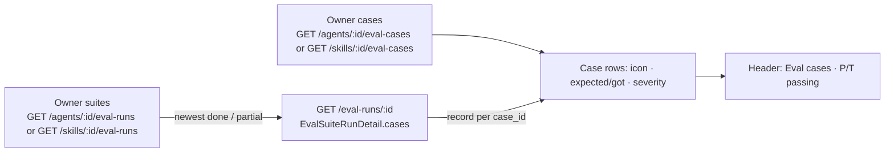

# Spec: Eval case rows show their last result (agent and skill Evals tabs) | Spec ID: SPEC-2026-10-17-eval-case-row-status | Status: implemented
Supersedes: amends the presentation of [SPEC-2026-10-15-eval-ui-design-alignment](2026-10-15-eval-ui-design-alignment.md) AC-15 (second line of a case row) and the label of the run control of [SPEC-2026-10-12-eval-run-history-compare](2026-10-12-eval-run-history-compare.md) AC-1 ("Run eval (n)"); both keep their text, the amendment lives here and in `specs/eval-pipeline.md`.
Modules: client
Approved: 2026-10-17 (user)

> Spec G3 of three. Depends on [G1](2026-10-17-skill-evals-server.md) (skill suites) and [G2](2026-10-17-skill-evals-client.md) (the skill Evals tab), and changes the shared case list used by both the agent and the skill Evals tab. No server, contract or model-call change.

## Problem and user

The case list says what each case expects but not how it did: the user must open the run history and the newest suite to learn which cases fail. The reference Evals screen (D-1) shows the result on every row and a pass count in the list header. The user wants that on both the agent and the skill tab (G1 C-7).

## Goals / Non-goals

- **G-1** The case list header shows how many current cases passed in the newest finished suite, next to "Run all evals" and "New eval case".
- **G-2** Every case row shows its result in that suite (passed, failed, errored, never run) by icon and text, with "expected … got …".
- **G-3** Every case row shows what it asserts on the right: "<SEVERITY> · <category>" or "assert empty".
- **G-4** Per-row Run / Edit / Delete become icon buttons, keeping their accessible names.
- **G-5** The same behaviour on the agent and the skill Evals tab.

- **NG-1** Storing per-case Run results; a per-case Run does not change a row's status (G1 C-8).
- **NG-2** Any server or contract change, including a server-computed `matched_count`.
- **NG-3** Per-case history (results of older suites) on the row.
- **NG-4** Sorting or filtering cases by result.
- **NG-5** Changing the dashboard, run history, compare or the agent eval page.

## User stories

- **US-1** As a user on an Evals tab, I see at a glance "Eval cases · 17/20 passing" and which rows fail.
- **US-2** As a user, I read on a failing row "expected 1 finding, got 0" without opening the run.
- **US-3** As a user, I see on the right of each row whether it asserts a "CRITICAL · security" finding or an empty result.

## Design references

- **D-1** text from user, relayed by the main session, 2026-10-17 (screenshot described in text; image not available to the spec author): header "Eval cases · 17/20 passing"; buttons "Run all evals" and "New eval case"; rows with a status icon (green check passed, red x failed, small dot never run), monospace case name, MUST FIND / MUST NOT FLAG badge, second line "expected 1 finding, got 1" or "never run", right side "CRITICAL · security" or "assert empty", then Run / Edit / Delete icon buttons.
- **D-2** code — current row: `client/src/app/agents/[id]/_components/AgentEditor/_components/EvalsTab/EvalCasesList/EvalCasesList.tsx:53-137` (badge, name, text buttons Run / Edit / Delete, `file:line` second line, inline per-case Run result) and the separate run control `client/src/components/agent-evals/EvalRunControl/EvalRunControl.tsx:66-111` ("Run eval (n)" with confirm and progress).
- **D-3** code — data available without a contract change: `EvalSuiteRun` list per owner (`GET /agents/:id/eval-runs`, G1 `GET /skills/:id/eval-runs`) and `GET /eval-runs/:id` → `EvalSuiteRunDetail.cases[]`, each `EvalRunRecord` with `case_id`, `outcome`, `pass`, `actual_output.kept` (findings with `file`, lines) and `error` (`server/src/vendor/shared/contracts/eval-ci.ts:57-130`); `EvalCase.expected_output` `kind`, `file`, `start_line`, `end_line`, `severity`, `category` (`knowledge.ts:83-137`).
- **D-4** spec — Spec A Scoring rules "Match": same file (exact string) and intersecting closed line ranges, tolerance 0 (`specs/2026-10-12-eval-cases-and-scoring.md:131-138`); dashboard "latest" = newest `done` / `partial` suite (`server/docs/eval.md:297-298`).
- **D-5** i18n — existing keys `evalsTab.neverRun`, `evalsTab.passed`, `evalsTab.failed`, `evalsTab.runCaseName`, `evalsTab.editCaseName`, `evalsTab.deleteCase` (`client/messages/en/eval.json:178-245`).

## Workflow and communication

## Contracts

n/a — no contract change; reads only the existing responses listed in D-3 (NG-2).

## Acceptance criteria (EARS)

Terms. **Reference suite**: the owner's newest suite with status `done` or `partial` (as the dashboard's `latest`, D-4). **Record**: the reference suite's `EvalRunRecord` whose `case_id` equals the row's case. **got N**: the number of findings in the record's `actual_output.kept` that match the case's expectation by Spec A's Match rule (D-4, G1 C-10).

- **AC-1** — WHILE the owner has a reference suite, the case-list heading SHALL read "Eval cases · 
/<T> passing", where T is the number of current cases and P the number of current cases whose record has `outcome: passed`; WHILE it has none, the heading SHALL read "Eval cases".
  - Source: G-1, US-1, D-1, D-3, OQ-2
  - Verify: component (RTL) — 20 cases, record passed for 17 → "Eval cases · 17/20 passing"; a case added after the suite counts in T only; no finished suite → "Eval cases"

- **AC-2** — The case-list heading row SHALL hold, after the heading, a "Run all evals" button and the "New eval case" button; "Run all evals" SHALL keep the confirmation, progress, refusal and notice behaviour of the run control (Spec B AC-1…AC-3, G2 AC-8 on the skill tab), which no longer renders separately as "Run eval (n)".
  - Source: G-1, D-1, D-2
  - Verify: component (RTL) — buttons by name in that order; click opens the existing confirm with the case count; no "Run eval (" text on either tab

- **AC-3** — WHEN a row is rendered, it SHALL start with a status icon: a check named "Passed" for `outcome: passed`, a cross named "Failed" for `failed`, a warning sign named "Errored" for `error`, and a small dot named "Never run" when the case has no record.
  - Source: G-2, US-1, D-1, pass-1 gap G4 (not colour alone)
  - Verify: component (RTL) — `getByRole("img", { name: "Passed" })` etc. for four fixtures; icons differ in shape, not only colour

- **AC-4** — WHEN a row has a record that is not `error`, its second line SHALL read "expected 1 finding, got <N>" for `must_find` or "expected 0 findings, got <N>" for `must_not_flag`, followed by " · <file>:<start_line>".
  - Source: G-2, US-2, D-1, D-4, G1 C-10
  - Verify: component (RTL) — kept findings: one intersecting, one other file → "got 1"; plural forms for 0 and 2; unit — the match helper on boundary lines (touching ranges match, adjacent do not)

- **AC-5** — WHEN a row has no record, its second line SHALL read "never run · <file>:<start_line>", and WHEN its record is `error`, "errored · <file>:<start_line>" with the record's `error` text as the tooltip.
  - Source: G-2, D-1, EC-2, EC-3
  - Verify: component (RTL) — both texts; tooltip carries the error

- **AC-6** — WHEN a row is rendered, its right side SHALL read "<SEVERITY> · <category>" for `must_find` (severity upper-cased; an empty part and its separator omitted; nothing when both are empty) and "assert empty" for `must_not_flag`.
  - Source: G-3, US-3, D-1, D-3, EC-4
  - Verify: component (RTL) — "CRITICAL · security"; only category → "security"; `must_not_flag` → "assert empty"

- **AC-7** — The per-row Run, Edit and Delete controls SHALL be icon-only buttons (play, pencil, bin) with the accessible names "Run eval case “<name>”", "Edit eval case “<name>”" and "Delete eval case “<name>”" and the same behaviour as before (D-2, G2 AC-7).
  - Source: G-4, D-1, D-5, pass-1 gap G4
  - Verify: component (RTL) — buttons by those names have no visible text; click behaviour unchanged (existing tests)

- **AC-8** — WHEN a suite of the owner finishes while the tab is open, the heading count and every row status SHALL reflect the new reference suite without a page reload, and a per-case Run SHALL NOT change any row's status or the heading count.
  - Source: G-1, G-2, G1 C-8, EC-5
  - Verify: component (RTL) — tracked run moves to `done` → heading and icons update; a per-case Run result appears inline, icons unchanged

- **AC-9** — IF the owner's suite list or the reference suite detail fails to load or is still loading, THEN the case list SHALL still render every row with its badge, name, right side and controls, show no status icon and only "<file>:<start_line>" on the second line, and show the heading "Eval cases".
  - Source: G-2, pass-1 gap G3 (states), EC-6
  - Verify: component (RTL) — stubbed `500` on `GET /eval-runs/:id` → rows present without icons; heading without count

- **AC-10** — The agent Evals tab and the skill Evals tab SHALL show AC-1…AC-9 identically, each from its own owner's cases and suites.
  - Source: G-5, G1 C-7
  - Verify: component (RTL) — the same fixture rendered under an agent owner and a skill owner gives the same heading and rows; the requests go to the owner's routes

## Edge cases

- **EC-1** A case was added after the reference suite → "never run", counted in T only → AC-1, AC-5.
- **EC-2** A case of the reference suite was deleted → its record is ignored (rows come from current cases) → AC-1.
- **EC-3** The record errored → "Errored" icon and "errored" text → AC-3, AC-5.
- **EC-4** An expectation with empty severity or category (hand-written case) → AC-6.
- **EC-5** A suite is `running` → rows keep the previous reference suite until it finishes → AC-8.
- **EC-6** The detail request fails → AC-9.
- **EC-7** The expectation was edited after the reference suite: the icon comes from the stored `outcome`, "got N" is matched against the current expectation, so they can disagree → [NEEDS CLARIFICATION: OQ-1].
- **EC-8** Only `failed` suites exist (e.g. no provider key) → no reference suite → "Eval cases", "never run" rows → AC-1, AC-5.
- **EC-9** 100 cases → all rows, no pagination (Spec A NG-7) → NFR-2.

## Non-functional requirements

| ID | Category | Requirement (measurable) | Verify |
|---|---|---|---|
| NFR-1 | accessibility | Status icons have accessible names and differ in shape; icon buttons are keyboard-reachable with visible focus; the right-side and second-line texts are text, never colour alone (WCAG 2.2 AA). | component (RTL role / name queries) |
| NFR-2 | performance | The list adds at most one request beyond today's (`GET /eval-runs/:id` for the reference suite; the suite list is already loaded by the run control) and renders 100 rows without pagination. | component (RTL) — request count with 100 cases |
| NFR-3 | i18n / layout | New strings get `camelCase` keys under `eval.json` `evalsTab.row.*` / `evalsTab.passingCount` with ICU plurals called with `count`; the name, second line and right side truncate on one line with a tooltip at 1280 px. | unit — keys exist; manual — long names at 1280 px |

Not relevant: cost (no model call), security (no new input; texts rendered as plain text), observability.

## Inputs and provenance

| Input | Tag |
|---|---|
| Cases, suites, suite detail | `[reused: existing eval routes and G1 skill routes]` (D-3) |
| Status, P/T | `[reused: stored EvalRunRecord.outcome]` |
| got N | `[deterministic: client match of stored kept findings against the expectation, Spec A Match rule]` |

## Untrusted inputs

Case names, `error` texts and expectation severity / category (user- or LLM-written) are rendered as plain text with React escaping; long values truncate with a tooltip.

## Traceability

| Source | Covered by |
|---|---|
| G-1 | AC-1, AC-2, AC-8 |
| G-2 | AC-3, AC-4, AC-5, AC-8, AC-9 |
| G-3 | AC-6 |
| G-4 | AC-7 |
| G-5 | AC-10 |
| US-1 | AC-1, AC-3 |
| US-2 | AC-4 |
| US-3 | AC-6 |
| D-1 header / buttons | AC-1, AC-2 |
| D-1 row parts | AC-3…AC-7 |
| Pass-1 gap G1 (no data source for status; "got" undefined; Run stateless) | AC-1, AC-4, AC-8; G1 C-8, C-10 |
| Pass-1 gap G2 (severity · category, "assert empty") | AC-6 |
| Pass-1 gap G3 (loading / error states) | AC-9 |
| Pass-1 gap G4 (icon-only names, colour) | AC-3, AC-7, NFR-1 |
| Pass-1 gap G5 (volumes) | NFR-2 |
| Pass-1 gap G6 (i18n) | NFR-3 |
| U5 (accepted) | AC-1…AC-10 |
| EC-1, EC-2 | AC-1, AC-5 |
| EC-3 | AC-3, AC-5 |
| EC-4 | AC-6 |
| EC-5 | AC-8 |
| EC-6 | AC-9 |
| EC-7 | OQ-1 |
| EC-8 | AC-1, AC-5 |
| EC-9 | NFR-2 |

## Clarifications

All 2026-10-17; the user accepted every recommended default ("погоджуюся з усіма пунктами"), relayed by the main session (full log: G1 C-1…C-17).

- **C-1** (B7) The row redesign applies to both the agent and the skill tab, as this separate spec.
- **C-2** (B8) Per-case Run stays stateless; row status comes only from the newest finished suite.
- **C-3** (N1) "got N" = kept findings that intersect the case's expectation.

## Open questions

- **OQ-1** [NEEDS CLARIFICATION: After a case's expectation is edited, the row icon (stored `outcome`) and "got N" (matched against the current expectation) can disagree (EC-7). Default: **keep both as specified** and add no marker; the next suite resolves it. Alternative: derive the icon from "got N" in the client too. Not blocking.]
- **OQ-2** [NEEDS CLARIFICATION: The heading without a finished suite reads "Eval cases" with no count (AC-1); the design only shows the counted form. Default: **as written**. Alternative: "Eval cases · never run". Not blocking.]
