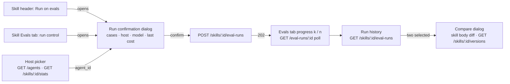

# Spec: Skill evals — Evals tab and "Run on evals" on the Skills page (client) | Spec ID: SPEC-2026-10-17-skill-evals-client | Status: implemented
Supersedes: amends the "Evals tab and Run on evals button" out-of-scope lines of [02-skills-for-review-agents](02-skills-for-review-agents.md) (`:47-48,87`); reuses the agent Evals-tab building blocks of Specs A–F and the baseline shipped without a spec (D-3). The older specs keep their text; the amendment lives here and in `specs/eval-pipeline.md`.
Modules: client
Approved: 2026-10-17 (user)

> Spec G2 of three. Depends on [G1 server + contracts](2026-10-17-skill-evals-server.md) (routes, `EvalSuiteRun.owner_kind` / `skill_id` / `skill_version`, refusal codes). The case-row result display (status icon, "expected … got …", "N/M passing", "Run all evals" label) is [G3](2026-10-17-eval-case-row-status.md) and applies to both tabs.

## Problem and user

G1 gives a skill its own eval cases and suite runs through a host agent, but the Skills page has no way to reach them: the detail has tabs Config, Preview, Stats, Versions, Context and no actions in its header (D-4). A skill author needs the same Evals tab agents have — cases, run, history, compare — plus a host-agent choice, and a "Run on evals" button in the skill header (D-1).

## Goals / Non-goals

- **G-1** An "Evals" tab in the skill detail with the skill's case list, New eval case, Edit, Delete and per-case Run — the same list the agent tab uses.
- **G-2** A host-agent picker that decides which agent runs the skill's cases, preset sensibly.
- **G-3** Start a skill suite from the tab and from a "Run on evals" button in the skill header, with the cost confirmation and progress the agent tab has.
- **G-4** Skill run history, regression banner and compare, keyed on the skill version, with the host visible.
- **G-5** Copy an agent's case into the skill's set.
- **G-6** The agent Evals tab and the eval dashboard behave exactly as before.

- **NG-1** The case-row result display and the "Run all evals" / "N/M passing" header (G3).
- **NG-2** Skill rows or cards on `/eval`, in recent runs, or a `/eval/skill/<id>` page (G1 C-5).
- **NG-3** Remembering the host choice anywhere other than the latest suite (G1 C-3).
- **NG-4** A "Turn into eval case" target picker on the FindingCard (G1 C-6).
- **NG-5** A with / without skill baseline view (G1 NG-1).
- **NG-6** New `@devdigest/ui` primitives; existing ones only.

## User stories

- **US-1** As a skill author on `/skills?id=<skill>&tab=evals`, I see my skill's eval cases and can add, edit, run and delete them.
- **US-2** As a skill author, I pick the agent that hosts my skill for the run, or accept the preset one.
- **US-3** As a skill author on any tab of the skill, I press "Run on evals", confirm the spend and land on the Evals tab with live progress.
- **US-4** As a skill author, I compare two skill runs and see what changed in the skill body and whether the host changed.
- **US-5** As a skill author, I copy an existing agent case into my skill instead of writing it again.

## Design references

- **D-1** text from user, relayed by the main session, 2026-10-17 (screenshot described in text; image not available to the spec author): Skills page, tab "Evals" of `pr-quality-rubric`. Header "Eval cases · 17/20 passing"; buttons "Run all evals" and "New eval case"; rows: status icon (green check / red x / small dot for never run), monospace case name, MUST FIND / MUST NOT FLAG badge, second line "expected 1 finding, got 1" or "never run", right side "CRITICAL · security" or "assert empty", Run / Edit / Delete icon buttons. Skill header top-right: "Run on evals". The row and header parts are G3.
- **D-2** code — agent Evals tab: `client/src/app/agents/[id]/_components/AgentEditor/_components/EvalsTab/EvalsTab.tsx:15-33` (run control, cases, regression banner, history, compare dialog) and the shared blocks in `client/src/components/agent-evals/` (`EvalRunControl`, `EvalRunHistory`, `RegressionBanner`, `EvalCompare` with `PromptDiff` over agent versions, `EvalCompare.tsx:70`); hooks `client/src/lib/hooks/eval.ts` (all keyed by agent id).
- **D-3** code — baseline shipped without a spec (user decision 2026-10-17), `hw6-evals` working tree seen 2026-10-17: `EvalCasesList` with per-row Run / Edit / Delete and "New eval case" (`EvalCasesList.tsx:25-172`); the unified two-column `CaseEditorDialog` (hand-written case and edit, "Run case", "Run on save"; `CaseEditorDialog/CaseEditorDialog.tsx:22-80`); badge text "Must find" / "Must not flag" (Spec E C-17, `client/messages/en/eval.json:194-199`). These take an `agentId` today.
- **D-4** code — skill detail: `client/src/app/skills/_components/SkillDetail/SkillDetail.tsx:28-56` (header: icon, name, type badge, version chip; no actions) and `constants.ts:1-11` (`SKILL_TABS = config, preview, stats, versions, context`); the tab comes from `?tab=` through `parseSkillTab`, derived from `SKILL_TABS` (`helpers.ts:4-5`, `SkillsView.tsx:32`).
- **D-5** code — linked agents of a skill: `SkillStats.agents` `{ id, name, enabled }` from `GET /skills/:id/stats` (`server/src/vendor/shared/contracts/knowledge.ts:339-346`); all agents from `GET /agents` (`useAgents`, `client/src/lib/hooks/agents.ts:8`); skill body history from `GET /skills/:id/versions` (`useSkillVersions`, `client/src/lib/hooks/skills.ts:84`).
- **D-6** curated — client `INSIGHTS.md` 2026-10-07 (a new tab must be accepted by the page's tab parser), 2026-10-01 (a new i18n namespace must be registered in `src/test/render.tsx`), 2026-10-06 (`mockFetch` answers only 200/404; stub fetch for 409/422), 2026-09-19 (`@devdigest/ui` inputs lack `id` / `aria-label`).
- **D-7** spec — G1 contracts and refusal tables R-G1…R-G3 (`specs/2026-10-17-skill-evals-server.md`).

## Workflow and communication

## Contracts

| Contract | Change | Shape |
|---|---|---|
| All G1 contracts | consumed | per G1 Contracts; the client copy `client/src/vendor/shared` follows the server copy |
| `GET /agents`, `GET /skills/:id/stats`, `GET /skills/:id/versions` | unchanged | read for the picker, the preset and the compare body diff |

No new endpoint or contract beyond G1.

## Acceptance criteria (EARS)

**Tab and case list**

- **AC-1** — The skill detail SHALL show an "Evals" tab after "Context", and WHEN the page is opened with `?tab=evals`, the Evals tab SHALL be the selected tab.
  - Source: G-1, US-1, D-1, D-4, D-6
  - Verify: component (RTL) — tab by role and name "Evals"; unit — `parseSkillTab("evals")` returns `evals`, tested against every `SKILL_TABS` key

- **AC-2** — WHEN the Evals tab opens, it SHALL list the skill's cases from `GET /skills/:id/eval-cases` with the same row content, badges, per-row Run / Edit / Delete controls, delete confirmation, loading, error and empty states as the agent tab's case list (D-3), the empty text naming the skill ("No eval cases for this skill yet…").
  - Source: G-1, US-1, D-1, D-3
  - Verify: component (RTL) — rows from a stubbed list; "Must find" badge; Delete asks for confirmation then sends `DELETE /eval-cases/:id`; empty and error states

- **AC-3** — WHEN the user saves a new hand-written case or an edit in the case editor opened from the skill tab, the dialog SHALL send `POST /skills/:id/eval-cases` (new) or `PATCH /eval-cases/:id` (edit) and the skill's list SHALL show the result without a page reload.
  - Source: G-1, US-1, D-3, G1 AC-2
  - Verify: component (RTL) — request URL and body; list refetched

- **AC-4** — WHEN the user chooses "Copy from agent case" next to "New eval case" and picks a case, the tab SHALL send `POST /skills/:id/eval-cases/copy` with that `case_id` and show the new case in the list. The picker lists the cases of every agent of the workspace, grouped under the agent's name.
  - Source: G-5, US-5, G1 AC-3, C-4
  - Verify: component (RTL) — picker groups by agent; request body `{ case_id }`; list refetched

**Host agent**

- **AC-5** — WHEN the Evals tab opens, the host picker SHALL offer every agent of the workspace as "<name> · <model>" and SHALL preselect, in this order: the `agent_id` of the skill's newest suite if that agent still exists; else the first agent in `SkillStats.agents`; else no agent.
  - Source: G-2, US-2, C-1, C-2, D-5
  - Verify: component (RTL) — three fixtures for the three branches; the picker has an accessible name "Host agent"

- **AC-6** — WHILE no host agent is selected (none exists in the workspace, or none chosen), the tab's run control, every per-case Run and the header's "Run on evals" SHALL be disabled and the tab SHALL show the hint "Pick an agent to run this skill's evals".
  - Source: G-2, C-1, EC-1
  - Verify: component (RTL) — empty agent list → all three disabled, hint visible

- **AC-7** — WHEN the user runs one case from the skill tab (row Run or the editor's "Run case"), the request `POST /eval-cases/:id/run` SHALL carry the selected host's `agent_id`.
  - Source: G-2, US-2, G1 AC-6, D-3
  - Verify: component (RTL) — captured request body includes `agent_id`

**Running**

- **AC-8** — WHEN the user starts a run from the tab's run control or from "Run on evals", the system SHALL first show a confirmation naming the case count, the host agent's name and model and the last finished skill suite's cost ("—" when none), and only on confirm SHALL send `POST /skills/:id/eval-runs` with `{ agent_id }`.
  - Source: G-3, US-3, C-1, C-6 (U1), G1 NFR-1, Spec B AC-1 (same rule)
  - Verify: component (RTL) — dialog text; no request before confirm; body `{ agent_id }`

- **AC-9** — The skill header SHALL show a "Run on evals" button at its right end on every tab, and WHEN a run is started from it, the page SHALL switch to the Evals tab (`?tab=evals`) showing that run's progress "k / n cases".
  - Source: G-3, US-3, D-1, C-8
  - Verify: component (RTL) — button present on Config; after confirm the URL tab is `evals` and the progress status is shown

- **AC-10** — WHILE a skill suite is `running`, "Run on evals" SHALL be disabled with the accessible description "An eval run is in progress", and WHILE the skill has no cases, it SHALL be disabled with "Add an eval case first".
  - Source: G-3, D-1, pass-1 gap G3 (disabled states), EC-2
  - Verify: component (RTL) — both states via `aria-describedby` text

- **AC-11** — IF a skill request is refused with a G1 code (`host_required`, `host_not_found`, `host_not_allowed`, `not_agent_case`, `eval_run_in_progress`, `no_cases`, `too_many_cases`, `invalid_diff`, `not_found`, rate limit `429`), THEN the control that sent it SHALL show an inline text naming that reason and stay usable.
  - Source: G1 R-G1…R-G3, EC-3, EC-4
  - Verify: component (RTL) — hand-stubbed `fetch` with `422 host_not_found` and `409 eval_run_in_progress` (D-6); text shown, control re-enabled

**History and compare**

- **AC-12** — WHEN the skill tab shows its run history, rows SHALL come from `GET /skills/:id/eval-runs`; the version cell SHALL read "v<skill_version>" and an extra "Host" cell SHALL read "<host name> v<agent_version>" ("Deleted agent" when the host no longer exists); the regression banner SHALL use these skill suites and versions.
  - Source: G-4, US-4, C-9, EC-5
  - Verify: component (RTL) — "v3" in the version cell; host cell text; deleted-agent text; banner text names the skill version

- **AC-13** — WHEN two skill runs are compared, the compare dialog SHALL title them with their skill versions ("vN → vM"), SHALL show the line diff of the two skill bodies from `GET /skills/:id/versions` instead of the agent prompt diff, and WHEN their `agent_id` or `agent_version` differ, SHALL show the note "Host changed: <name> vA → <name> vB".
  - Source: G-4, US-4, C-7, EC-6
  - Verify: component (RTL) — title text; body diff rendered from stubbed versions; note present only when hosts differ

**Regression guard**

- **AC-14** — The agent Evals tab, the `/eval` dashboard and `/eval/[agentId]` SHALL render and request exactly as before this spec (agent routes, "v<agent_version>", prompt diff), with no host picker.
  - Source: G-6, C-3
  - Verify: component (RTL) — the existing agent-tab, dashboard and agent-page tests pass unchanged; no request to `/skills/` from the agent tab

## Edge cases

- **EC-1** The workspace has no agent, or the user clears the picker → AC-6.
- **EC-2** The skill has no cases → "Run on evals" disabled (AC-10), the tab's run control disabled as on the agent tab (Spec B).
- **EC-3** The chosen host is deleted in another tab before Run → `422 host_not_found` text (AC-11); the picker refetches agents.
- **EC-4** Two browser tabs start runs at once → one gets `409 eval_run_in_progress` text (AC-11).
- **EC-5** The host of an old suite was deleted → "Deleted agent" in history (AC-12); the preset falls back (AC-5).
- **EC-6** Two compared runs have the same skill version but different hosts → no body diff, host note shown (AC-13).
- **EC-7** A long skill or agent name in the picker, header or history → one line with ellipsis and full-text tooltip (NFR-2).
- **EC-8** The skill is renamed → history shows the current name in the page header; suites keep cases by skill id (G1 C-15) → AC-12.
- **EC-9** A run is in progress when the page loads → the tab adopts it and shows progress, as the agent tab does (Spec B AC-2) → AC-9.

## Non-functional requirements

| ID | Category | Requirement (measurable) | Verify |
|---|---|---|---|
| NFR-1 | accessibility | Every new control (tab, picker, Run on evals, Copy from agent case, host cell) is keyboard-reachable with visible focus and has an accessible name; disabled reasons are text (`aria-describedby`), never colour alone (WCAG 2.2 AA). | component (RTL role / name queries) |
| NFR-2 | accessibility / i18n | Every new string has a `camelCase` key nested by section (`skills.json` `detail.tabs.evals`, `detail.runOnEvals`; `eval.json` `skillEvals.*`); names of skills, agents and models truncate on one line with a tooltip at 1280 px. | unit — i18n keys exist; manual — 80-character names at 1280 px |
| NFR-3 | performance | Opening the Evals tab issues at most these reads: skill cases, skill suites, agents, skill stats (plus one suite detail while a run is tracked); polling only while a suite is `running`, at the agent tab's interval. | component (RTL) — count stubbed requests |
| NFR-4 | cost | No model call without the AC-8 confirmation, except the per-case Run the user clicks (one call). | component (RTL) — no `POST …/eval-runs` before confirm |

Not relevant: security beyond G1 (the client sends ids only; workspace checks are server-side), observability (no new logs).

## Inputs and provenance

| Input | Tag |
|---|---|
| Cases, suites, refusals | `[reused: G1 routes]` (D-7) |
| Agents for the picker | `[reused: GET /agents]` (D-5) |
| Preset host | `[deterministic: client — newest skill suite's agent_id, else first SkillStats.agents]` |
| Skill body diff | `[reused: GET /skills/:id/versions]` |
| Run results | `[reused: G1 — one LLM call per case on the server]`; no model call in the client |

## Untrusted inputs

- Case names, diffs, PR text, finding text from runs, skill bodies in the compare diff and agent names are rendered as plain text (React escaping), never Markdown or HTML; the diff view uses the existing `PromptDiff` rendering.
- Error texts from the server are shown as plain text.

## Traceability

| Source | Covered by |
|---|---|
| G-1 | AC-1, AC-2, AC-3 |
| G-2 | AC-5, AC-6, AC-7 |
| G-3 | AC-8, AC-9, AC-10 |
| G-4 | AC-12, AC-13 |
| G-5 | AC-4 |
| G-6 | AC-14 |
| US-1 | AC-1, AC-2, AC-3 |
| US-2 | AC-5, AC-7 |
| US-3 | AC-8, AC-9 |
| US-4 | AC-12, AC-13 |
| US-5 | AC-4 |
| D-1 Evals tab | AC-1, AC-2; row details NG-1 → G3 |
| D-1 "Run on evals" | AC-9, AC-10 |
| D-3 baseline reused for skills | AC-2, AC-3, AC-7 |
| Pass-1 gap G3 (states: no host, running, disabled, refusals) | AC-6, AC-10, AC-11 |
| Pass-1 gap G4 (icon-only controls, colour) | NFR-1 |
| Pass-1 gap G6 (i18n) | NFR-2 |
| Pass-1 gap G7 (spend before run, host and model not in design) | AC-8 |
| Pass-1 gap G8 (history, compare, regression not in design) | AC-12, AC-13 |
| Pass-1 gap G1, G2 (row status, expected/got, severity) | NG-1 → G3 |
| Pass-1 gap G5 (volumes ≤ 100) | G1 AC-4; unchanged list, no pagination |
| U1 Run on evals (accepted) | AC-8, AC-9, AC-10 |
| U2 host picker (accepted) | AC-5, AC-6 |
| U3 empty states (accepted) | AC-2, AC-6 |
| U4 copy from agent cases (accepted) | AC-4 |
| U5 row layout on both tabs (accepted) | G3 |
| U6 compare body diff + host changed (accepted) | AC-13 |
| EC-1 | AC-6 |
| EC-2 | AC-10 |
| EC-3, EC-4 | AC-11 |
| EC-5 | AC-5, AC-12 |
| EC-6 | AC-13 |
| EC-7 | NFR-2 |
| EC-8 | AC-12 |
| EC-9 | AC-9 |

## Clarifications

All 2026-10-17; the user accepted every recommended default ("погоджуюся з усіма пунктами"), relayed by the main session. The full decision log is G1 C-1…C-17; the entries that shape this spec:

- **C-1** (B2) Host picker in the tab, preset to the first linked agent, any workspace agent selectable; running disabled with a hint when there is no agent.
- **C-2** (B3) Host chosen per run, prefilled from the newest skill suite.
- **C-3** (B5) Skill suites only in the skill's Evals tab, never on agent views or the dashboard.
- **C-4** (B6, U4) Cases are hand-written or copied from an agent case.
- **C-5** (B7, B9) Row result display on both tabs goes to G3; this spec is G2.
- **C-6** (UX U1–U6) All six UX proposals accepted; U5 is realised in G3.
- **C-7** (N6) Compare warns on a host change.
- **C-8** (N9) "Run on evals" switches to the Evals tab after starting.
- **C-9** (N5) History and header show the skill's current name.
## Open questions

None.
