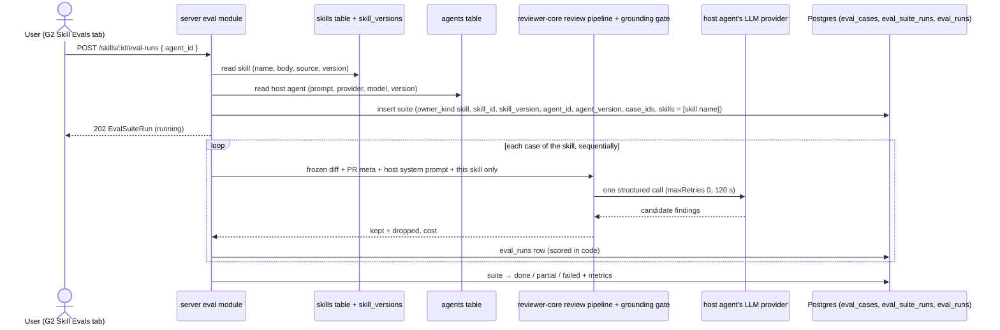

# Spec: Skill evals — skill-owned cases and suite runs (server + contracts) | Spec ID: SPEC-2026-10-17-skill-evals-server | Status: approved
Supersedes: amends [SPEC-2026-10-12-eval-cases-and-scoring](2026-10-12-eval-cases-and-scoring.md) NG-1 ("only agents own cases") and the "Skill-owned eval cases" out-of-scope line of [02-skills-for-review-agents](02-skills-for-review-agents.md); amends the baseline routes shipped without a spec (D-2) for skill-owned cases. Both older specs keep their text (same rule Spec E applied to B and D); the amendment lives here and in the index `specs/eval-pipeline.md`.
Modules: server, @devdigest/shared (contracts)
Approved: 2026-10-17 (user)

> Spec G1 of three: G1 (this, server + contracts) → [G2 client](2026-10-17-skill-evals-client.md) → [G3 case-row status](2026-10-17-eval-case-row-status.md). G2 and G3 depend on G1.
>
> Disambiguation: this measures a DevDigest **skill** (a prompt block injected into review agents) on product data in Postgres. It is unrelated to the root `evals/` package, which evaluates Claude Code skills.

## Problem and user

A DevDigest user who edits a skill's body (for example the `pr-quality-rubric` rubric) cannot tell whether the edit made reviews better or worse. Agent evals (Specs A–F) measure a whole agent; a skill has no model or system prompt of its own and only takes effect inside an agent's prompt (D-4, D-5). This spec lets a skill own its own eval case set and run it through a **host agent** the user picks per run, with **only this skill** in the prompt, scored by the existing code-only scoring. The suite records the skill version and the host's version, so two runs can be compared along the skill-body axis. The UI is G2; the case-row result display is G3.

## Goals / Non-goals

- **G-1** A skill owns an eval case set: list, write by hand, copy from an agent case, edit, delete.
- **G-2** Run every case of a skill's set once through a chosen host agent with only this skill in the prompt, scored exactly as an agent suite (Spec A Scoring rules).
- **G-3** Record on every skill suite the skill id and version and the host agent id and version, so runs are comparable and their confound (host change) is visible.
- **G-4** Run one stored skill case statelessly through a chosen host, like the baseline per-case Run (D-2).
- **G-5** Keep agent eval views free of skill suites: agent history, dashboard and recent runs show agent suites only.

- **NG-1** A/B "with vs without the skill" baseline runs and lift metrics (option D of the pass-1 analysis); a later spec (C-1).
- **NG-2** A neutral built-in reviewer prompt or a "skill eval" feature model (option C); the host is always a real agent (C-1).
- **NG-3** Running the host's other enabled skills in a skill suite (option B); only this skill is in the prompt (C-1, C-13).
- **NG-4** Storing a preferred host agent on the skill; the host is chosen per run only (C-3).
- **NG-5** Creating a skill case from a finding ("Turn into eval case" with a skill target); cases are hand-written or copied (C-6).
- **NG-6** Moving a case between an agent and a skill; copying only (C-17).
- **NG-7** Skill rows on the Eval Dashboard, in recent runs or on `/eval/[agentId]` (C-5).
- **NG-8** Persisting the result of a per-case Run (C-8).
- **NG-9** Writing skill eval runs to `agent_runs` / `run_traces`; they never count in skill stats (`GET /skills/:id/stats`) or PR run history (as Spec A NG-9).
- **NG-10** Cleaning up eval data of a deleted skill: its cases and suites become unreachable (`404`) and stay in the table (as Spec A NG-10).
- **NG-11** Replaying a past skill version; a run always uses the skill's current body (as Spec A NG-4).
- **NG-12** Cancelling a running skill suite (as Spec A NG-5).

## User stories

- **US-1** As a skill author, I write an eval case for my skill by hand, or copy one of an agent's existing cases into my skill's set.
- **US-2** As a skill author, I run my skill's set through an agent I pick, and later read recall, precision and citation accuracy for that skill version.
- **US-3** As a skill author, I run one case through a host to check it, without storing anything.
- **US-4** As an agent owner, my agent's eval history, banner and dashboard card are not changed by someone else's skill suites that used my agent as host.

## Design references

- **D-1** text from user, relayed by the main session, 2026-10-17: Skills page, tab "Evals" of skill `pr-quality-rubric` (screenshot described in text; the image was not available to the spec author). Header "Eval cases · 17/20 passing", buttons "Run all evals" and "New eval case", rows with status icon, name, MUST FIND / MUST NOT FLAG badge, "expected 1 finding, got 1" or "never run", right side "CRITICAL · security" or "assert empty", Run / Edit / Delete icons; skill header top-right "Run on evals". The UI parts are G2 / G3; G1 provides their data.
- **D-2** code — baseline shipped without a spec (user decision 2026-10-17), `hw6-evals` working tree seen 2026-10-17: `POST /agents/:id/eval-cases` (hand-written case, `source: null`), `PATCH /eval-cases/:id`, `POST /eval-cases/:id/run` (stateless, nothing stored) — `server/src/modules/eval/routes.ts:115-167`, `server/src/modules/eval/service.ts:288-417`, documented in `server/docs/eval.md:31-33`.
- **D-3** code — `server/src/db/schema/eval.ts:20-33` (`eval_cases.owner_kind` already `skill | agent`, `owner_id` no FK) and `:41-81` (`eval_suite_runs.agent_id` / `agent_version` NOT NULL; partial unique index `eval_suite_runs_agent_running_uq` on `agent_id` WHERE `running`).
- **D-4** code — `server/src/db/schema/skills.ts:5-34`: a skill has `name`, `body`, `type`, `source`, `enabled`, `version`; no model or prompt. `server/src/modules/skills/repository.ts:166-189`: only a body change bumps `version`, and every version is snapshotted in `skill_versions`.
- **D-5** code — `server/src/modules/agents/repository.ts:71-87` (`enabledSkillsForPrompt`: a skill reaches a prompt only through an agent link with both switches on); `server/src/modules/eval/service.ts:394-401,465-473` (a case run needs an agent's system prompt, provider and model).
- **D-6** code — coupling found in pass 1: `server/src/modules/eval/repository.ts:156,169,190,428` hardcode `owner_kind = 'agent'`; `service.ts:272-273,341-342,376-377` treat `eval_cases.owner_id` as an agent id in delete, update and per-case run; `repository.ts:366-394,427-465` select agent history, recent runs and dashboard by `agent_id` only.
- **D-7** curated — `server/docs/eval.md` (prompt contents `:172-188`, scoring `:190-219`, one call per case `:221-241`, suite lifecycle `:243-290`, dashboard `:292-303`, recent runs `:305-330`).
- **D-8** curated — server `INSIGHTS.md`: 2026-08-05 (skill relinks are not versioned on agents), 2026-09-19 (skill stats read `agent_runs` + traces; a skill reaches a prompt only with both switches on), 2026-10-16 (reasoning model errors most eval cases; a non-reasoning model finishes ~9/9 for ~$0.01 per suite), 2026-09-19 / 2026-09-20 (`ADD COLUMN IF NOT EXISTS` trap on shared dev DBs); root `INSIGHTS.md` 2026-08-05 (a skill body is joined into a trusted prompt section).
- **D-9** text — staged copy `client/messages/en/skills.json:123`: "Every save snapshots the body so eval runs stay reproducible against the exact text they scored."

## Workflow and communication

## Contracts

| Contract | Change | Shape |
|---|---|---|
| `EvalCase` (`knowledge.ts`) | unchanged shape | `owner_kind` may now be `skill` (the enum already allows it); `owner_id` is then the skill id. For a copied case `expected_output.source` is the source case's `source` (nullable as today) |
| `EvalCaseManualCreate` (`knowledge.ts`) | unchanged | reused as the body of `POST /skills/:id/eval-cases` |
| `EvalCaseCopyRequest` (`knowledge.ts`) | new | request: `case_id`: string (an agent-owned case of the same workspace). Unknown keys rejected |
| `EvalSuiteStartRequest` (`eval-ci.ts`) | new | request of `POST /skills/:id/eval-runs`: `agent_id`: string, required (the host). Unknown keys rejected |
| `EvalDryRunRequest` (`eval-ci.ts`) | changed | + `agent_id`: string, optional — the host for a skill-owned case; must be absent for an agent-owned case. `expected_output` unchanged |
| `EvalDryRunResult` (`eval-ci.ts`) | changed | + `skill_version`: integer, nullable (null = an agent-owned case or a finding dry-run). `agent_version` = the version of the agent whose config ran (the host for a skill case) |
| `EvalSuiteRun` (`eval-ci.ts`) | changed | + `owner_kind`: `agent` \| `skill`; + `skill_id`: string, nullable (null = agent suite); + `skill_version`: integer, nullable (null = agent suite). `agent_id` / `agent_version` = the agent whose config ran the cases (the owner for an agent suite, the host for a skill suite). `skills` of a skill suite = exactly `[<skill name at start>]`. Carries through to `EvalSuiteRunDetail`, `EvalRecentRun`, `EvalDashboardRow.latest` |
| `GET /skills/:id/eval-cases` | new | response `EvalCase[]` of that skill, ordered by `name`; `404` unknown/foreign skill |
| `POST /skills/:id/eval-cases` | new | request `EvalCaseManualCreate`; response `201` `EvalCase` (`owner_kind: skill`, `source: null`, `input_meta` stub as for agents). Refusals R-G1 |
| `POST /skills/:id/eval-cases/copy` | new | request `EvalCaseCopyRequest`; response `201` `EvalCase`, a new case owned by the skill. Refusals R-G1 |
| `PATCH /eval-cases/:id`, `DELETE /eval-cases/:id` | changed (behaviour) | same shapes as D-2 / Spec A; the running-suite guard is the case **owner's** (R-G2) |
| `POST /eval-cases/:id/run` | changed | request `EvalDryRunRequest` (now with `agent_id`); response `EvalDryRunResult`. Refusals R-G2 |
| `POST /skills/:id/eval-runs` | new | request `EvalSuiteStartRequest`; response `202` `EvalSuiteRun` (`status: running`, `owner_kind: skill`). Refusals R-G3 |
| `GET /skills/:id/eval-runs` | new | response `EvalSuiteRun[]` of that skill, newest first, at most 50; `404` unknown/foreign skill |
| `GET /eval-runs/:id` | unchanged shape | answers for agent and skill suites alike |
| `GET /agents/:id/eval-runs`, `GET /eval/dashboard`, `GET /eval/recent-runs` | changed (behaviour) | shapes unchanged; agent-owned suites only (AC-12) |
| DB `eval_suite_runs` | changed | + `owner_kind` (text, `agent` \| `skill`, NOT NULL, default `agent`, CHECK); + `skill_id` (uuid, nullable, no FK — as `agent_id`); + `skill_version` (integer, nullable). A row is a skill suite iff `owner_kind = skill`, and then `skill_id` and `skill_version` are non-null. At most one `running` suite per owner (agent id for agent suites, skill id for skill suites) replaces the per-`agent_id` index. The plan writes the migration (NFR-5) |
| `Skill`, `SkillStats`, `EvalExpectation`, `EvalRunRecord`, `EvalDashboardRow` | unchanged | — |

Error envelope: the existing structured error envelope.

**R-G1 — skill case creation refusals** (`POST /skills/:id/eval-cases`, `POST /skills/:id/eval-cases/copy`)

| Condition | Status | `code` |
|---|---|---|
| skill unknown or in another workspace | 404 | `not_found` |
| (copy) source case unknown or in another workspace | 404 | `not_found` |
| (copy) source case is not agent-owned | 422 | `not_agent_case` |
| (manual) patch has no `@@` hunk for `expected_output.file` | 422 | `invalid_diff` |
| the skill already has 100 cases | 422 | `too_many_cases` |
| a suite of this skill is `running` | 409 | `eval_run_in_progress` |

**R-G2 — case edit / delete / run refusals** (`PATCH`, `DELETE`, `POST /eval-cases/:id/run`)

| Condition | Status | `code` |
|---|---|---|
| case unknown or in another workspace | 404 | `not_found` |
| (`PATCH`, `DELETE`) a suite of the case's owner is `running` | 409 | `eval_run_in_progress` |
| (run) skill-owned case and no `agent_id` | 422 | `host_required` |
| (run) `agent_id` unknown or in another workspace | 422 | `host_not_found` |
| (run) agent-owned case and `agent_id` supplied | 422 | `host_not_allowed` |
| (run) the case's skill no longer exists | 404 | `not_found` |
| (`PATCH`, run) `expected_output.file` is not the frozen diff's file | 422 | `file_not_in_diff` (unchanged) |

**R-G3 — skill suite start refusals** (`POST /skills/:id/eval-runs`)

| Condition | Status | `code` |
|---|---|---|
| skill unknown or in another workspace | 404 | `not_found` |
| body without `agent_id` or with unknown keys | 422 | `validation_error` |
| `agent_id` unknown or in another workspace | 422 | `host_not_found` |
| a suite of this skill is `running` | 409 | `eval_run_in_progress` |
| the skill has 0 cases | 422 | `no_cases` |
| the skill has more than 100 cases | 422 | `too_many_cases` |

## Acceptance criteria (EARS)

Scoring, matching, the per-case timeout (120 s), `maxRetries: 0`, the output-token cap and the suite status rules are Spec A's (AC-10, AC-12, C-24, C-25), unchanged, and apply to skill suites and skill per-case runs alike.

- **AC-1** — WHEN the user lists a skill's cases, `GET /skills/:id/eval-cases` SHALL return only the cases with `owner_kind = skill` and `owner_id` = that skill, ordered by `name`.
  - Source: G-1, US-1, C-6
  - Verify: integration (`*.it.test.ts`) — a skill with 2 cases and an agent with 3: the skill list has the 2, sorted; `GET /agents/:id/eval-cases` still has the 3; foreign skill → `404`

- **AC-2** — WHEN the user writes a case by hand for a skill, `POST /skills/:id/eval-cases` SHALL return `201` with an `EvalCase` whose `owner_kind` is `skill`, `owner_id` is the skill id and `expected_output.source` is `null`, built from the body exactly as the agent hand-written case is (D-2).
  - Source: G-1, US-1, D-2, C-6
  - Verify: integration — body and stored row; the `input_diff` carries the file headers of `expected_output.file`

- **AC-3** — WHEN the user copies an agent case into a skill, `POST /skills/:id/eval-cases/copy` SHALL return `201` with a new `EvalCase` owned by the skill whose `name`, `input_diff`, `input_files`, `input_meta` and `expected_output` (including `source`) equal the source case's, and SHALL leave the source case unchanged.
  - Source: G-1, US-1, C-6, C-17
  - Verify: integration — copy, compare fields, re-read the source case and the agent's list (unchanged)

- **AC-4** — IF any condition of table R-G1 holds, THEN the creating request SHALL answer with that row's status and `code` and store no case.
  - Source: C-6, EC-1, EC-2, EC-3
  - Verify: integration — one case per row, including a copy whose source is a skill case (`422 not_agent_case`) and a create while a skill suite runs (`409`)

- **AC-5** — WHILE a suite of a case's owner is `running`, `PATCH /eval-cases/:id` and `DELETE /eval-cases/:id` SHALL answer `409 eval_run_in_progress` for that case, and a running suite of any other owner SHALL NOT block them. This replaces the baseline guard, which looked up a running suite by `owner_id` as an agent id (D-6).
  - Source: G-1, D-2, D-6, C-4, EC-4
  - Verify: integration — skill suite running → `PATCH` / `DELETE` of a skill case `409`; a running suite of the host agent → skill case `PATCH` succeeds; agent case guard unchanged

- **AC-6** — WHEN the user runs one skill-owned case with a host, `POST /eval-cases/:id/run` SHALL return `200` `EvalDryRunResult` from exactly one model call built as in AC-8 with that host, whose `agent_version` is the host's current version and `skill_version` is the skill's current version, and SHALL store no `eval_runs`, `eval_suite_runs`, `agent_runs` or `run_traces` row.
  - Source: G-4, US-3, D-2, C-2, C-8
  - Verify: integration — `MockLLMProvider` call count 1, captured request as in AC-8; row counts unchanged; an agent-owned case without `agent_id` still runs its own agent with `skill_version: null`

- **AC-7** — IF any run condition of table R-G2 holds, THEN `POST /eval-cases/:id/run` SHALL answer with that row's status and `code` and make no model call.
  - Source: C-2, C-14, EC-5, EC-6
  - Verify: integration — one case per row; mock call count stays 0

- **AC-8** — WHILE a skill suite or a skill per-case run executes a case, the model request SHALL contain the case's `input_diff`, the `input_meta` title (and body when non-empty), the host agent's current system prompt and exactly one skill block — this skill's current body, with the third-party line when its `source` is third-party — and SHALL contain no other skill of the host and no repo map, callers, rank note, project context, intent or memory section.
  - Source: G-2, D-5, D-7, C-1, C-13, EC-7
  - Verify: integration — host linked to 2 other enabled skills: the captured request has one `### <skill name>` block only; diff equals `input_diff`; excluded headings absent

- **AC-9** — WHEN the user starts a skill suite with a host, `POST /skills/:id/eval-runs` SHALL return `202` with an `EvalSuiteRun` in status `running` whose `owner_kind` is `skill`, `skill_id` the skill, `skill_version` the skill's current version, `agent_id` the host, `agent_version` the host's current version, `case_ids` the skill's current cases in name order and `skills` exactly `[<skill name>]`. This holds also when the skill or the host is disabled or the host is not linked to the skill.
  - Source: G-2, G-3, US-2, C-1, C-2, C-3, C-11, C-12, EC-8
  - Verify: integration — response fields; disabled skill, disabled host and unlinked host each still `202`

- **AC-10** — IF any condition of table R-G3 holds, THEN `POST /skills/:id/eval-runs` SHALL answer with that row's status and `code` and create no suite run.
  - Source: C-3, C-4, EC-5, EC-9
  - Verify: integration — one case per row, including two concurrent starts for one skill (exactly one `202`)

- **AC-11** — WHILE a skill suite is `running`, `POST /agents/:id/eval-runs` for its host agent SHALL still return `202`, and WHILE an agent suite is `running`, `POST /skills/:id/eval-runs` with that agent as host SHALL still return `202`.
  - Source: C-4, EC-10
  - Verify: integration — both orders; two `running` rows coexist

- **AC-12** — The system SHALL exclude skill suites from `GET /agents/:id/eval-runs`, from every field of `GET /eval/dashboard` (`latest`, `running`, `delta`, `drop`) and from `GET /eval/recent-runs`, and SHALL list them only through `GET /skills/:id/eval-runs` (newest first, at most 50, that skill only) and `GET /eval-runs/:id`.
  - Source: G-5, US-4, D-6, C-5
  - Verify: integration — finish one agent suite and one skill suite hosted by that agent: agent history has 1 row, dashboard `latest` is the agent suite and `running` false while only the skill suite runs, recent runs has 1 row; `GET /skills/:id/eval-runs` has the skill suite; foreign skill `404`

- **AC-13** — WHEN agent suites stored before this change are read, every response SHALL carry them with `owner_kind: agent`, `skill_id: null` and `skill_version: null`, and their other fields unchanged.
  - Source: G-5, D-3, NFR-5
  - Verify: integration — migrate a DB holding an agent suite; `GET /eval-runs/:id` and `GET /agents/:id/eval-runs` return it with the three new fields as stated

## Edge cases

- **EC-1** Copying the same agent case twice into one skill → two independent copies; no duplicate check → AC-3, [NEEDS CLARIFICATION: OQ-1].
- **EC-2** Copying a skill case (into the same or another skill) → AC-4 (`not_agent_case`).
- **EC-3** The skill reaches 100 cases → AC-4 (`too_many_cases`).
- **EC-4** A host agent's own suite runs while the user edits a skill case → allowed, AC-5.
- **EC-5** The host agent is deleted between choosing it and starting → AC-7 / AC-10 (`host_not_found`); past suites keep the stored `agent_id`.
- **EC-6** The skill is deleted: its cases and suites are unreachable (`404`), not cleaned up → AC-7, NG-10.
- **EC-7** A third-party skill (`imported_file`, `community`, `imported_url`) keeps the third-party line in its block (as in every eval prompt today, D-7) → AC-8, Untrusted inputs.
- **EC-8** The skill or host is disabled, or the host is not linked to the skill → still runnable, AC-9 (C-11, C-12).
- **EC-9** Two start requests for one skill at once → AC-10.
- **EC-10** A skill suite and its host's agent suite at the same time → AC-11.
- **EC-11** The host's prompt or model changes between two skill suites: `agent_version` differs and G2 shows it on compare → AC-9; the model is not frozen (Spec A EC-13).
- **EC-12** The skill body changes between two suites: `skill_version` differs → AC-9.
- **EC-13** The skill is renamed between suites: `skills` records the name at start; cases stay tied to the skill id → AC-9, C-15.
- **EC-14** The server crashes while a skill suite runs → NFR-2.
- **EC-15** The host uses a reasoning model and most cases end `error` → Spec A status rules, suite `partial` / `failed` (D-8) → NFR-1.
- **EC-16** The dev DB is shared across branches → NFR-5.

## Non-functional requirements

| ID | Category | Requirement (measurable) | Verify |
|---|---|---|---|
| NFR-1 | cost | One call per case, `maxRetries: 0`, on the host's model; per-case and per-suite `cost_usd` recorded as for agent suites. A 20-case skill suite on `deepseek/deepseek-chat-v3.1` costs ≤ $0.05; any paid demonstration run is announced to the user first. Tests spend $0 (`MockLLMProvider`). | integration — call count = `cases_total`, captured `maxRetries: 0`; manual — `cost_usd` of a demonstration suite |
| NFR-2 | reliability | The boot reaper turns every `running` suite, skill or agent, into `failed` / `interrupted` and keeps its case rows (Spec A NFR-3, extended). | integration — insert a `running` skill suite, boot, read `failed` |
| NFR-3 | security | Every new route resolves the workspace and answers `404` for a foreign skill or case and `422 host_not_found` for a foreign `agent_id` (OWASP A01). Rate limits per minute: `POST /skills/:id/eval-runs` 5, `POST /skills/:id/eval-cases` and `/copy` 30, `POST /eval-cases/:id/run` 10 (unchanged), answering `429` (A06). Request bodies reject unknown keys (A08); `POST /skills/:id/eval-cases` has the same body cap as the agent hand-written case. | integration — foreign ids; a rate-limit case built with a non-test `nodeEnv` (server INSIGHTS 2026-10-07) |
| NFR-4 | observability | One log line per finished skill suite in the existing format plus the skill id: `eval suite <id> (skill <skill_id>): <status>, <passed>/<total> passed, cost <usd or n/a>`; one line per skill per-case run with `case_id`, `skill_id`, host `agent_id`, `outcome`, `cost_usd`. | integration — captured log lines |
| NFR-5 | reliability / data | The `eval_suite_runs` change is generated with `pnpm db:generate`, hand-edited to `ADD COLUMN IF NOT EXISTS` (shared dev DBs, D-8), applied with `pnpm db:migrate`; afterwards `pnpm db:generate` reports no changes. Existing rows read as agent suites (AC-13). | manual — `pnpm db:generate` clean; integration lane migrates a fresh DB |
| NFR-6 | verification | `pnpm verify:l06` covers AC-1…AC-13 and NFR-2…NFR-4 and still fails without Docker. | manual — run it |

Not relevant: performance (≤ 100 cases per owner, local single user), accessibility (no UI in G1).

**LLM feature checklist (§7a)** — `[new: 1 LLM call per case]` of a skill suite or skill per-case run
- Cost: NFR-1; shown as `cost_usd` per case and suite; G2 shows the expected spend before a run.
- Latency: 120 s per case (Spec A C-25); G2 shows "k / n cases".
- Failure: timeout, refusal, malformed output, missing key → case `error`, suite `partial` / `failed` with reason; per-case run → `200 outcome: error` (D-2). No retry.
- Grounding: the existing mandatory gate; citation accuracy measures it.
- Trace: no `run_traces` (NG-9); per-case `actual_output` + NFR-4 log lines replace it.
- Injection: see Untrusted inputs.

## Inputs and provenance

| Input | Tag |
|---|---|
| Skill name, body, source, version | `[reused: skills row at run start]` (D-4) |
| Host system prompt, provider, model, version | `[reused: agents row at run start]` (D-5) |
| Hand-written case diff, name, expectation | `[reused: user input, EvalCaseManualCreate]` (D-2) |
| Copied case input and expectation | `[reused: the source agent case's frozen row]` |
| Per-case candidate findings | `[new: 1 LLM call per case]` — the host's review with only this skill; on failure the case is `error` |
| Kept / dropped findings | `[deterministic: reviewer-core grounding gate]` |
| Match, pass, metrics, status | `[deterministic: eval scoring]` (D-7) |

## Untrusted inputs

- **Frozen diffs and PR title/body** (copied from agent cases, written by PR authors) and **hand-written diffs and names**: data, never instructions; they reach the model only through the existing review prompt assembly, which wraps untrusted sections and appends the injection guard (Spec A, unchanged). Names are rendered as plain text.
- **Skill body**: joined into a trusted prompt section today (D-8, root `INSIGHTS.md` 2026-08-05); third-party sources keep the `> Third-party skill…` line. A skill eval adds no new exposure: the body already reaches every linked agent's real reviews. Not changed here.
- **Model output** (findings): stored as data, rendered as plain text (G2).
- **Provider error messages**: redacted and cut to 300 chars (unchanged).

## Traceability

| Source | Covered by |
|---|---|
| G-1 | AC-1, AC-2, AC-3, AC-4, AC-5 |
| G-2 | AC-8, AC-9, AC-10 |
| G-3 | AC-9 |
| G-4 | AC-6, AC-7 |
| G-5 | AC-12, AC-13 |
| US-1 | AC-2, AC-3 |
| US-2 | AC-9 |
| US-3 | AC-6 |
| US-4 | AC-11, AC-12 |
| D-1 (data for the Evals tab and Run on evals) | AC-1, AC-9, AC-12; display in G2 / G3 |
| D-2 baseline made owner-aware | AC-5, AC-6, AC-7 |
| D-6 coupling | AC-5, AC-12 |
| Pass-1 gap: host deleted / no host | AC-7, AC-10 |
| Pass-1 gap: skill suites leaking into agent views | AC-12 |
| EC-1 | AC-3, OQ-1 |
| EC-2, EC-3 | AC-4 |
| EC-4 | AC-5 |
| EC-5 | AC-7, AC-10 |
| EC-6 | AC-7, NG-10 |
| EC-7 | AC-8 |
| EC-8 | AC-9 |
| EC-9 | AC-10 |
| EC-10 | AC-11 |
| EC-11, EC-12, EC-13 | AC-9 |
| EC-14 | NFR-2 |
| EC-15 | NFR-1 |
| EC-16 | NFR-5 |

## Clarifications

All 2026-10-17; answered by the user ("погоджуюся з усіма пунктами" — accepted every recommended default), relayed by the main session.

- **C-1** (B1) How a skill eval runs → option A: a host agent's system prompt, provider and model plus this skill only; one call per case; no baseline arm. A/B lift (D) is a later spec; a neutral harness (C) and the host's full skill set (B) are rejected.
- **C-2** (B2) Which agent is the host → any agent of the workspace, chosen in the UI; preset to the first agent linked to the skill (G2); with no agent at all, running is disabled (G2).
- **C-3** (B3) Storage of the host choice → per run only: sent in the request body and recorded on the suite (`agent_id`, `agent_version`); nothing new on `skills`; G2 prefills it from the latest suite.
- **C-4** (B4) Suite storage → `eval_suite_runs` gains `owner_kind`, `skill_id`, `skill_version`; at most one running suite per owner; a skill suite does not block its host's agent suite.
- **C-5** (B5) Visibility → skill suites only in the skill's Evals tab; excluded from agent history, the regression banner, the `/eval` dashboard, `/eval/[agentId]` and recent runs.
- **C-6** (B6) Case sources → hand-written and copied from an agent case; finding → skill is out of scope.
- **C-7** (B7) Case-row result display → on both tabs, as a separate spec G3.
- **C-8** (B8) Per-case Run → stays stateless; nothing is stored.
- **C-9** (B9) Split → G1 server + contracts, G2 client, G3 case rows, in that order.
- **C-10** (N1) "got N" → the number of kept findings that intersect the case's expectation (applies in G3).
- **C-11** (N2) A disabled skill can be evaluated (as disabled agents, Spec A EC-10).
- **C-12** (N3) A disabled host is allowed; a deleted host is refused at start (`host_not_found`); old suites keep the stored id.
- **C-13** (N4) The host's other skills are excluded; the suite's `skills` holds only this skill's name.
- **C-14** (N7) Rate limits for skill routes equal the agent routes'.
- **C-15** (N5) Cases stay tied to the skill id across a rename; history shows the current skill name (G2).
- **C-16** (N6, N9) Compare warns on a host change; Run on evals switches to the Evals tab (both G2).
- **C-17** (N8) Cases are copied, never moved, between an agent and a skill.

## Open questions

- **OQ-1** [NEEDS CLARIFICATION: Should copying an agent case that this skill already holds a copy of be refused (`409 duplicate`)? There is no stored link from a copy to its source case, only the shared `source` block (null for hand-written cases). Default: **allow** independent copies (EC-1); not blocking.]
